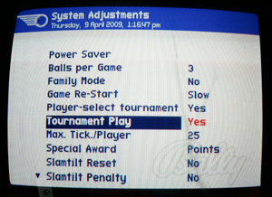
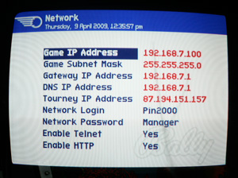
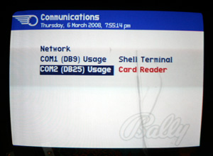
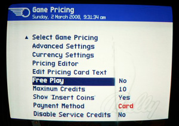

# myPinballs tournament game setup

> [!NOTE]
> Preserved from <https://www.mypinballs.com/tournament/core/gamesetup.jsp> on `2026-11-11`. This Markdown is a readable derivative; `raw/` contains the captured evidence.

### Enabling Tournament Play

The first thing that you need to set before you can join in is the Tournament option. Navigate to the System Adjustments menu by pressing the enter on the coin door buttons, then select Adjustments from the main menu and then System Adjustments from the next menu. Set the Tournament option to 'Yes' (See Snap Shot 1).

This is the only way that tournament play can be enabled. Using the Player-Select Tournament option (pressing the four flipper buttons) to start a tournament game will not work with this system. This is due to a limitation with the current game code software. Maybe we can get this fixed later.

### Entering the Network Addresses

 The network addresses for your home network are entered into the Network screen. This is found by navigating in the following way. **Adjustments - Communiations - Network**.

Snap Shot 2 shows the settings to enter for your RFM game. Enter the addresses exactly as you see in the screen shot. (These settings map with the settings found in our free router configuration file.) The telnet account details should be left as default values to begin with to aid setup and then can be modified later if needed. The Tourney address is our Static IP **87.194.151.157**. Telnet should be enabled and HTTP disabled.

### Using the Barcode Reader

If you have a barcode reader attached then you need to navigate to the Game Pricing menu and then turn off free play in the pricing menu and set the payment method to Card. (See Snap Shot 3)

Next you need to navigate to the Communications menu and set the usage for Comm 2 to Card Reader. (See Snap Shot 4)

### Playing without a barcode reader

If you don't have a barcode reader, you can still join in. Set the free play option to yes. All games that are played will be logged against your main account. (The account with your external IP recorded in the profile)
