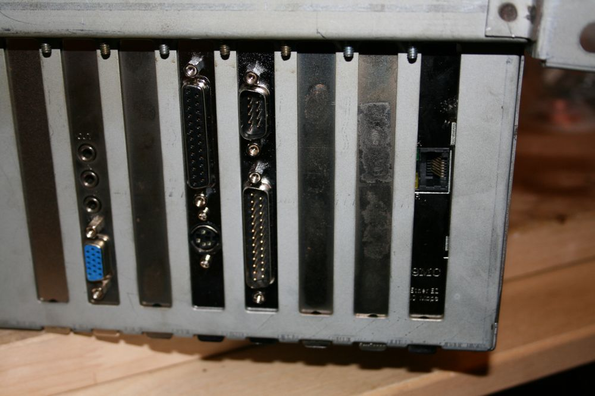
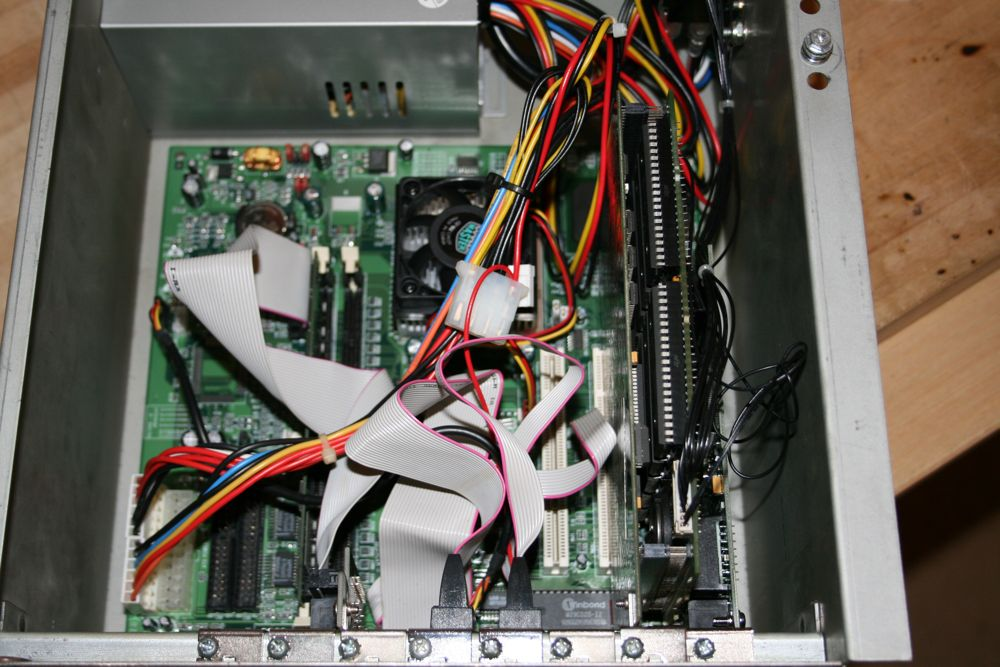
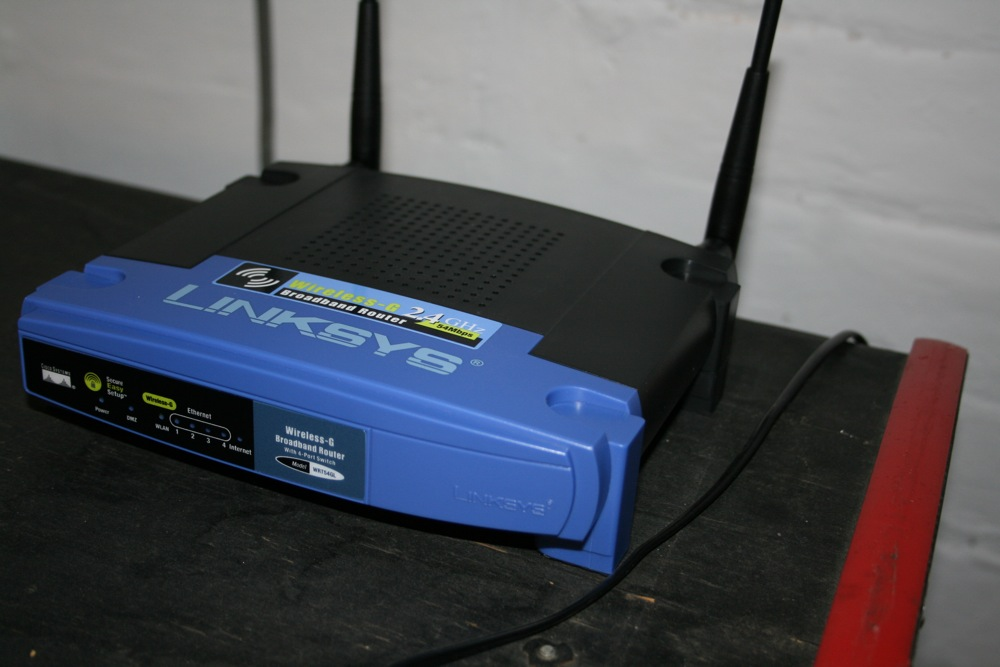
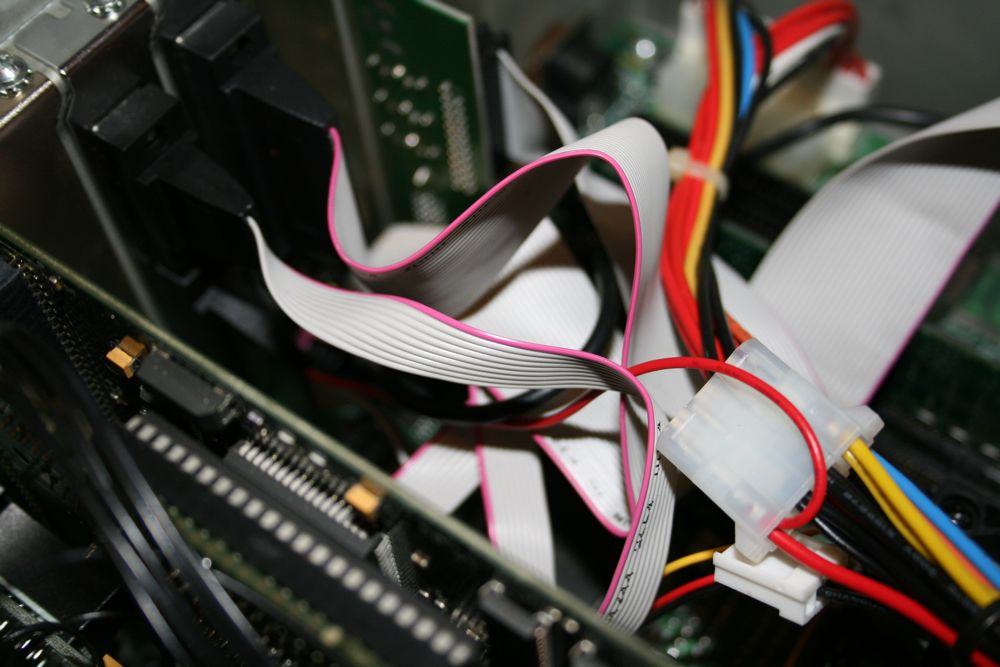
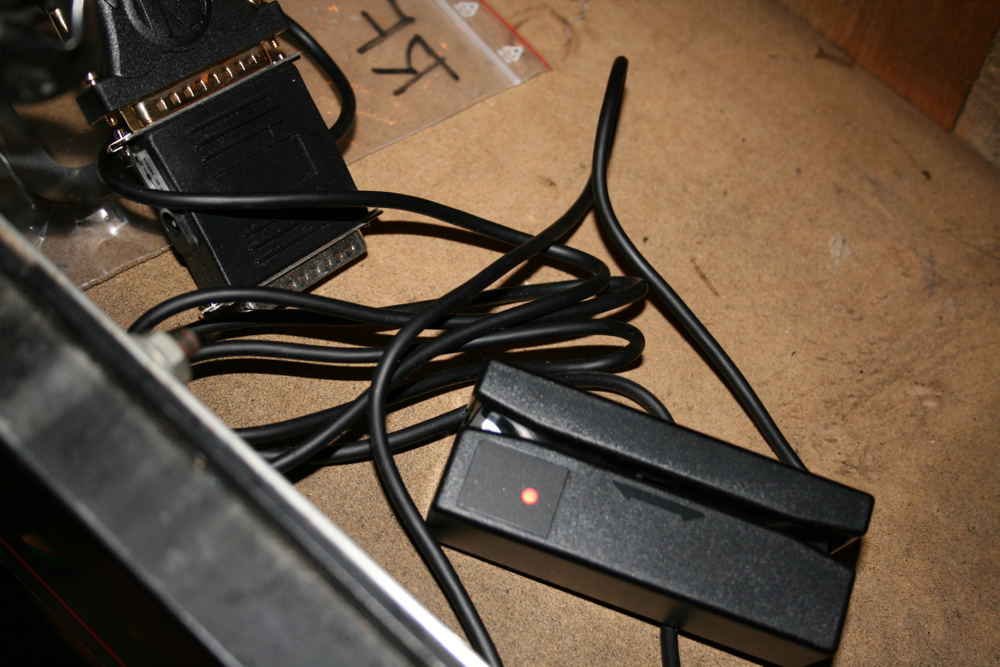

# myPinballs tournament technical setup

> [!NOTE]
> Preserved from <https://www.mypinballs.com/tournament/core/techsetup.jsp> on `2026-11-11`. This Markdown is a readable derivative; `raw/` contains the captured evidence.

You are currently in: **[Tournament System](https://www.mypinballs.com/tournament/)** | **Technical Setup**

### Adding a Network Card

An SMC8416 brand network card should be installed into the spare ISA slot on the RFM computer motherboard. The slot is located on the far edge of the motherboard, next to the slot with the prism card installed. This is the first job in getting your game to communicate with the outside world!

This card is available in 3 revisions all of which will work. They are SMC8416T, SMC8416BT and SMC8416BTA. The letters at the end refer to the different ports on the card. We only need the RJ45 one (T).

### Expanding your Network

The game's network card must be connected to a router running open source software DD-WRT version 24 SP1. This can be downloaded here - [http://www.dd-wrt.com. Any router which is able to run this software will work. See DD-WRT's site for a full list, but I recommend the Linksys WRT54GL, or the Linksys WRT160N. The config application is accesed from url http://192.168.1.1 Once you have your game router running DD-WRT you need to load our default config which can be can be downloaded here - [http://www.mypinballs.com/tournament/setup/router/client.bin](https://www.mypinballs.com/tournament/setup/router/client.bin). To load the config file navigate to Administration - Backup and select the downloaded file. Click Restore to confirm. The router will update and reboot. Re-connect on http://192.168.7.1 - login using mypinballs.com with password tournament Once the default config is loaded, you need to add 2 settings. These are the only custom settings you need to add here and allow the router to join your home network. 1) Navigate to the wireless tab and select the basic tab. Enter your home wireless name into the box marked Wireless Network Name (SSID), Click apply 2) Click the wireless security tab and enter your security mode and password. Click apply. Reboot router and check the WAN IP address displayed on the default screen. Make a note of this address, you'll need this next.](http://www.dd-wrt.com)

### Allowing the Communication between Server and Game

To enable the server to talk to the game you need to allow a couple of ports through your main router's firewall. The ports are 2069, 23 and 8080. You need to allow these ports, for both UDP and TCP, in to the WAN IP address you made a note of earlier.

If you don't have a firewall set up, or have the WAN IP in a DMZ then you don't need to worry about this. Finally add the WAN IP as a static lease on your main router so the address will not change on reboots. Consult your router/ISP help files for more info on setting these services up on your main router.

### Adding Scrolling Scores during Attract Modes

You game will connect to the tournament system if the game software is v1.5 or later. However if you want to add scrolling scores during attract mode then you need the v1.8 software update. This is available from me once you register and have your game connected. Please also note that the 1.8 update requires 8Mb or more of Ram. Most games shipped with only 4Mb of Ram. Any PC100 Ram will work fine.

### Adding the Barcode Reader

The model I have currently tested is a CipherLab 1022R Barcode Reader. This is the one I recommend, though any rs232 barcode reader should work. The barcodes on the badges are stored in a standard format that any reader should read. To connect your reader you need to connect it using a straight wired 25pin serial cable. One end connects to the 25 pin serial port (Comm 2) on the rfm computer and the other end to the default 25 pin connection of the barcode reader. Also, a 5 volt connection needs to be added to pin 25 of the rfm computer Comm2 serial port, which can be fed from the internal power supply.

Finally check the RS232 setup of your reader and confirm the following options are selected. - Parity - None - Data bits - 8 - Terminator - Carriage Return

### Barcode Reader Useful Downloads

Below are some useful resources that I have colated to make the setup of your reader easier. New items will be added here as and when I find them. Please do not link to the items individually. Link to this page instead.

**CipherLab 1022R**- [System Default Configuration Card 1](assets/system_card_side1.jpg) - [System Default Configuration Card 2](assets/system_card_side2.jpg) - [User Manual](assets/manual.pdf)

### Disclaimer

Please note that if you modify your game computer then it is at your own risk.

myPinballs Tournament System v1.2.2 | Contact Us at [tournament@mypinballs.co.uk](mailto:tournament@mypinballs.co.uk)
