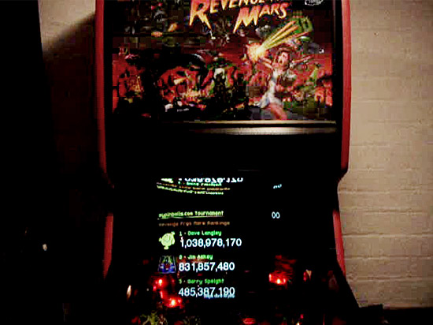
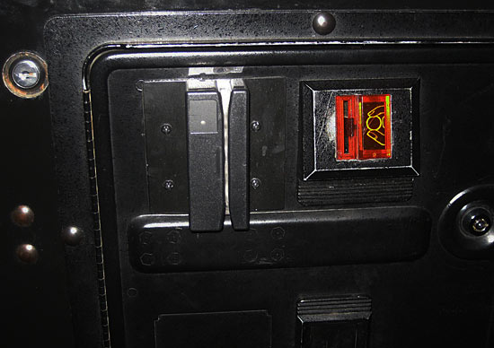
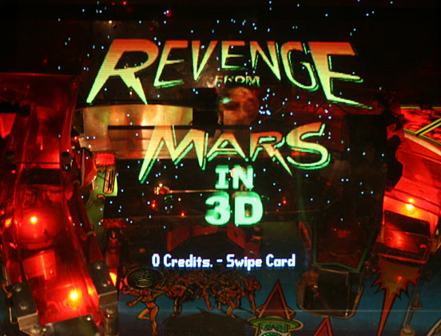
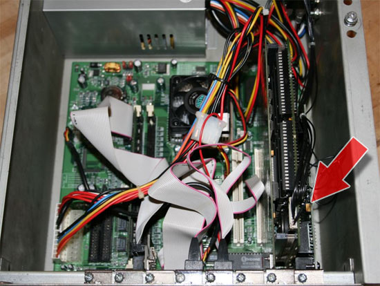
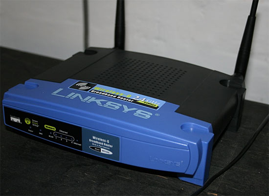

# Revenge from Mars goes online — Pinball News

> [!NOTE]
> Preserved from <https://www.pinballnews.com/news/rfm.html> on `2026-11-11`. This Markdown is a readable derivative; `raw/` contains the captured evidence.

| **ET PHONES HOME** |
| --- |

*Date: 15th May 2008.*

Imagine for a moment, you're playing Revenge From Mars and your score is really starting to rack up. Perhaps you've attacked Mars, had a stellar Martian Attack or just been playing for a long, long time.

As the last ball drains, you get to put in your initials, but there's the slight disappointment of knowing that only you and those who play your machine will ever get to see how good that score was. It might be one of the highest scores ever, or certainly up there with the best of them, but you'll never know.

Well not any more, since a new system from programmer Jim Askey allows Revenge From Mars scores from all around the world to be automatically sent through the internet to a central high score list which is then sent back and displayed on your RFM's monitor.

*A Revenge From Mars machine showing the high scores*

Networking Pinball 2000 games is not new. It was shown at [Pinball Expo 1999](https://www.pinballnews.com/shows/expo99/index.html) when a dozen Star Wars Episode 1 machines were linked together for the Flip Out tournament and the same concept appeared again in 2006 when Germany hosted the [European Pinball Championship](https://www.pinballnews.com/shows/epc2006/index.html).

Now that same idea has been expanded by Jim into a global network where any RFM machine fitted with the necessary hardware can join in.

Jim, who is a Java web programmer by trade, had the idea in the back of his mind for some time. He first got into pinball when his dad acquired a Mr & Mrs Pac-Man back in 1989, since which time he's bought and restored over 50 games. After his father had bought a Revenge From Mars in 2000, Jim got his own RFM a couple of years ago. *"As soon as I got it working, I remembered all the fun I had before and vowed to keep this one forever. So much so that I still haven’t given it the full restoration it deserves. It's just too much fun to have out of action!"*

Finding himself with some free time over the Christmas period, Jim set about developing his worldwide tournament system. By April he had it working and online, ready to accept scores.

Jim told Pinball News, "*My system is 100% original so no code from the original program is used. I developed all the code myself, but have had two main testers to help me out with bugs and testing game connections, bar code readers, etc. They are Dave Langley (UK) and Chris Senior (USA). They have both been great and I thank them both very much for all their help. I used the original system and one that Dave showed me to monitor the packet communications as a base to work out what needed to be sent to the game and what I would receive back.*"

Connecting a Revenge From Mars machine to the internet and then to Jim's system requires some additional hardware in the form of a network card, a router and a barcode reader. Although the latter isn't compulsory, it does help identify multiple players on the same machine since players can print their own personal swipe cards which they use before playing to identify themselves.

*A coin door with the barcode reader installed*

*The main screen when a barcode reader is installed*

Without it, the machine is identified by the IP address of the internet connection and all scores are recorded under a single user's identity.

The SMC8416T Pinball 2000-compatible network card used is an old design but still quite widely available through Ebay where it sells for about $15. It plugs inside the computer and provides an ethernet port on the back of the case. This plugs into the router which connects the game to the internet.

*The network card installs inside the computer case*

No custom software is needed on the Revenge From Mars machine - it just needs to be running software version 1.5 or higher which incorporates the networked tournament system and all the network settings - but the Linksys WRT54GL router has to run a special version of firmware.

Jim explains, "*This router was chosen as it is a very common router available around the world and is pretty inexpensive - about £35-40 ($75-80) here in the UK. It enables open source software to be run on it, which is needed to fix an internet communication issue related to the original Williams code. It also allows the game to be easily connected to a user's broadband setup even if the broadband connection isn’t physically near the game. The [website](http://www.mypinballs.com/tournament/) has more details regarding the setup of this.*"

*The Linksys router used to connect to the internet*

With the router, network card and barcode reader set up, players just need to register on the website, add a picture or avitar and print off their swipe card.

Once that is done, all the scores will be sent to the central server and the top 30 positions are sent back to the machine to be shown on the display.

[Get the Flash Player](http://www.macromedia.com/go/getflashplayer) to see this video clip.

Got problems seeing the video? Consult our [help page](https://www.pinballnews.com/video/help.html) for assistance.

Jim said there's not much data sent back to his system but it may be possible to include more. "*The games only send the score and player id. Things like the date of the score are captured by my system itself. It would be nice to pull out other stats from the games, but that it something for the future.*"

At the present time there are about 30 registered players but Jim would like to expand that number. "It is completed for now, though there will be new features added as I think of them or people request them and I find time. I'd like to get over 100 people with games connected and competing. That would be really cool. My main aim though is to have a system that people can enjoy and see the benefits of Pinball 2000."

If you'd like to add your RFM to the worldwide tournament system, details of the parts and settings needed can be found on Jim's website at: [www.mypinballs.com/tournament](http://www.mypinballs.com/).

[Back to the News page](https://www.pinballnews.com/news/index.html)

[Back to the front page](https://www.pinballnews.com/index.html)

© Pinball News 2008
