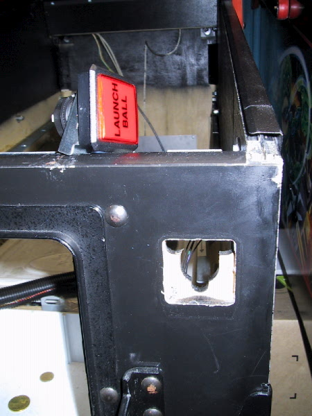
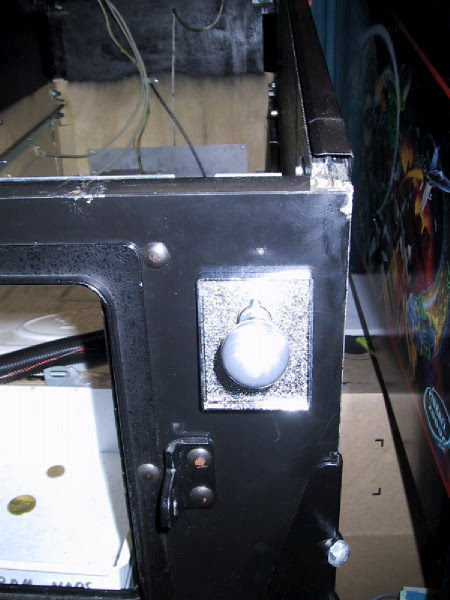
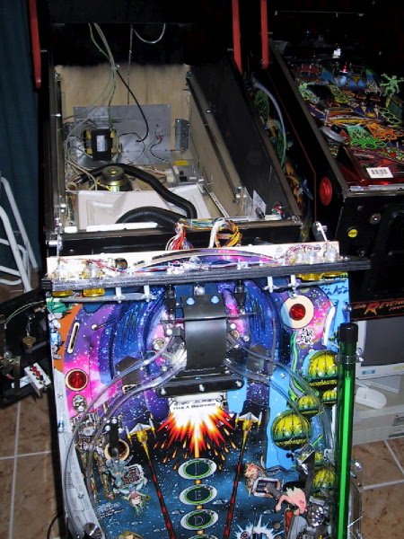
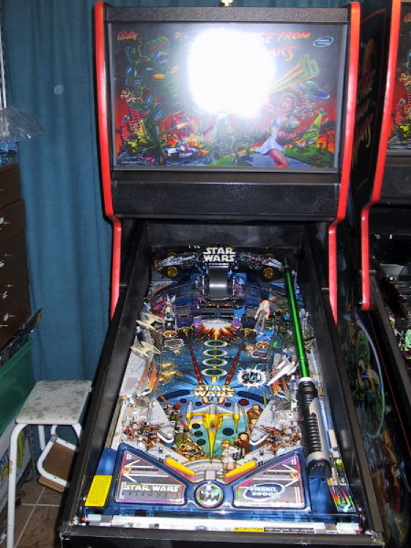
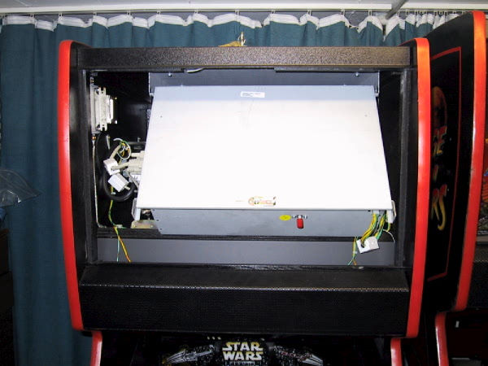
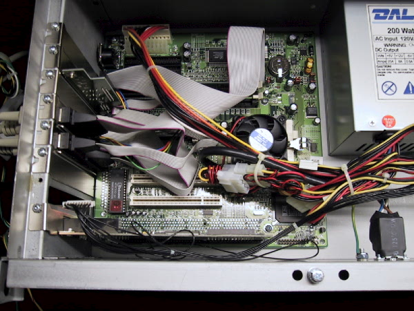
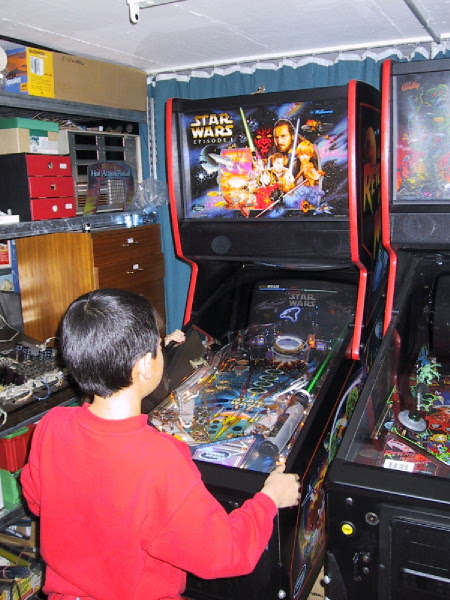

# Pinball2000.de RFM and SWE1 game swap

> [!NOTE]
> Preserved from <https://www.pinball2000.de/pin2000_rfm_ep1_swap.html> on `2026-11-11`. This Markdown is a readable derivative; `raw/` contains the captured evidence.

Pinball 2000 Swap between Ep1 and RFM:

Version 2.03 With SWAP data problem

Hint: Scroll down to find all infos or use the tags!

[Find here the content of the Ep1 Kit](https://www.pinball2000.de/ep1kit.html)

[1) General Pin2000 Game Swap Statements](https://www.pinball2000.de/pin2000_rfm_ep1_swap.html#General)
[2) How to perform a Game Swap](https://www.pinball2000.de/pin2000_rfm_ep1_swap.html#The Upgrade)
[3) Game Swap Problems](https://www.pinball2000.de/pin2000_rfm_ep1_swap.html#The Problems)
[4) More Problems](https://www.pinball2000.de/pin2000_rfm_ep1_swap.html#More_Problems)
[5) Other SW Upgrade Problems](https://www.pinball2000.de/pin2000_rfm_ep1_swap.html#Other_SW_UPGRADE_PROBLEMS)

**1) General Game Swap Statement RFM <-> Ep1:**

The game swapping between RFM and Starwars Ep1 ist generally
possible without any restrictions, that means you can either make
a RFM out of an EP1 or an EP1 out of an RFM. The restrition
is, that only Ep1 Kits are (were) ever available at WMS for a price
of about $2000. (Germany: Price Reduction to about 1200$).
This original Ep1 Kit contains the playfield, manuals,
the backflash, ROMs (no PRISM) and the sideart cabinet stickers.
Due to several commercial RFM to Ep1 conversions also some used
RFM 'kits' are one the market. I also still may sell one.

What do you need for game change: At least a playfield, a ROM-Set,
and the startbutton (RFM) / shooter rod (ep1) is necessary. For
easy change-back a complete PRISM-Card is really recommended.
The backflash and manuals are a should have and at least the side
art is not really necessary, as once installed (Ep1) you can not switch
back to RFM sideart (no method for sticker swapping known yet).

For an easy swap between the 2 games Robert Winter found a great way to modify the RFM autoshooter.
See his [pages](http://robertwinter.com/pinball/pin2000/p2k_shooter.html) for all the information and images its is worth to do so!!. The major modifications are
[the shooter with button](http://robertwinter.com/pinball/pin2000/inside.jpg) , and the installation of an [autoplunger](http://robertwinter.com/pinball/pin2000/autoplunger.jpg) to the RFM playfield.

**2) How to perform the Upgrade:**

If you buy a NOS Ep1 Upgrade kit you will find instructions
how to perform the upgrade. Nevertheless (and for all used
kit buyers) i will try to describe in short words and pics how to
do this Upgrade:

First of all you should start the 'old' game a last time.
Go to utilities, 'Update game code', and select the menue
'Disable Update Game Code' - confirm with start button.
This is necessary to prevent from trouble after the ROM change.
If you have 2 PRISM boards you do not need that.

a) Get Playfield out of cabinet and unplug the connectors
[Playfield pulled](assets/ep1kit12.jpg) , [and disconnected](assets/ep1kit13.jpg)

b) remove shooter rod or Launch Button and install the other
device needed for RFM or Ep1 (still waiting for a combi solution)

c) bring new playfield, plug in connectors and slide into cabinet

d) remove Backglass and [swap Backglass Translite](assets/ep1kit23.jpg) (if you do not
own 2 separate glasses)

e) pull computer case and open it

f) remove the PRISM sandwhich card

and put it on a clean antistatic
table (or into a antistatic bag if you own 2 PRISMs, continue with l)

g) divide Sandwhich Board carefully into two halfes using the black
WMS spacer tool
h) pull all 10 ROMs and install the 10 new ROMs - take care of the
pin 1 side marked with a notch
i) reassamble PRISM card
for the steps g) to i) with pictures see [PRISM Infos](https://www.pinball2000.de/prism_infos.html)
j) install the PRISM card back into the computer case and fix it with screw
k) plug also a PUB card with the latest game SW for you specific game
into the computer case, switch on game, wait till update finished,
switch off again, remove PUB - if you don't have a PUB card,
regard problems mentioned below and do not forget step n)
l) close computer case, slide it back, reinstall (the right) backglass
m) install the Ep1 cabinet sticker provided with the Ep1 kit, which
I would not recommend - save them for later times and bad Ep1
cabinets to come
n) If you have installed PUB switch on game and wait till PUB Update
has been finished. If you do not own a PUB card you now need a serial
i/f Update with WMS Upgrade Manager and the latest game SW of that
game you installed. If you do not do this, at least the sound will not work
and you have gameplay of a very early SW release.
See WMS page for more Update Infos.
If you have problem to load the PUB card, see the [General Pinball2000 Troubleshooting Page](https://www.pinball2000.de/troubleshooting.htm#PUB_LOAD_PROBLEM)

Update (w/o cabinet stickers) is ready

**3) General Problems occuring during Ep1/RFM Swap**

At least the latest SW releases of RFM and Ep1 produce major problems
when you swap the ROMs for a game change and have the latest game
SW loaded in the Flash ROM of Sound and Game.

**When installing Ep1 ROMs on a game that ran before with RFM 1.4 or 1.5 on it,**
**the game will report "checksum U109" problems. Disable Update SW before swap**
**and so a serial update of the sound and Program flash directly after swap.**

**When installing RFM ROMs on a game that ran before with Ep1 1.4 on it, the game**
**will not come up at all and perform a permanent reboot (reported by Sebastian Sievers,**
**Germany). You must 'Disable update game code' before swapping the ROMs,**
**then RFM program will start but sound is not working. Serial update of game and sound**
**after that must be done and puts game into full funtionality.**

These problems were at least reported with above mentioned versions, but maybe the also occur
on versions used before.

The easyest solution that I currently know is to use a PUB card for that game swap or
to own a second PRISM sandwhich card - one for RFM and one for Ep1!

**Some features change behaviour after SWAP: Not all data of P2000 game SW is stored onn the PRISM, but also on the battery backed RAM of the PC motherboard. So when you SWAP RFM with SWE1 or viceversa it might happen, that the SW interpretes data stored from the other game as valid and misinterpretes these data. To be shure everything works well after a SWAP you should do a Factory Reset. For more infos take a look at [The RFM Software Bugs](https://www.pinball2000.de/rfm_swbugs.htm)**

**4) Other Problems that occured during Ep1/RFM Swap**

**4a) Bended Pins:**

Scott Frazer wrote:

This (Ep1 to RFM conversion) worked as far getting the game to start telling me it's at
version 1.4 but I'm still getting the following messages at boot time:

** Image Cookie does not match **
 ** Reload MASKED image ROM files **

I also saw a BOOTDATA command so I ran that with the following options:

BOOTDATA CURRENT VERIFY
 BOOTDATA ROM VERIFY
 BOOTDATA FLASH VERIFY

all three commands return the following line (among others that look ok)

im_mask[3] is BAD

Does this mean I'm doomed to buying a replacement daughterboard with
 ROMS? I've checked the seating of the ROM chips and they look fine.
 cold solder are possible I guess, but I don't see anything wrong :-)

ANSWER:
There are four pairs of masked ROMs on the daughter board which contain
the OS, game code, and image data. The error indicates that the 4th
pair has a problem (U106, U107). Since the other 3 pairs check OK, I
would guess that you have a bad address line or a pin bent under one
of the U106 or U107 ROMs. The only way to be sure about a bent pin is
to pull the ROMs out and check. If the problem is an address signal,
it is probably a loose solder joint on one of the two big headers that
connect the daughter board to the main board. The header socket on the
main board is a surface mount it is possible for the connections to be
torn away from the board when the daughter board is dissassembled from
the main board. If the problem is not a bend ROM pin, then take the
main board to someone with a soldering iron (fine tip) and carefully
reflow the surface mount header socket leads...

--tom
And it were bended Pins!

**4b) Wrong ROM Plug and forgotten SW Upgrade:**

from RGP 6.7.2000 (shortened)

PRISM Board works fine with RFM, SW 1.2a I assume .
Changed to Ep1 ROMs.
After the rom swap, I get now sound.
I've also noticed the following:
- When p2k starts up, it says update mismatch (2nd Line). (Never used to
say that when running as RFM).
- Test reports always tells me to check Lamp Column 6B, which of course,
isn't used in SWEP1.

He made 2 mistakes: First one Ep1 ROM was labeled wrong (with paper
sticker) which misleaded him to plug the ROM wrong.
**Be carefull with Ep1 ROMs! When you have Soundroms labeled with paper,**
**disregard the paper orientation when looking for Pin1. Look under the paper**
**to find out where the notch of Pin1 side is. Otherwise you cook the ROMs!**
Second problem was, always after ROM change the SW must be updated
(serial or PUB), otherwise the sound DSP might not work at all!

**5) Other SW Upgrade Problems**

**Serial I/F Update Problem 1:**
Addition from Joe Schober: Update with MAC Power Book:
First, a bit of trivia that might interest, oh, as many as two or three of you.
 Maybe. :-) I don't have a PC laptop. I'd previously tried updating a
Pin2000 (RFM) machine with my Mac PowerBook, running Virtual PC, and had no
success -- no ACK received on the very first data packet. With this week's
updates, I decided to try again, and fooled around 'til I got it. Solution: 1)
Reduce speed to 57600 bps (NOT BAUD, ARGH!) 2) In VPC's preferences > COM1,
check the box marked "Non-modem device". I don't know what this does, but it
seems to be necessary. With those changes, updating Pin2000 from VPC works
fine.

**Serial I/F Update Problem 2:**

Make sure that the filenames are EXACTLY as indicated by the source
files on the web site. If the update manager still can't find them,
move them to the "Pinball 2000 Update Manager" subdirectory under
Program Files\Pin2000 (assuming you installed in that directory).

Make sure you are communicating over COM1 port and don't have any other
program active that tries to grab the COM1 port.

If fupdate continues to fail, check your null modem cable and power
off/on the game after the game is connected to your laptop and try
again. Try not to have other DOS sessions open (I've had fupdate fail
with other DOS sessions open)

If all else fails, run FUPDATE directly:

fupdate -b115200 -debug COM1 (if I remember correctly, fupdate -? for
details)

Jim Hicks

 Here you can find some great P2K Update Informations from Thierry in french language! [French Update Pages](http://www.flipperfrance.com/forum/viewtopic.php?id=1466).
