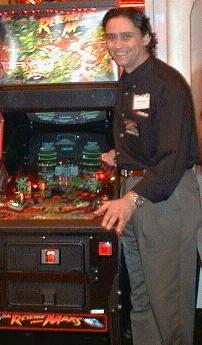

# George Gomez making of Pinball 2000 archive

> [!NOTE]
> Preserved from <https://www.pinball2000.de/new_making_of_pin2000.htm> on `2026-11-11`. This Markdown is a readable derivative; `raw/` contains the captured evidence.

# The Making of Pinball 2000

### A transcript of the Pinball Expo 99 seminar given by George Gomez

Published in *Pinball Player* Volume 19, Issue 7
The magazine of the **Pinball Owners Association**
(copied from their website, waiting for OK, but did not find an EMAIL address yet)

## Introduction

 Billed as the highlight of this year's Pinball Expo, George Gomez (lead designer on **Williams'** Pinball 2000 range) presented an illuminating seminar. In his eagerly awaited discourse, he discussed the design and some of the thinking behind the project as well as giving an insight into the company's future plans.

Little did we know at the time that **Williams Electronics Games** would be closed for good on the very next working day? It makes this verbatim account of the seminar all the more relevant, and poignant.

## The seminar

|  *George Gomez launching* *Pinball 2000 at ATEI 99 in London* |
| --- |

*Rob Berk:* Our next presenter began his career inventing and designing toys, but he got bored with that quickly. In 1993 he began his designing career at Williams. His games include *Corvette*, *Johnny Mnemonic*, *NBA Fastbreak*, *Monster Bash* and *Revenge from Mars*. It's our pleasure to introduce as a first time speaker, head speaker at the Expo, George Gomez.

*(Video presentation.)*

*George Gomez:* I want to tell you the story and I want to tell you the story first hand. What you're going to hear are my opinions, not the opinions of Williams Electronics Games or WMS Industries. It doesn't mean you can ask me how many games we made. If I try answering that question there's a WMS Ninja strike team that propels in from the ceiling.

In order to really understand where you are at any given point in time I truly believe that you need to fully realise where you've been. I think that's really key to anything we do.

Does anybody remember a really bad 80s movie called *Brainstorm*? In this movie, for those that haven't seen it, there's a device with these really cool transducers, its a helmet and you put it on and it records your brainwaves and it manages to interpret them such that you can wear the helmet and you will feel everything I've felt, see everything I've seen, and it feels like you're living my experience. I really wish that technology was true because right now I'd make you all put on the helmets and feel what I've felt over the last two years.

It's really important that you feel a part of my story because the thing about Pinball 2000 is it's about passion. It's about a bunch of guys trying to make something happen. And it's in an arena that isn't particularly conducive at this particular point in time.

So I'm gonna take you through the really good stuff and then I'm gonna take you through the really bad stuff. And then we'll talk about it and it'll be like therapy.

## A Culture

 I want to say a word about one of the most powerful cultures in the history of pinball. You need to know a bit about that culture so that you know where this comes from and why it happened. That culture I'm talking about is the Williams engineering department.

A thousand years from now when an archaeologist digs over 3401 N California Avenue and finds all the toxic waste from the 1930's transformer production, what they're gonna find is a clan of pinball. In this clan is this living breathing organism made up of all these different guys.

I've been really fortunate to work in some of the most challenging creative environments in the world, I think. I worked as an inventor of toys and that was a highly challenging creative environment. In order to sell three items a year I had to invent 52 things and I had to take those 52 things to protoype and show them to toy companies.

Williams Electronics Games has in some ways raised the bar above that. It has been more challenging to work there as a designer, even morethan it was to work at Marvin Glass inventing toys.

The reason I went to Williams was not what you might think. I didn't go there with this dying need to design pinball machines. I went there, not necessarily for the love of the game, I went there to challenge myself, because I looked at the toys I was designing and I said you know I get a little LED and a little 9 volt motor and I've gotta make this thing cost $14.95 at Toys R Us.

Now, I'm looking at pinball and Pat Lawlor is putting $100 mechanisms on a playfield and I'm thinking that looks pretty fun to me. I wanna spend $4000 making the coolest toy I can make. That drove me there and the personal challenge of finding this environment that would challenge me again. Every 6 years I get bored and I do something else.

I worked at Midway in the early 80's on video games. I did pixel graphics, you know one pixel at a time and I designed these really cool controls and I worked on games and I got bored with that and I moved on.

Williams was this place where the lure of guys like Steve Ritchie design 15,000 pinball machines for a title and live life completely. I wanted to see if I could swim with the sharks.

That's what drove me there and once I got in there I started working on pinball and pinball saturated me and became a part of me. I think the way that it is a part of you. It's something that's taken me by surprise, I really did not expect that. I expected it to be another cool design job and I thought I was gonna get my jollies by playing with cool toys and cool tools. I thought this company was gonna make me a star.

At Williams Electronics spiritual leaders walk the halls. We're talking about passionate men with insane visions and bullet-proof demeanours that insist that they're right. You have never seen grown men screaming and yelling at the top of their lungs in the hallway over a multiball rule. You would think we were talking about nuclear proliferation, the amount of passion that goes into the product we make. The nuance of the return, off the right ball guide to the right flipper on that loop shot, is it too high on the flipper, you know. These discussions are endless.

You're talking about the most brutal critics in pinball. They make you guys look easy. The reason I say that is that the guys at Williams that design pinball machines not only criticise you, but they know what the answer is. You guys criticise me but sometimes you don't know what the answer is. There is such pride in this engineering department that we have never once reverse engineered the competition's product. We have never brought in a machine to find out what made it tick. I have to tell you that Ferrari reverse engineers Lamborghini's product. There is an element of pride here that says competition is down the hall, not down the street. This is a flavour for this culture, this environment.

At night, John Popadiuk says, the ghosts of the great designers walk the halls. When you're in your office at 2 o'clock in the morning; all day long you were sure that ball guide was in the right place, and then at 3 o'clock in the morning for some ungodknown reason, you decide to move it a sixteenth of an inch. That's I think the inspiration of those guys, I hope.

## The Birth of Pinball 2000

 It was this passionate group that was repeatedly challenged to step up and try to fix the business of pinball. Management said we need to make it profitable. The world has changed, nobody wants what you guys are doing, you're boring everybody. Invent something new. We just cannot continue to repeat ourselves. We have put umpteen million heads on a playfield, we have created layer upon layer of ramps, we have convoluted rule sets, we have video modes, we have all this stuff and guess what; it's not making a difference. We're just rehashing ourselves. And management says this has got to stop, you have got to come up with something or we're done!

Our company's a business; you've heard that in this forum a lot. That business has to make sense. Make it fun. That was the criteria. I have been doing leisure entertainment products for 20 years now and I have to tell you the other day I played RFM in mental preparation for this; I spent an hour on the game, and I came away thinking "this is fun". This product is fun. It's entertaining me. I drained my third ball and my bonus got me the extra ball. I was jazzed. I mean, you can't plan on that, but I was jazzed. It was fun.

I'm not so sure that it's enough to make it fun, anymore. And this is a personal thing, and it's one of the things that is discussed constantly. I think I made a fun game and we haven't set the world on fire, but more about that later.

Management's call to action on this was first answered by John Popadiuk with his version of Pinball 2000. His version of Pinball 2000 had a 27 inch monitor mounted in the back of the backbox where the translite is.

I have to tell you that engineering as a whole believed in this and followed this vision for about six months. I was somehow troubled; I was troubled because I was around in the 80s working at Midway. I saw *Caveman*, I played *Caveman*. *Granny and the Gators* was gnawing at me. These things were bothering me. The lack of interactivity. We really need to put the video some place where we can do something with it. But we went in this direction.

This business of interaction between the ball and the video was troublesome because there wasn't an easy way to do it. There was a lot of conversation but it wasn't.... you know, you see it, you see the after effect and you think oh clever, awesome, ominous. But it wasn't that way at that particular moment in time.

Neil Nicastro, then chairman of the company, calls me up in engineering. At this meeting are basically the key elements of game design, the designers and programmers, maybe a few other people. Larry (De Mar) is running the meeting and he wants to know what's going on with Pinball 2000. Every day that goes on is essentially a day we're spending their money.

During the course of this meeting, Larry reports on progress and then Neil says, "Who here, does not believe this is the best direction that we need to be taking?" And three hands went up, and there's this silence, and the three hands, Mark Weyna, Pat Lawlor, George Gomez, absolute known trouble makers! "What's your problem?" Well, it's not interactive. We're playing up there, we're playing down here and then we're playing up there. We're already doing that with the dot matrix. This is not going to set anybody on fire.

Now, Neil has a way with words. "Well boys, this is the direction the company is going in and basically there are three choices. Those choices are you jump on the bandwagon and you help these guys out as best you can and follow this vision of the company, you invent something better, or you get the hell out! There is no room for dissention at this point in time. We have to be together, we have to make this work."

At the time I was dating this woman in Boston and the day of the meeting I was going to San Fransisco for one of those girlfriend, romantic weekend things. She sets it up and you just go along. "No problem, I'll meet you at the airport and we'll catch a plane." The meeting's at 1 o'clock and I've got a 3 o'clock flight out and I called her and said, "Look, I may have to meet you in San Fransisco because this is not looking good".

It was a terrible weekend. I took my briefcase and it was full of drawings and God forbid that some psychoanalyst should get hold of my notebook from that weekend! I was totally distracted and like I said, it wasn't a good weekend.

So I got back from the weekend and Pat comes to see me and he says, "You know, that meeting was about gauging our commitment". Our commitment to this product, and I don't think he walked away feeling real warm and fuzzy about this. We're in danger. We have lived under this danger for a while now in engineering, but every time it gets really close it's very scary, you know. They're gonna yank the plug!

We start talking about trying to make this video interactive. We have experience with this mirror technology from the 80s; in the 80s video games could not afford the massive amounts of memory that you have in video games today. Video games are made up of tiny little things, like 32 pixels by 32 pixels big, called sprites or picture blocks. You could move a lot of them but you couldn't draw scenery. I couldn't draw a planet or a city, etc.

What we would do is we would make the video move and take plastic or cardboard and create the scenery and blend the two things with something called a combining mirror. It's a see through mirror which reflects the two objects together so that to the eye they appear to be together. Now, I did not invent the combining mirror. Some guy at Disney invented the combining mirror. What I invented is the interaction between this virtual object on the playfield and the pinball. Our eureka deals with that little bit of technology.

That meeting was a troublesome meeting; it basically splintered engineering. It splintered this group, which is why I wanted to talk to you about the culture of that group. When we came out of that meeting Dwight Sullivan said to me you guys don't have a better idea, you're just being assholes, you know. You're just causin' trouble. There's no better idea here, just shutup and get on the bandwagon. John (Popaduik) is mad at me because it's his thing and I'd basically said it's not good enough. Coming out of that meeting, it wasn't great.

We started talking about doing something and Pat says, "I've got all these shiny new tools set up in my garage. We really ought to do it offsite because Dwight might come in your room and say something about the thing that we're building and then you're gonna feel bad."

## Eureka

 Let me talk to you about eureka. If you've played *Monster Bash* you know that eureka does not happen when Dr Frankenstein decides that he's gonna animate a guy made from parts from a bunch of dead guys. Eureka happens when he throws the switch and the electrodes energise Frankenstein and the table comes down and Frankenstein comes to life, at which point he screams, "It's alive!" That's his version of eureka and that is eureka. Now I'm gonna describe eureka to you as it happened the first time in Pinball 2000.

The wonderful thing about Pinball 2000 is that eureka blessed us throughout the process. If everyone hadn't stepped up and been an inventor at some point in time, you wouldn't be seeing Pinball 2000. Pinball 2000 would not have happened.

It's a Friday night and it's about 9 o'clock, it's late, during the development of *Monster Bash* and engineering is pretty much deserted except for Lyman Sheats, programmer extraordinaire, working away on the finishing touches to *Monster Bash*. I'm in my office with my hot glue gun, my Exacto knife, and the things I use to do what I do. I start building that model that you saw [in the video presentation].

I made this thing and I started screwing around with it. I put this thing together and I take my flashlamp and I go, "Oh my God, eureka!" It's 9 o'clock and the phone rings at Pat Lawlor's. And Pat picks up the phone and I say, "Pat, this thing's going to work, man. This thing, it's got video on the playfield."

"Yeah, yeah, yeah. You're coming over tomorrow, right?"

I go running down the hallway to see Mr Sheats and I say, "Lyman, look at this". Lyman looks up and he says, "Look at that display, will you". He's working on *Monster Bash* and to Lyman getting rid of the (glitches) in the display is what separates the men from the boys as far as programming goes. "Lyman, look at this. This is our future."

The following day, and off to Marengo. Pat's way out there. I don't know what you know about the local geography, but it's out there! The only cool thing is I've got this brand new M3 and these roads are deserted. It became a ritual that the very first time, this thing was about a month old, and I got it up to 130 mph before I ran out of nerves and then rolled into Pat's garage. This became my adrenalin rush at the end of every day, I'm out of here at Pat's.

We're in this garage and we're talking about Williams and we're talking about pinball and we're cutting wood and we're putting that thing together. We're doing monitor weight lifting. There's an old 80s monitor in there left over from when I used to try to develop 80s video games. That's the reason there's an Amiga hooked to it. In the 80s, there was a period in my life, in which I was trying to pinch game ideas. I had images loaded on it from that time. I was trying to fire it up today but the Amiga was as cantankerous today as it was when we were working on it in the garage.

We built that thing and we did monitor weight lifting. "Hold the monitor up, Pat. What do you think?" "Oh yeah, yeah, that's it" "Okay, quick, get a pencil!" That's how that thing came about. We didn't make any drawings. We just kind of measured this, and I'm measuring and Pat's sawing. The place is a mess, there's sawdust all over us. Patricia, Pat's wife, is bringing out food.

We did this for about three weeks, mostly at nights and weekends. I was still working on *Monster Bash* and Mr Sheats wasn't too interested in Pinball 2000. His attitude was, "Whatever, dude. That's nonsense." During that time he was engrossed in *Monster Bash* and so we built this thing and we brought it in and basically everybody was jazzed.

We brought this thing into this conference room and everybody from engineering was there and everybody's got something to say about it. This is the shift in gears that sends us in this direction. John was a little upset. He's six months into a game and he's got a playfield, he's got video, he's got things happening. And eventually John comes around and one of the very first things that happens, once we get going on this project, is that John's team actually brings up the very first true interactive video image on a playfield that reacts to a pinball.

## Further Developments

 Cameron Silver programs this thing that looks like a Tie fighter because even back then their theme was Star Wars, and it's an old Tie fighter because they haven't got any material on the new movie yet. So this Tie fighter hovers around and drops to the centre of the playfield and it kinda hangs around there. And you hit it with the ball and it explodes, and man, that was another eureka. The whole process is full of these things. These are the things that made it all happen.

During that time, one of the problems was, when it was determined that Star Wars was so far out, management decided that's too far. You guys have got to do something before then. So, they didn't want to change the schedule, even though we'd essentially abandoned the platform and picked up a new platform. They wanted the old schedule to fit the new design.

John's team got relegated to second game and they began searching for volunteers for first game. Lyman wasn't real happy, you know, when I went in and said, "Lyman, we really ought to do this". He is still up to his ears in Phantom Flip, you know. We volunteered and now the fun really starts. We're done making mock ups and now we've got to make this thing real.

We do have this list that we talked about, in attempting to address what we thought were problems; the business side of pinball, the functionality, etc. (These) are just as important in some respects as (asking) "is this fun?" They are equally vital to the process.

We begin this process with Larry running these weekly meetings in which all the problems that were currently pending were addressed. Slowly but surely ideas emerged from the collective 45 to 50 people that we had working on this thing to solve every problem. It was an environment unlike any I'd ever worked in. Literally, we invented new things every week. The skid rails for the bottom of the playfield, so you could get the playfield out quickly, the connector buss at the back, the concept of transporting these playfields easily. A thousand details that if you ever have the opportunity to dive into a Pin 2000 and analyse you will discover. In the midst of this, management is still very impatient.

So, there's a chapter, when I write the book on Pinball 2000, the title's gonna say "Pinball 2000, A Game Designers View", or somesuch. There's gonna be a chapter called 'Inventors All', and it will talk about those thousands of inventions that happened in the nick of time, miraculously, to make this thing work.

We go to London (for the ATEI show), this thing is unstable, but the reception in London... And to the company's credit they totally supported us, they threw one hell of a party at the Museum of Natural History; black tie, killer food, pretty girls, the works, and it was great. We've got these games on the floor and we're up against our sister company. They've got some heavy hitters like "Hydro Thunder" and video games of note.

When those people got out of the presentation at which the themed tapes were shown; this is a normal procedure for us, we show these tapes to our customers, to our distributors and operators, and then we let them at the games. When the doors opened to this room that the pinballs were in, there was a couple of islands of RFM's back to back, in a circle, and they were mobbed. There's photographs and video tape of this, and it was an amazing thing, this hunger for a product that did something. And at that particular point in time, that was the product. London came and went, games went on test.

The coolest thing about the Internet at this time was that I really enjoyed all the messages that people sent in. It was really exciting to go to work every day, fifteen to twenty messages, "This is so cool", "I can't believe this", "My favourite of all time". Some day I'm gonna have the Pinball 2000 framed and right underneath it's gonna say; the guy who sent me the message, maybe he's in this room, all it said was, "You've blown my f**king mind!" I had to deal with the guys who were criticising it and hadn't seen it yet, too. That never ceases to amaze me, I'd get a critique like the guy had played it for an hour, and he hasn't seen it yet!

## Pinball 2000 In Practice

 I just want to talk briefly about production. If you got one of the early games, you probably didn't get a perfect game. You have to understand that one of the things about doing this game was that everything was going on concurrently. Typically, that's not the case. You've got an operating system that the game runs on being written at the same time as the game is being written. And you've got the cabinet going together at the same time as I'm designing playfields.

Yesterday, the playfield was 46 inches long; today the playfield's 43 inches long. All of these things are happening concurrently. We have new artists, we've never designed a video game in pinball and we have new artists with new tools, and these guys are teaching themselves 3-D video art overnight.

If you get a chance to come up and have a look at the drawings you'll see the tops of the backboxes are called 'Test Fixture no 1' and 'Test Fixture no 2'. In an effort to maintain security about what we were doing, because we were so excited about it, we used two cabinet vendors. We sent the tops to one guy, and we called them 'test fixtures', and we sent the bottoms to the other guy. Now, the guy who gets the bottom, he knows what that is, right? It looks like a pinball machine, it might be 3" shorter, but it looks like a pinball machine! But you'd never know what 'Test Fixture no 1' is.

If you talk to the guys that worked on Star Wars they have a story like mine about their product. The story I've told you doesn't include every little nuance, because I want you to buy my book! You want a happy ending, don't you? You want to see our heroes struggling to overcome incredible odds and succeed. I get the girl and ride off into the sunset.

I designed Pinball 2000 with all my heart and all my skills, but these are dark times. Remember, these are my opinions, this is not an official statement from anyone at WMS. My spider senses sting me, my spider sense has been on fire this last month. Pinball will survive, I'm here to tell you that. I fear that our company may have lost the ability to make it make economic sense. If that's the case, being as it's a business, they might choose not to be in the pinball business.

The engineering department that I so lovingly spoke of, is in danger and the brands that we recognise are in danger. And Gary Stern might just be the last man standing. Please remember that I tried to elevate the art. Williams has been very good to me. The flood of memories is indeed a brainstorm. If Black Friday comes, my brothers and I, in pinball, will live to fight another day.

I have one more tape and then we will do questions.

*(Video presentation.)*

## Questions

 [In the following section some items have been omitted as they were considered not directly relevant to the issues under discussion. Some questions and answers have been omitted because the questions were not clearly audible on the audio tape.] ***Question:*** (about elements of playfield design in Pinball 2000; question not clear on audio tape.)

***George Gomez:*** You've only begun to see what we can do with Pinball 2000. To me that's what's sad. If Pinball 2000 goes away and doesn't make it... Think of the first dot matrix games that you saw and think of the things we didn't do in that first game. I wasn't even around for that first game, and think of what a dot matrix game was like at the state of the art, like *Monster Bash*. You've seen two (Pinball 2000) games that were built under duress. They were built in a very short period of time under a lot of stress to get something done, and get it working and let's go.

I've seen Pat's game; Pat Lawlor is doing game number three. Pat and Louis Koziarz have a game going that really departs from what John did, and it departs from what I did. The video is in the same place but their targets look like video targets that are actually integrated into the three-dimensional architechture of the playfield. They've worked the ramp into it and it's a different approach. It's the approach that Pat and I talked about a long time ago, and he's doing it. He's had a lot more time to pay attention to lighting. The things that you've complained about in the first two games are things that I think can be improved substantially. We don't think of it as limitations. If all you've seen is the first two games, you're going to feel that way. Forgive us, we didn't get it perfect.

***Question:*** After RFM first came out there were reports on the Internet about how the pinball division finally turned a profit for the first time in a long time...
***George Gomez:*** We did!
***Question (continued):*** Can you comment on management's opinion of the potential that would seem to bring?

***George Gomez:*** We made a million bucks in the quarter that we sold RFM. If you could make a million bucks every quarter with pinball, I think we'd be in the game. I think that some of it has to do with (the fact that) our inconsistency, if you will, affects us. And also, the amount of money it takes to develop a pinball machine, as opposed to the other things that you can do with the money, given the return. That's as much of an answer as I can give you. Don't get me wrong, Williams has been a wonderful, tremendous place. This company has allowed me to walk in with a hair-brained scheme like this and turn it into a product. It's a business, and they have to make business decisions. I'm a designer and I have to design stuff. Maybe it's pinball, it's been toys, it's been pinball, it's been video games, it's been whatever. But we do what we've got to do.

***Question:*** Before *Revenge from Mars* came out there was a lot of speculation about what the end product would look like. Were you and your team influenced by any of this?

***George Gomez:*** I guess you could say that. We (did) read it and it really amused us!

***Question:*** Why did you not include the replay feature and were there meetings (where that was discussed)?

***George Gomez:*** Oh yes. Here's the deal. My opinion today is that we made a mistake. On replays and on ball saves, we made a mistake. At the time I did not have a strong enough opinion, and some of us did. It's an opportune time to change the play mechanics when you're introducing a new platform. If you're ever going to screw around with that kind of stuff, that's the time to do it.

I guess I was a little surprised at the backlash. We were trying to balance (the coolness of our product) against the need for it to make money. Maybe it's cool enough that if you take this away it's not going to make a difference. The replay thing has been talked about for so many years. I know Roger (Sharpe's) opinion very well. You can talk to Roger and he'll tell you, "Look at Steve Epstein's operation in New York. Operated for years without replays. Succesfully. Best location in the country." I know Larry felt very strongly about the replay situation, and he drove that. It's like all pinball, it's something that's discussed and discussed and discussed. And sometimes we take a shot, you know. You've got to do that, we have to try stuff.

***Question:*** So what's your feeling now?

***George Gomez:*** Well, I feel you've got to have it in. We got such a backlash on it. I've tried it twice, I tried it on *NBA Fastbreak*. I quickly had to back-pedal.

***Question:*** You have here a great vision, which I hope is the first of many, but when you were putting the first Pin2000 together, what were you most proud of and what are you most disappointed in?

***George Gomez:*** I'm incredibly proud of (the thing that) Pin2000 (has become). [Exact words not clear on audio tape.] As I mentioned, I fear for it and I don't know what kind of life it has. I fear that all of these cool ideas that all of us have about what we can do with it next, won't see the light of day. That's a disappointment to me. It's not my best game.

My personal feeling is that the best two games I've ever done were *Monster Bash* and *Corvette*. Those are my favourites. When you do a game if you're illuminated by that game, if you live it and feel it, the game will be a lot better. It's not that I didn't do that with this game but the reality of it is that the platform consumed some part of my creative energies. I proudly tell you that my fingerprint is on every **piece** of a Pinball 2000. There isn't a box, screw, bracket, thing that I didn't influence in one way or another. And I'm proud of that, I'm very, very proud of that.

***Question:*** You were going to talk about some of the engineering changes that were made, like the smaller playfield and all that.

***George Gomez:*** In an attempt to make the game make sense, the business side is important. Every dollar means something. Somewhere in here there's a drawing, and I brought it specifically for that reason, of the nested cabinet panels. You have a 4' by 8' sheet of plywood and if I can get all four sides of the game, top and bottom, out of that sheet of plywood I save a substantial amount of money. The problem with doing that, in order to get all that stuff to fit, was to go to a 43 inch playfield. It didn't scare me because I remember *High Speed* and *Black Knight*, and I said, "Well, they're 42 inch". We're used to seeing these 46 inchers and they're nice, but I'm going to go 43. It's the most I can stuff into the thing and still make the cabinet make sense monetarily. We fought the cost thing every inch of the way. I promise you, that given more time, it would cost even less. You do what you can inside of what you have.

***Question:*** (What has been done to make Pinball 2000 appeal to new players?) [Exact wording not clear on audio tape]

***George Gomez:*** One of the reasons to do Pinball 2000 in the way that we did it, was to try to attract a new player. I'm not sure that we've done that yet. I don't think it's unnatural for a product to take some time to take. If it takes it's not going to be because I ran ads; maybe $10,000,000 of advertising would help me. I think it has to happen because people are standing in front of it having fun. The problem that we face is a universal coin-op problem, it's not just a pinball problem. Our brothers across the street, at Midway, their arcade stuff isn't doing any better than our arcade stuff. They have this wonderful cushion called Sega Nintendo. They make way more money selling a CD-ROM with Hydro Thunder on it than they do making a $4000 standalone Hydro Thunder. The entire coin-operated game business is hurting. It's so hurting! Go to the arcades, stand there, who's in there? It's like a ghost town and I fear for the business.

***Question:*** Related to that, were there any discussions about changing the marketing model to give more of a push to the operators?

***George Gomez:*** All of these things are talked about. There's problems with that too.

***Question:*** I can easily put $10 into a quarter (play) machine, but I'll think twice about putting four quarters into one machine. It's just a mental thing for me.

***George Gomez:*** You're not the only one that needs to be re-educated on that. I really feel that every other form of entertainment doesn't cost what it did twenty years ago. I'm not certain why it is that ours has to. Perhaps it's a cultural thing that I can't change, but a movie doesn't cost what it used to, popcorn doesn't, pop doesn't, and comic books don't. Here's your entertainment dollar; you're fifteen years old and you're at the mall and you're standing around. Gee! Why does a pinball machine still cost 50 cents? I'm giving you a lot more for your money.
***Comment from audience:*** For the lack of a dollar coin!
***George Gomez:*** That would help.

***Question:*** Your competitors probably buy your products and reverse engineer (them) and take all the good ideas and incorporate in their machines. Why wouldn't you want to do something similar, if you liked say a feature, in somebody else's machine?

***George Gomez:*** Maybe we're too proud, I don't know. It doesn't mean that we don't play their games. We have a certain standard and we try to design to it.

***Question:*** It sounds like you may be disappointed in the way that scores are displayed within your graphics. Would you like to have a dot matrix display or something that would hold the constant scores?

***George Gomez:*** No, I just think there's an elegant way to display information inside the platform and in some ways we discovered it late and didn't have a chance to implement it. In other ways, even what we discovered will evolve. I don't want another display. The magic of the combining mirror is that I've got you looking where I want you to look. As the games get better and the virtual targets get used more as a virtual target than as a movie screen, you'll find it will feel very natural. The proportions take some getting used to, but now I look at it and I think it's pretty cool.

***Question:*** Do you think it will reach a point where you have more continuity in the play?

***George Gomez:*** I am absolutely convinced. And I'm not telling you that pinball as we knew it will cease to exist. I'm not telling you that at all. Both games can and will co-exist, and if a miracle happens and we continue to grow and make money, I think you will see 2000 grow and reach the same sort of level of polish that our old product did.

***Hostess:*** Thank you very much, George.

Copyright by POA, Pinball Owners Association and 
