# Pinball2000.de PRISM information

> [!NOTE]
> Preserved from <https://www.pinball2000.de/prism_infos.html> on `2026-11-11`. This Markdown is a readable derivative; `raw/` contains the captured evidence.

Pinball2000 PRISM INFOs

Pageversion 3.1 (add developer PRISM pictures) hint: scroll down ore use the tags for navigation

[1) The PRISM Pictures and Split procedure](https://www.pinball2000.de/prism_infos.html#Pictures)
[2) Duncan Brown ROM Infos](https://www.pinball2000.de/prism_infos.html#Duncan Infos)
[3) More from Duncan](https://www.pinball2000.de/prism_infos.html#Duncan 2)
[4) The PRISM partno and prices](https://www.pinball2000.de/prism_infos.html#PRISM price)
[5) ROM Infos by M.Wiest](https://www.pinball2000.de/prism_infos.html#M.Wiest ROM Infos)
[6) Even more from Duncan](https://www.pinball2000.de/prism_infos.html#Duncan 3)
[7) Duncan & Tom: Why a PRISM might fail:](https://www.pinball2000.de/prism_infos.html#Duncan 4)

**1) The PRISM Pictures and SPLIT PROCEDURE**

An assembled PRISM card and the divider tool (right)
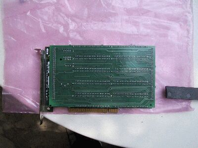

Set the divider tool in this position
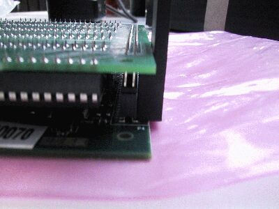

And turn it a little bit to the side
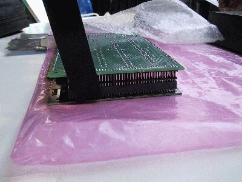

Continue to do this on all for edged of the doughter board,
with increasing angles so a smooth come up is achieved

The finally splitted mother and doughter board
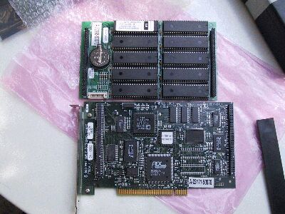

The motherboard
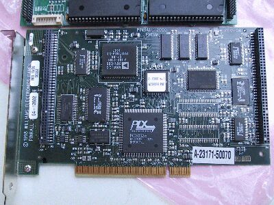

The doughterboard with the ROMs and battery
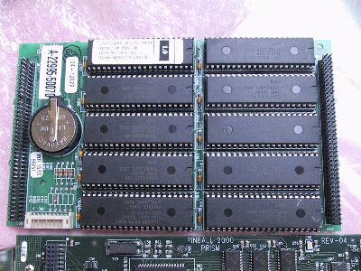

To remove ROMs carefully use a screw drawer and lift
the chip a little on one side...
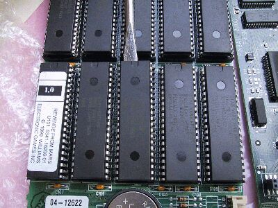

...and on the other side
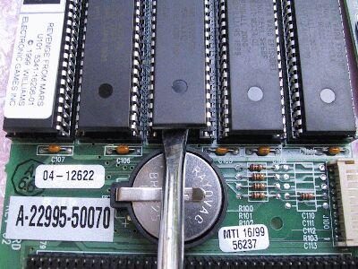
and continue to do this on both sides till the ROM is free.

When reinstalling ROMs look at the Pin1 Notch - forget
the orientation of the paper labels if there are some (see problems)!!!

**2) Information of Duncan Brown (ex. WMS Development) about the PRISM ROM/FLASH**

> Question: How big are they (THE ROMs)? Are they 16 bit wide? (RGP. 17.3.2000)
IIRC they were 64Mb, 16-bit-wide parts. The densest EPROMs were only
half as dense, and quite expensive. The masked parts were actually
fairly cheap in the scheme of things, but it was more a matter of not
having the board real estate for twice as many chips.
The theory was that nobody would ever have to mess with chips again- the
graphics which were developed early on and never changed would go into
the masked parts, while the game code (which can change to due to
enhancements or bug fixes) is in Flash, so gets uploaded via serial port
or via PUB card. That theory broke down in the low-cost-at-all-costs
situation that developed with the SW:EI kits as they were winding out
production of the last games ever.

For development we had PRISM cards fully populated with Flash!!! That
was very convenient for us, but of course quite expensive. In the rare
cases where a game needed to go somewhere (a show, for instance) before
the masked parts were ready, we'd just send it out with one of those
full-Flash PRISM cards...but we always needed to get them back, since
they weren't cheap and the supply was limited!
Duncan

 See some recent pictures of the Developer PRISM here

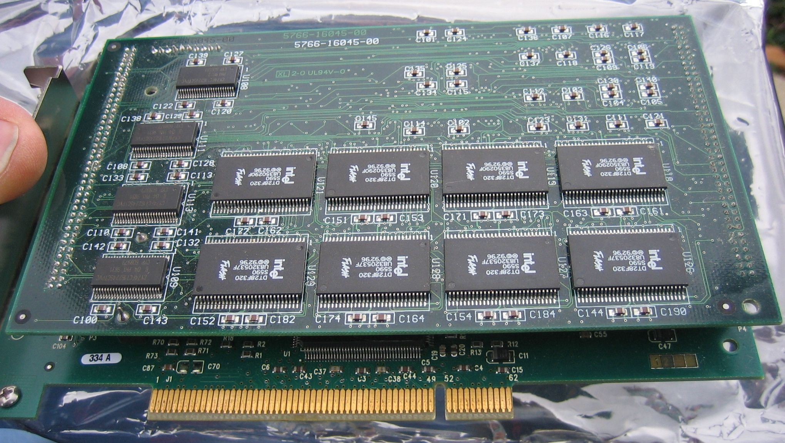

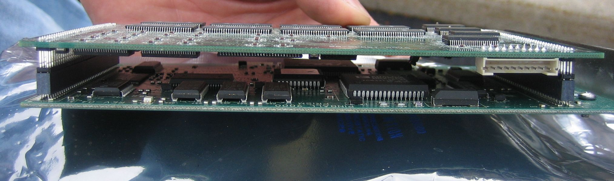

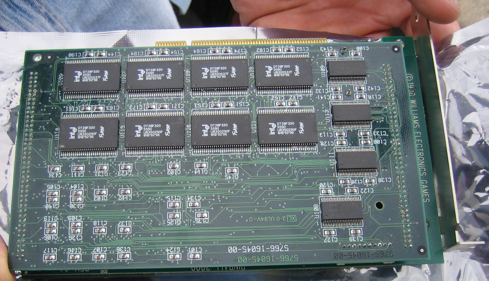

**3) More ROM Informations from Duncan Brown**

Yes, if you have a complete (2-card sandwich) PRISM card to swap when
you swap playfields, you are also getting the saved uupdate code to stay
with the game when you swap. If you just have the ROM daughtercard, and
swap that each time you change playfields, you would have to go through
the update procedure each time too, since the update Flash is on the
main card.
Duncan

**4) Prices of PRISM card:**

Here are the wms prices in spring 2000, were it was still available:
Full prism card card daughter board and roms $448.00
Daughter board no roms $178.00
Prism Card $238.00
these are approximate prices from WMS when I ordered my daughter board
PartNo:
A-22994-50069 Prism Card sandwich assembly (SW:EI)
A-23171-50069 Programmed Prism Card (SW:EI)
A-22995-50069 Prism Daighter Card w/ROM (SW:EI)
(Same numbers as above, but substitute -50070 if you want RFM)
For unprogrammed/ROMless boards:
04-12602 Prism PCB assembly
04-12622 Prism ROM daughtercard cassembly
In the meantime there were NLA at WMS and so IPD did not get any of these and cannot sell them.
In Germany they are still available at NOVA games for about 1100$ !

**5) ROM Infos by M.Wiest**

On PRISM doughter card there are 8 ROM Positions for Gameroms and two ROM positions for Sound ROMs.
The ROM sockets are wired for 16Bit data Access and 22 address lines, that make a maximum of 64Mbit or 8Mbyte per ROM.
To fullfill a 32bit access of the processor 2 ROM sockes are wired to form 32bit data adresses.
It is noted in the manual that 16/32/64 Mbit ROM can be used. RFM uses all sockets (10 ROMs), but I do not know what
density the ROMs have. One day I might readout the ROMs with my EPROMMer and a ROM to EPROM adapter, but that
will give a lot of files and big work. If they are 64Mbit ROMs each has the capacity of 16 4 Mbit EPROMs......

Infos from RGP and myself 31.3.2000

**6) More PRISM Infos from Duncan Brown:**

> 1. When you hook up a notebook to update the program code, are you
> writing that code to the PRISM card? straight to RAM? Is there
> some Flash somewhere that I haven't noticed on the schematics
> yet?

There is Flash on the PRISM card.

> 2. Can I take a SWE1 PRISM card, plug it into a RFM, and then use
> the update program to replace the entire image? If you are
> writing the image to RAM, seems like you could do without
> the ROM half of the PRISM sandwich pair. (seems like this
> should be possible)

The Flash contains mostly programming, and the ROM contains mostly
graphics images. (Both contain sound data). So if you swap the card
from one game type to another, you *must* install the proper ROMs for
that game. Also note that the update manager knows what game you have
based on what's in ROM on the card...so if you were plugging your
SW:EI card into a RFM just as a handy chassis to use while upgrading
the code (FOR SW:EI!) it should theoretically work [M.Wiest: it does!].
But just plugging the SW:EI card into an RFM still with its original ROMs
does not magically make it start thinking it's an RFM card.

> 3. Are the updates available on the WMS website complete images
> or partial replacements? (I would guess partial replacement)

They replace the entire contents of the Flash portion of the PRISM
card.

> 4. Is the PRISM card used during normal game play? Would it be
> considered as part of the mainboard from other WMS games?

Uh...yes, it's used during normal gameplay! That's the equivalent to
both the EPROMs and the DCS sound circuitry from older games;
absolutely required to run. In fact if you take it out, the
motherboard boots into a normal BIOS!

Here's how it works, overall: The ROMs contain everything needed to
run the game: program data, graphics data, sound data. Because of the
lead time for masking ROMs, they contain whatever version of those
things existed at the time the data had to be sent off to the chip
company...usually a pretty bad way-pre-v1.0 version of the code...but
good enough to run and take coins and basically behave properly for
location play.

When you update the game, you are putting a new version of game code
and some sound data and even some image data into the Flash part on
the board. This "overlays" the equivalent section of the ROM, so it's
what gets used instead when the game boots and runs. But the ROM
version is always there as a failsafe fallback. If an update goes
bad, or the Flash somehow loses its mind on location and gets
scrambled, or whatever, the boot process will see that it is corrupt
and not use it as an overlay, instead using what was originally in the
ROMs. Thus the game will not die, will not magically be on free play,
or any other really bad problem in a location environment. And it
will still boot so you can get to the update mode and re-Flash it.
From memory (no pun intended) I believe the ROM space is 64MB, and
the Flash part overlays 4MB of that.
Duncan

**7) Duncan & Tom: Why a PRISM might fail (10/2001):**

John Ross wrote: ... I'm wondering what causes the prism card to fail?
I'm not aware of PRISM cards failing in general. The demand for spares
at this point seems to be driven mostly by people wanting to swap
between RFM and SW:EI frequently without the hassle of pulling all those
ROMs, updating the Flash, etc. (i.e. doing the swap as it was
originally envisioned, not in the way that was forced on them by the
cost-cutting folks who put together those PRISM-less kits after the
company had announced it was closing!)

The biggest failure mode I see with PRISM cards is where they are simply
not seated correctly in their slot. (Yes, frequently like this straight
from the factory!)

AFAIK Gene has the rights to have these boards made. I had heard he
actually found a supply of the ROM side of the sandwich, which makes
life a little simpler for people swapping between the two games.

I've seen bad speakers cause static, but you say yours are fine. It
does sound like some sort of interference problem. Are all of your
cables coming from the PC box original? (Many of them had toroids for
reducing emissions.)

And more from Tom Uban:
What kind if prism card failures have you had? The main problem
that I know of relating to prism cards is that the PCI slot
connection is delicate. If the prism card is not well seated into
the slot and if the card is not secured, it can fail or be flakey.

While reproducing the prism board is possible, it would not be
cheap. It also uses the Midway SDRC ASIC, which Midway parts sales
wants about $35 to purchase. There are a number of other fairly
expensive components as well. The cost to setup a small run would
also push up the per board cost, not to mention the cost of the
redesign, if the original design data are not to be had.

How many boards do you think people would buy if they were made
available? And how much would those people be willing to pay?

As far as the static in the audio, there was a change made to the
prism board to change a resistor value in the drive to the amplifier
board (IIRC). I will talk to the board designer and try to get the
exact change that was made and post the information here...
--tom
