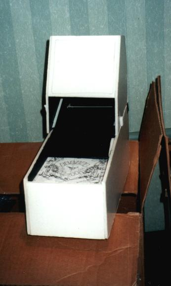
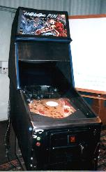
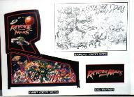
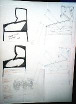
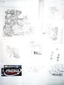
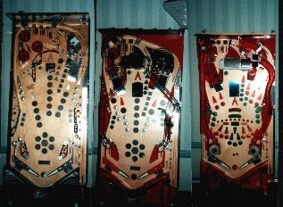
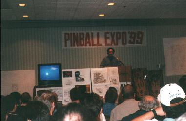
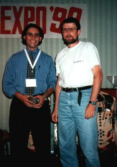
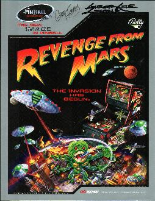
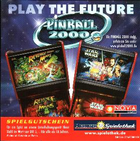

# Pinball2000.de Revenge From Mars history

> [!NOTE]
> Preserved from <https://www.pinball2000.de/rfm_his.htm> on `2026-11-11`. This Markdown is a readable derivative; `raw/` contains the captured evidence.

History of Pinball2000 and Revenge from Mars:
(**Version 3.01** added many Sketch Links!!)

In the meantime I got the tape of the famous George Gomez speech at pinball expo 99 from dutch pinball association (Kellie S., where is your tape that I already payed 2 years ago?!). I want to use much info from this speech to put it here. I still have only little time so i first concentrate on the general and the tech section and continue with this section later. Martin

**As I do not have the Speech tape I found I good link to POA, where the members recorded most of George Gomez Speech! Find the english version**[here](https://www.pinball2000.de/new_making_of_pin2000.htm)**and hopefully soon my german translation**[here](https://www.pinball2000.de/new_making_of_pin2000_deutsch.htm)**.**

One Remark (FAQ): The first RFM machines delivered to germany all had no 'spot on the slingshots'. These spots (one on each slingshot) illuminate the central playfield area or, like in case of my RFM, spot on the wobbeling martians mounted at left and right side of playfield. The first RFMs in germany had a (german) note inside the manual, that the error message for these spot lamps can be ignored, because these lamps were not installed in that particular machine. If you own one of these playfields and want to upgrade: Right/Left Slingshot Spotlight Item 28B/18B Lamp Assembly # 04-12860-2 Bulb #555 (thanks to Jeff Rose)

RFM was the first Pinball machine of new WMS Pinball2000 technologie.
It was created by george gomez and a lot of other genius people from WMS pinball division.

t.b.c.

 This was the first model, that gave george gomez the inspiration of pinball2000. It is only 10 inch long!
I

 This was the first holo pin with an NGG whitewood playfield and a video pict. that came out of georges old AMIGA computer

 Different blueprints of first Pin2000/RFM ideas.

[Big Sketch of cabinet Design!!:](assets/rfm_sketch_big.jpg)

[Big Sketch of cabinet art!!:](assets/rfm_sketch2_big.jpg)

[Big Sketch of RFM scenes and Martians!!:](assets/rfm_sketch3_big.jpg)

[RFM Modes Lady Sketch:](assets/rfm_sketch_mode.jpg)

[Big O Beam Sketch:](assets/rfm_sketch_bigobeam.jpg)

[Drive In Demolition Sketch:](assets/rfm_sketch_drivin_d.jpg)

[Weapon Envy Mode (later renamed):](assets/rfm_sketch_weapon_envy.jpg)

[Martian Sketch:](assets/rfm_sketch_martian.jpg)

[Soldiers Attack Sketch:](assets/rfm_sketch_soldiers.jpg)

There are at least 6 different stages of RFM playfields known to me.

1) Fullsize Whitewood with 'Ball Elevator' and nearly no ramps (see pic below)
2) PIN2000-sized whitewood with black metal ramp (see pic below)
3) PIN2000-sized whitewood with final red ramps (see pic below)

There are at least 3 stages of playfields than can (could) be found on location:

4) Playfield without spots on slings, Paris in Peril in left group of actions (pic follows soon)
5) Playfield without spots on slings, final print
6) Playfield with spots on the slings.

 Different RFM prototype boards. Notice, that the first had still the regular size.

 George Gomez during his famous speech on pinball expo 1999.

 That is george (and me on right side...).

RFM flyer signed by george and Greg Freres, who did backglass artwork (John Y. did the side).

Here a picture of both Pinball2000 machines on a freeplay voucher.

The next Pinball2000 game was Star Wars. Wizard Blocks and playboy were started, but never completed by WMS pinball. Maybe some day we see them finished by somebody else....

to be continued

PS: George, if you ever read this, please give me a feedback and maybe some more information.
