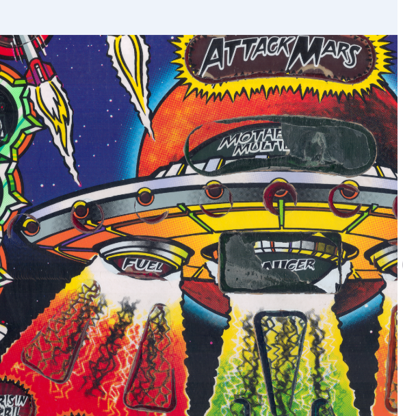
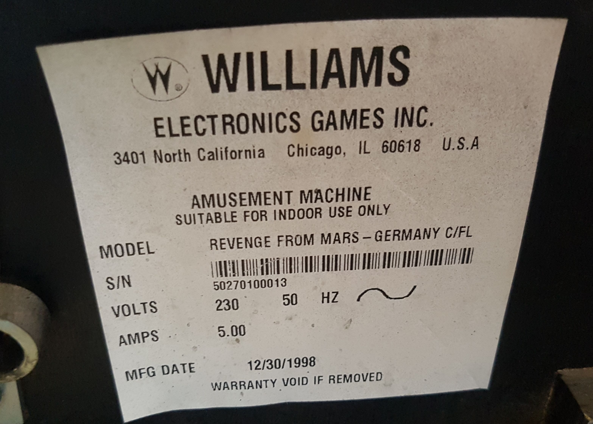
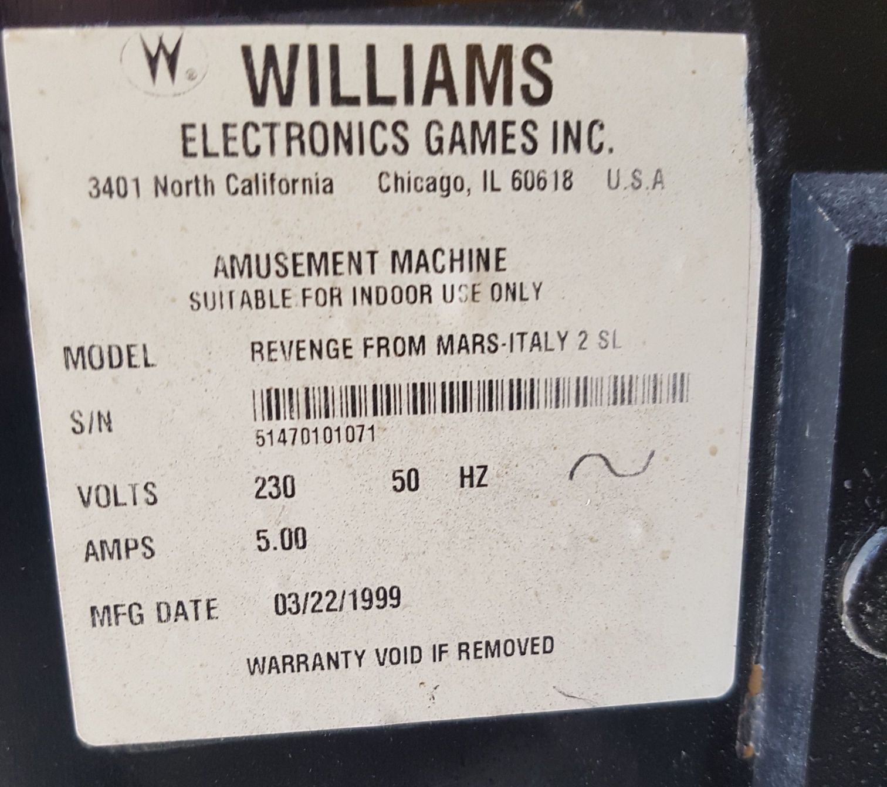

# Pinball2000.de RFM notes and FAQ

> [!NOTE]
> Preserved from <https://www.pinball2000.de/rfm_misc.htm> on `2026-11-11`. This Markdown is a readable derivative; `raw/` contains the captured evidence.

 Hint: Scroll down to find all RFM infos or use the Tags!

Misc. Information about RFM:

Version 3.01 - add tags, add action buttons

[1) Easter Egg](https://www.pinball2000.de/rfm_misc.htm#Easter Egg)
[2) Ethernet](https://www.pinball2000.de/rfm_misc.htm#Ethernet 1)
[3) Attack Mars Points](https://www.pinball2000.de/rfm_misc.htm#Attack Mars Points)
[4) Slow Animations](https://www.pinball2000.de/rfm_misc.htm#Slow Animations)
[5) Game Swap Problems](https://www.pinball2000.de/rfm_misc.htm#Game swap Problems)
[6) Playfield Buy](https://www.pinball2000.de/rfm_misc.htm#Playfield buy)
[7) SW Version 1.4 and 1.5 Differences](https://www.pinball2000.de/rfm_misc.htm#1.4 and 1.5 differences)
[8) Martian Bombs](https://www.pinball2000.de/rfm_misc.htm#Martin Bombs)
[9) The Motherships](https://www.pinball2000.de/rfm_misc.htm#Motherships)
[10) Action Button Use on RFM](https://www.pinball2000.de/rfm_misc.htm#Action BUTTONS)
[11) Relabelled MEL Game](https://www.pinball2000.de/rfm_misc.htm#Relabelled MEL Game)
[12) General Information about RFM SW Versions](https://www.pinball2000.de/rfm_misc.htm#RFM_SW_VERSIONS)

**1) Easter Egg & Co**

Easter Egg: Try B R L RR L RRR L L , it shows up the whole PIN2000 crew.

Great: The action buttons allow to flip pages (last score, high score, ...) in standby mode.

**2) Work on Ethernet:**
By Larry Scott

This weekend, I got my RFM up and running on our LAN using the
information at http://members.home.net/ratherplaypinball/rfmnotes.htm
(great site!). We're now attempting to write a frontend for the shell
commands, with the ultimate goal being a frontend that can start a game,
launch balls and use the flippers. This would be combined with a good
webcam and MS Media Server stream to facilitate someone playing my RFM
over the Internet.

The practicality of this, of course, would be limited.. broadband
would definitly be necessary (I have 408kbit upstream capability at
home) .. also a good cam and fast streaming server. Also probably have
to lower the playfield angle a bit.. we'll see. It's more a simple
project just to see if it can be done, and how well it works.

Anyway, the sticking points are game starting and ball launching. It
seems like all the pinevents commands are ignored, as well as the
"start" command. Therefore, while we can use the "flip" shell command
to toggle flipper status, we cannot start a game or launch a ball via
the shell. Are pinevents commands just toggles to enable/disable the
referenced item, or should that command trigger the argument
(game_start, ball_serve, etc)? If current/ex WMS employees know, and
NDA's would prevent a direct answer to these questions, would it be
possible to at least confirm/deny that game start and ball launching are
possible thru shell commands in RFM 1.4?

Regardless of the outcome of this project, the ability to telnet into
the game while it's being played is great, if only for the world of
opportunities one has to mess with their (unsuspecting) friends while
they're playing <Very evil grin>. The game tilt, scenemgr and flip
commands alone can wreak havok on an unsuspecting player :) "Hey! These
flippers are possessed!! Tilt?!?! I never touched it! And why is it
starting Attack Mars already??" Muhahahaa :)

A screenshot from that action can be found under [larrys RFM online shot.](http://www.frpg.org/p2k.gif)

**3) Points for Attack Mars (RFM):**

From RGP 24.5.2000 keith Jonson

On 24 May 2000 20:48:19 GMT, revengefrommars@aol.com (RevengeFromMars)
wrote:
>RFM players, what is the best score you have seen on the Attack Mars mode?

I think my best was 500-525M, but that was when I was testing it, not
necessarily during a real game. I've heard of close to 600M, which
would be getting close to the easily-attainable upper limit. There
isn't really an upper limit, because you could add-a-ball forever and
get piddly points, but you can figure out a reasonable limit as
follows:

Hurryups cap at 25M, 50M, and 250M. Optimally, you'll get 4.5M for
saucers, 25M for attack sattelites, 50M for boss hits, and 150M more
(max) if you quadruple the 2nd stage bonus at its maxed value. So
that gives us:

25M + 200M + 250M + 4.5M + 25M + 50M = 554.5M or so. Switches score
25K, and completing a bank scores 2.5M, so that's where other points
would come from.

**4) Animations get slow when bumping:**

From RGP 6.6.2000

Any one with a revenge from mars notice that the anamations get jerky when
the ball is in the pop bumpers? Or is it just mine? I'll be going down to
the bowling alley to see if the one down there does the same thing too. But
if anyone knows if this is normal please let me know.... (**Brad Kreisler)**
Correct Answer:

The simple fact of the matter is that rendering the screen takes a LOT
of CPU time. By FAR most of the cpu time in p2k is spent drawing and
managing screen objects. The 1 (or 2 if you have 1.3+) effect(s) that
can show up in the jets (bonus X and/or the jet rule) also have a
transparent aspect, so that takes even more cpu time to deal with. I
think I'm pretty safe in saying no mode runs at 60fps, so anything
else you throw up there will just bog it a bit more.
keith Johnson

**5) Problems after RFM->Ep1 Upgrade:**

See [RFM / Ep1 Swap](https://www.pinball2000.de/pin2000_rfm_ep1_swap.html)

**6) Buying a complete playfield:**

If you intend to manage an Ep1->Ep1 upgrade you might get the idea to
buy a new wired playfield. The order-No. is 50070-PL and the price is (was)
$2500, but I do not think this a good idea nor do I think that playfields are
still available. Used ones sell for about 1100$.

**7) Differences between SW 1.4 and 1.5:**

Reported by Jim Hicks at 7.8.2000:

XINA version is now 1.18 - Mon Jun 26 13:01:18 2000 (RFM 1.4 was 1.17,
SW:E1 1.3 was 1.16)

There is a new "Disable Service Credits" adjustment under Game Pricing.

Some defaults in Advanced Pricing have changed:

All Slot X Credit values default to 0. Slots 1,2,3,7,8 formally
defaulted to 25.
The Bill Validator slot default is "None" - was 7.
Coin Meter units default is "Off" was "25".
Slot 1/2/3/4 Credit values now default to 0 (was 25) and are no longer
shown unless "Edit Credit Values" is set to yes.

**8) Martian Bombs:**

When you're in Martian Attack (not the multiball), you can tap the launch
button to kill a Martian, if you have a Martian bomb. This is most useful if
you have one Martian left (the big one) and you drain before killing him -- hit
the launch button quickly to kill the Martian and start Martian Multiball!

In general, I've developed the habit of hitting the launch button when I drain
on RFM, AFM, MM, etc, just in case there's a bomb available to start a
multiball. (Jow Schober, 11 2000)

**9) Motherships:**

What are the different motherships you go up against in RFM? I think
I've seen these:

Mothership
 Grandmothership
 WickedStepmothership
 MotherInlawship
(Jim Swenson)

**10) Action Buttons during RFM gameplay:**

The question arises very often - what function do the action buttons have during RFM gameplay.
They can be used for:

- Selecting Start mode (one out of possible six)
- Selecting a film during Mars Kneads Women - or pressing all buttons to suppress a film
- Selecting an object to be 'beamed' on Alien Abduction - e.g. sportscars have higher values
- In bonus wave mulitball they move the cursor with the multiplier (2x, 3x etc).
- In Martian Bowling you aim with these when you try to pick up a spare.
- very important you need them to select the targets on Attack Mars!!

**10) Action Buttons during RFM gameplay:**

The question arises very often - what function do the action buttons have during RFM gameplay.
They can be used for:

- Selecting Start mode (one out of possible six)
- Selecting a film during Mars Kneads Women - or pressing all buttons to suppress a film
- Selecting an object to be 'beamed' on Alien Abduction - e.g. sportscars have higher values
- In bonus wave mulitball they move the cursor with the multiplier (2x, 3x etc).
- In Martian Bowling you aim with these when you try to pick up a spare.
- very important you need them to select the targets on Attack Mars!!

**11) Relabelled MEL Game Found:**

In January 2024 René Klaris contacted me and told me, that he got an RFM early MEL Game.
The game was very much used up as it seems to have done tons of plays on location in Italy.
Major Playfield Usage on this game:

 I scanned some areas of my MEL game for René so he could restore his game.

An amazing fact of this game is, that it seems to have been relabelled by NOVA Games, the European Importer
The early MEL label was found inside the cabinet, the later label on the outside back

Early Label of this game as German Version MEL Game 0013 inside the cabinet

 Later Label of this game as Italian 2-Slot Version 1071 outside the cabinet

 I have no idea what is behind this strange thing of relabelling games. My MEL game was scrapped by NOVA Games.

**12) General Information about the RFM SW Versions:**

As there are multiple RFM SW versions available please find a short overview here

 RFM SW Version 1.5: Last version officially released by WMS
 RFM SW Version 1.6: Version released post the WMS closedown by the WMS SW team, has bug fixes
 RFM SW Version 1.7: Version released post the WMS closedown by the WMS SW team, needs more RAM (for tournament usage)
 RFM SW Version 2.5: Version released by [Mypinballs Homepage](https://www.mypinballs.com/) Last version that works with regular HW.
 RFM SW Version >=2.6: Version released by [Mypinballs Homepage](https://www.mypinballs.com/) Needs HW changes (for more balls) to work
