# Pinball2000.de RFM prototype differences

> [!NOTE]
> Preserved from <https://www.pinball2000.de/rfm_proto.htm> on `2026-11-11`. This Markdown is a readable derivative; `raw/` contains the captured evidence.

**RFM Prototype Differences:**

**Version 2.00** for pinball2000.de

There were several RFM machines build with a prototype playfield and cabinet that were used on test locations and shown on ATEI in London. As the playfield layout for the tasks (BigOBeam, Paris...) changed (I suppose with SW version 0.5 or even less), I suspect that most of these prototype machines were smashed or whatever. With great luck I got into posession of a prototype machine in parts that was delivered to europe (france version). This machine is still not complete (monitor) but I already took a lot of pics (thanks to Gerhard Goller for the camera - Canon Powershot S10). The sideart of the cabinet and the backflash show for my eyes no visible differences to the series version. Within the cabinet I found only two major differences - the cover for the powerdriver seemed to be a metal cage??? (none in mine but I've seen one) and in series version WMS prepared the tin where the transformer is mounted with an openable hole for ethernet cable output. The playfield has many many artwork detail differences but nearly no mechanical difference that I found. Only reasonable differences are the spots on the slingshots, the cover of the right ramp, which was cut out of one promo plastic, and
the ballguide left to left outlane, which is made out of plastic and is metal in series version.

I found out, that there are different versions of RFM ROMs with different versions of initial game code. I found a version with code
0.6, which already used the final PF layout, and another set that had **0.1** on it (only freeplay), that worked with the prototype layout
of RFM PF. It was really a fun to play that version, as it was much simpler than final RFM release, had many different sounds, replay
possibility on all 4 levels and so on.

The prototype playfield has 5 (GI) lamps less than the final version. Missing are 57A, 48A, 47B and the 2 spotlights on slings.

The following pictures show mainly the artwork differences of the PF.

**Always find the prototype on the left and the series version on the right side**

Cabinet hole for ethernet on series version

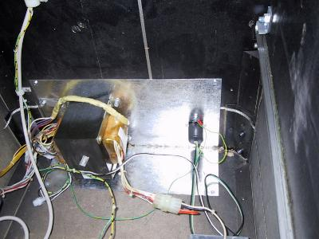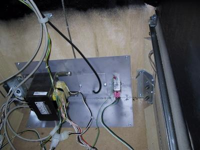

Ramp cover made of the promo plastics in series version

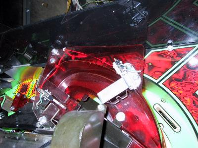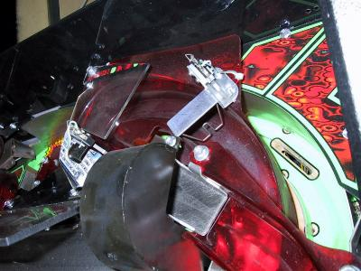

The upper playfield area color green begins later on series version. The center Targets are flat!

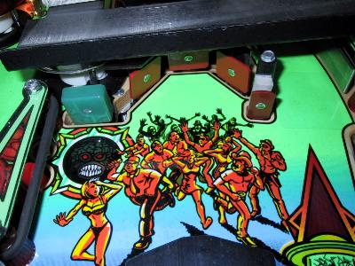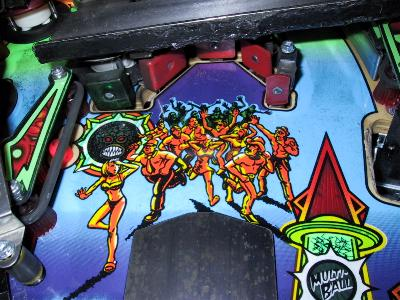

The Left return lane contains trademarks and no longer the Joe Dillon memory

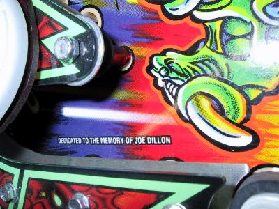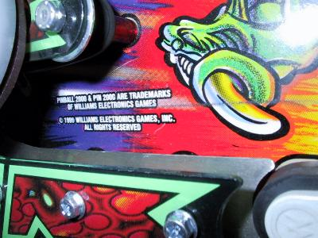

The right return lane containe (C) 1998 on proto!!:

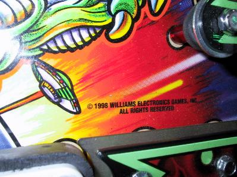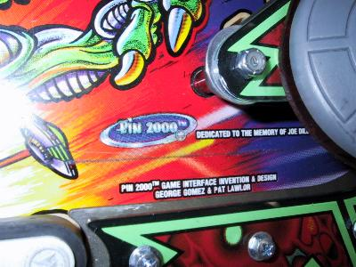

The Drains look much better on proto with Drain-O BEAM:

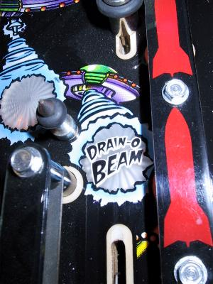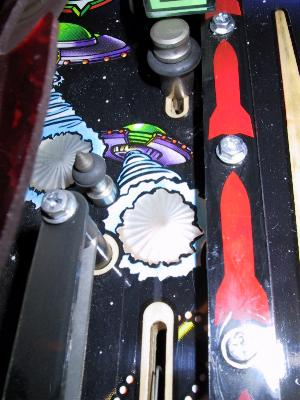

The Stroke of Luck hole has now an inscription:

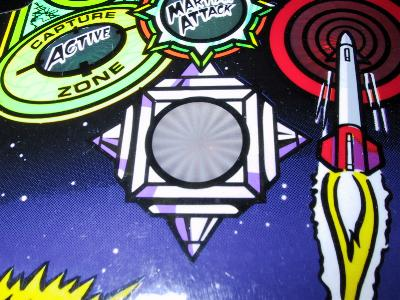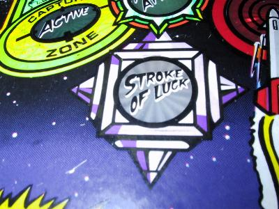

The engine beam of martian saucer (I find proto much better):

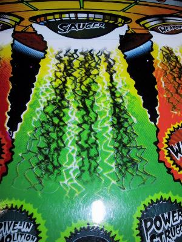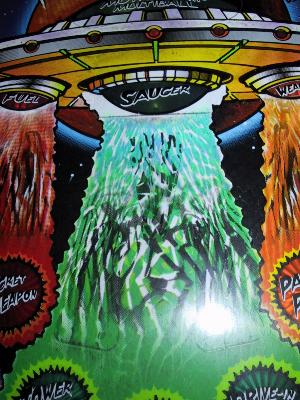

The complete task section on [prototype](assets/rfmp_atask_p.jpg), totally different than on [series](assets/rfmp_atask_s.jpg)version.

The left task section.

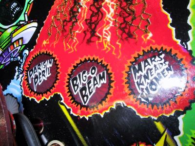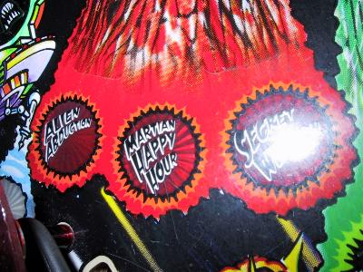

The center task section, even the color is different (prototype with 'Siemens' color).

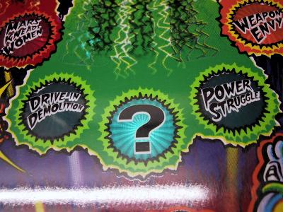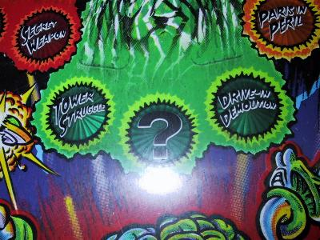

The right task section.

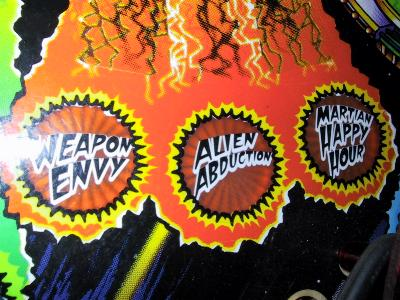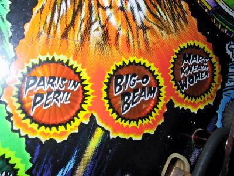

The credits of Pin2000 crew did change.

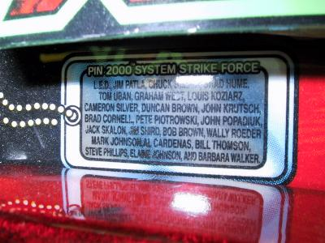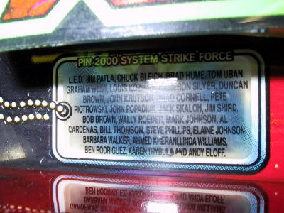

To be continued. M.Wiest
