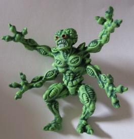

# Pinball2000.de RFM technical information

> [!NOTE]
> Preserved from <https://www.pinball2000.de/rfm_techinfo.htm> on `2026-11-11`. This Markdown is a readable derivative; `raw/` contains the captured evidence.

Technical Infos and problems Revenge from Mars specific:

(Version 2.04)

Hint: Scroll down for all infos or use the taglist

General Pinball2000 technical infos can be found [here.](https://www.pinball2000.de/Techinfo.htm)
General Pinball2000 troubleshooting infos can be found [here.](https://www.pinball2000.de/troubleshooting.htm)

**RFM Specific Problems and Solutions:**

[The RFM Software Bugs](https://www.pinball2000.de/rfm_swbugs.htm)

[The Autofire Bracket](https://www.pinball2000.de/rfm_techinfo.htm#Autofire_Bracket)
[Autofire does not fire properly](https://www.pinball2000.de/rfm_techinfo.htm#Autofire_not_fine)
[Stroke of Luck shoots between flippers](https://www.pinball2000.de/rfm_techinfo.htm#Stroke_Of_Luck_Aims_Wrong)
[The skip ramp does not come down](https://www.pinball2000.de/rfm_techinfo.htm#Skip_Ramp)
[The flippercoils got burned](https://www.pinball2000.de/rfm_techinfo.htm#Flipper_Coils)
[Microswitch problems](https://www.pinball2000.de/rfm_techinfo.htm#Microswitches)
[Standup targets defect / causing othe switch problems!](https://www.pinball2000.de/rfm_techinfo.htm#Standup Targets defect:)
[Playfield wood braking](https://www.pinball2000.de/rfm_techinfo.htm#Standup_Target_Wood)
[Flipper arms broken](https://www.pinball2000.de/rfm_techinfo.htm#Flipper_Arm_Broken)
[Cracks in Stroke of Luck area](https://www.pinball2000.de/rfm_techinfo.htm#SOL_Cracks)
[Ball through opto](https://www.pinball2000.de/rfm_techinfo.htm#Ball_Through_Opto)
[Lamp insert problems](https://www.pinball2000.de/rfm_techinfo.htm#Lamp_Insert_Problem)
[Stroke of Luck Oppto](https://www.pinball2000.de/rfm_techinfo.htm#Stroke_Of_Luck_Opto)
[Spotlight Missing?](https://www.pinball2000.de/rfm_techinfo.htm#Spotlight_Missing)
[The shooterlane switch](https://www.pinball2000.de/rfm_techinfo.htm#Shooterlane_Switch)
[The Stroke of Luck Popper](https://www.pinball2000.de/rfm_techinfo.htm#Stroke_of_Luck_Pop)

****Autofire bracket brakes:****
I have now seen it on 2 RFM playfields that the autofire bracket, that holds the autofire coil, brakes at the point where it was bended. I checked it on another still working playfield and also that bracked was very very weak! If you ever operate an RFM you should put one bracket into the machine for quick maintenance (Partno: 01-14618.1).

****Autofire does not work poperly:****
I have seen it on many RFM machines that the autofire has often problems to shoot the ball all the way up to the top of the playfield. In some cases this is caused by problems with the microswitch, that prevents the ball from leaning to the plunger. In most of the cases it is caused by the autofire bracket, that shoots the ball not in the center but higher than that. I is a little like 'Trick Billiard', this shoot makes the ball jump a little. I put a thicker washer between the autofire bracket and the playfield - that make the thing work perfectly.

****Stroke of Luck shoots ball directly between flippers:****
On many RFM it very annoying that balls coming out of the stroke of luck hole are shot directly in the middle of the two flippers and drain. I found a very easy way to avoid this - only bend the popper bracket on the right side a little bit into your direction - that makes the ball coming up the bracket roll a little bit to the left side of the bracket and hit the slingshot or the left flipper.

****Skip-Ramp does not go down:****
I currently try to find out what the best repair is. The Plunger that errects the ramp locks up in the coil. First preliminary tip: Put a tape to the coil stop (where end of pluger stops) - that prevents the plunger for coming into the coil too deep and lock. I also tried a spring (like the autofire spring) between the coil-center bracked and the plunger - but it still get stuck sometimes.

****Burnt Flipper Coils:****
RFM Software Version 1.0 gave to much power to the flipper coils in 50Hz Countries that let the coils burn. Use Software Rev. 1.1 or higher!

****Bad microswitches:****
My RFM had at least 2 bad microswitches. Although normal cherry switches were used these seem to have a low quality and often get stuck.
In most cases the switches need to be replaced - an adjustment does not help.

****Standup Targets defect:****
Two StandupTarget problems were reported. 1) Contacts are broken or instable - contact blades are shifted and no longer contact each other. 2) Targets become low resistance (about 70 ohm) which causes different switch matrix problems that cannot be located properly - only known correction for this is a replacement). [See a pic of central target section.](assets/crack_central_targets.jpg)

****Standup Targets - woodscrews break off Playfield:****
This seems to be one of the biggest problem of RFM. Already reported by several people. Trying to catch a photo and hints for repair. Problem is, that several standups on all sides of playfield (Martian Targets and center targets) were fixed like normal with woodscrews but that the wood within these areas is of bad quality and cracks in long clefts. [See martian targets on left side,](assets/crack_martian_left.jpg)[and martian targets on right side](assets/crack_martian_right.jpg)
See other cracked Martian playfields: [2](assets/crack_martian_2.jpg) ; [3](assets/crack_martian_3.jpg) ; [4](assets/crack_martian_4.jpg) ; [5](assets/crack_martian_5.jpg)
A solution has been mailed in by David aka “pinhead” from Belgium, follow his text below.
As soon as the beginning of a crack does appear:
- Remove the playfield from the cabinet and turn it upside down.
- Remove all the targets in the region
- Sand the whole region very lightly with high grain density sand paper (100 or more) to remove dust, nicotine, grease, ....
- Be careful to remove all dust, especially from inside the crack (use a air-blower spray for this; “Druckluftspray” in German; or a vacuum cleaner with a very small aspiration tube)
- Take white liquid wood glue. If needed, dilute it with a small quantity of water to make it very liquid (in a tea spoon, for example).
- Carefully drip the glue inside the cracks, and on the wood around, but take care not let it drip on the inserts, and that it not come out on the playfield side. If this happens, remove immediately the excess of glue with a soft wet piece of fabric. If the crack runs through a screw hole, you may drip a small amount of glue in the screw hole as well.
- Let the glue dry as specified by the glue maker, but give some extra hours if you diluted it with water. I think most of the time, allow 24 hours just to be on the safe side.
- Reinstall the targets, but do not overtighten the screws !

****Broken Flippers or Flipper Links**:**
Bad quality parts! Often need replacement of both! At least seen at RFM very very often.

****Stroke of Luck Hole Crack**:**
Playfield wood/painture crackles at left and bottom side of that hole. Secure it with a protective sheet! Here a pictures of [beginning problems,](assets/crack_stroke_of_luck_beginning.jpg)[another SOL](assets/crack_sol_2.jpg) t.b.c.

****Ball Through Opto**:**
 From RGP: On power up or whenever you open and close the coin door the game automatically recycles the balls. The game works perfectly but recycles upon each new powerup unlike my other two RFMs. Result: Was a bad trough eject opto number 41. Brand new machine. Ron Salny

****Playfield Lamp Insert Problem:****
(reported by ronald knor)

When I started cleaning my RFM, I noticed sharp edges in the middle area of the playfield. Inspection revealed that the "attack mars" and "saucer" lenses are not correctly mounted in the wood (I think the holes are drilled to deep).
**When I slightly press on them they seem to bend, cracking the paint on the edges.**
You might say: why the hell do you press on the lenses then? But they were already cracked because the same thing happens when a ball bounces over them.
On some other lenses in the middle section I can also feel small edges, but they won't cause trouble.
I attached some photos, made with my digital videocamera. I'ts not as sharp as a scanned photo, but a lot quicker!
This is what you see: 1) [the attack mars crack.](assets/crack_attack_mars_normal.jpg)2) [the same thing, zoomed out](assets/crack_attack_mars_zoom.jpg)
3) [the saucer section](assets/crack_saucer_normal.jpg) ( hey, a startrek quote!) You can see the crack running all the way to the left.
4) [the saucer zoomed in](assets/crack_saucer_zooml.jpg), you can see a piece just about to come off.
I already got a good solution from Rob Buisman:
Use transparent glue and secure the faulty lenses under the playfield. (sounds good to me, at least they won't bend anymore)
Then I only have to find a way to prevent the cracked paint from peeling off.
I'm quite sure this is not the only machine with this problem. Probably a whole series has been produced with these faulty lenses.
Please print this on your website with a BIG font, so others may be in time to save their pin!
Maybe I used to many Martian Bombs????
Comment Martin Wiest: Protect the hole area with protective mylar. I will do this soon, also because of 'stroke of luck'.

****Stroke of Luck Opto:****
****(****john.butler RGP 18.7.2000)

> Well the RFM I bought could not make it all the way through the party
> without having a problem. Guess that is what I get for not having time to
> shop it first. The kickout on the right side no longer detects a ball in
> the hole, so you have to wait for ball search to discover it.... Opto problem????

Possibility 1:
Forget the opto, I bet you it is OK.
I have a RFM and have experienced this problem. My original thought was
that my optos were bad. I swapped them with known good optos (which you can
borrow from your machine) and they tested good in every location except that
particular kickout. My problem was with a switch located just next to that
switch. Go into your switch test, (remove your balls, it makes things
easier) and look for a green square located next to that switch and repair
it.I bet you your problem will be corrected. This repair came directly from
Williams. He was very sure of this, so I bet you he has seen this problem
before.
If you want to E-Mail me your phone number, I'll stand in front of my
machine and try to walk you thru it.
Good Luck (Harry Williamson)

Possibility 2:
.... btw, it's probably not the opto.
more than likely the left-hand red target on the back-center shot (behind
the flip ramp) is shorted, replace w/new and you should be ok.
(Jonathan Deitch)
This is the same problem like noted [above.](https://www.pinball2000.de/rfm_techinfo.htm#Standup Targets defect:) Jonathan was right, this was the
problem..

****Spotlights missing?****

Here you go! RFM spotlight part Nos.

Item 18B
Lamp Assembly Part # 04-12860-2
Bulb Type #555
Bulb Part No 24-8768
Socket Part # Not sold separate
Description Left Slingshot Spotlight

Item 28B
Lamp Assembly Part # 04-12860-2
Bulb Type #555
Bulb Part No 24-8768
Socket Part # Not sold separate
Description Right Slingshot Spotlight

NOTE: These are identical units, only the item no is unique

****Shooter Lane Switch****
(from Paul Haupt RGP 31.5.2001)
This is no big deal, but I just had to replace my switch in the shooter lane
on my RFM, since the trip wire on the old switch actually broke off from
it's weld. Upon closer examination after I installed the new switch, I
noticed that when the ball is ejected into the shooter lane from the ball
trough, the switch is hit almost directly from the side. The switch is
still working properly, but it just seems that this was not a great design.
Has anyone else experienced this? Has anyone ever moved their switch closer
to the plunger to avoid such a direct hit from the ball ejector?
(M.Wiest: This is also a very common problem)

Good answer from Todd George:
I noticed this also, so I just bent the wire on the switch on my
machine so that the "actuator wire" did not stick up as high. It
still actuated the switch, but didn't get pounded as hard.

****Stroke of Luck Popper****
(from Paul Barber, Mail 1/2003)
My game had a really trashed popper bracket on the SOL hole (after 37000 plays) and this was the fix:

Best fix I found is to buy Kerry Stair's Monster Bash popper bracket and a Monster Bash armature / plunger and this will fix the problem with no other modification needed!
The plunger is about US $6 from Marco specialties, who also sells Kerry's bracket at US$ 50-60. You can buy the bracket direct from Kerry too. Kerrys bracket is in stainless steel and is much stronger / better looking than the original.
Paul.

to be continued by  Wiest.
