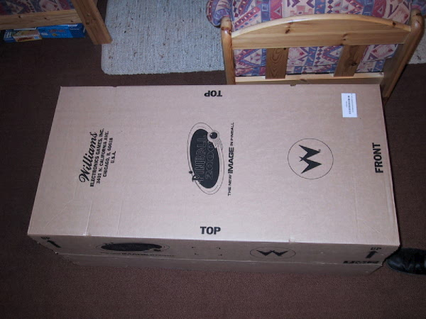
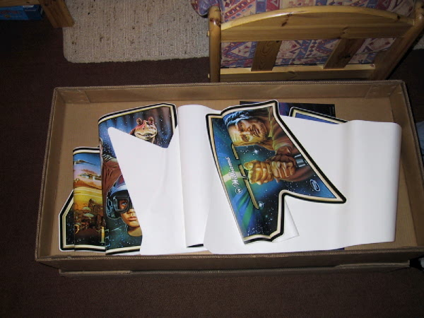
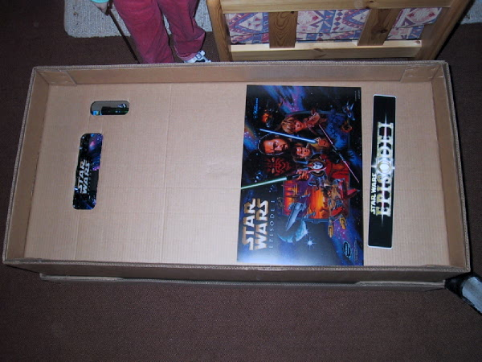
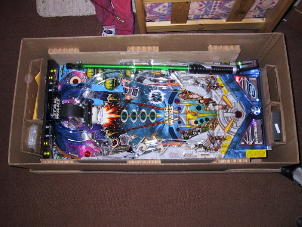
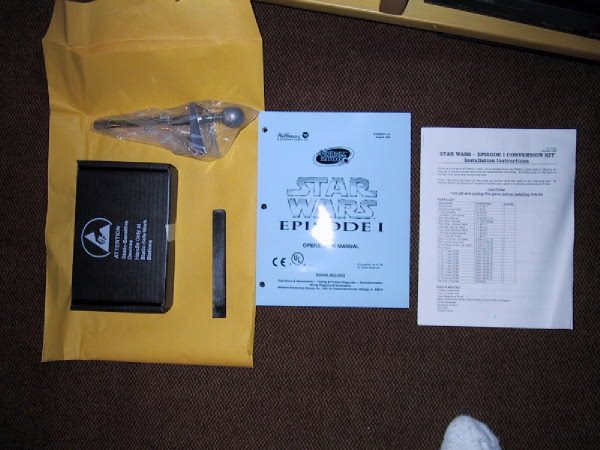

# Pinball2000.de SWE1 conversion kit contents

> [!NOTE]
> Preserved from <https://www.pinball2000.de/ep1kit.html> on `2026-11-11`. This Markdown is a readable derivative; `raw/` contains the captured evidence.

The Content of the Starwars Epsisode1 Conversion Kit:

Version 1.01
Embedded images and links were mixed to reduce loading time!

See the magic box:

[The box sticker of my kit](assets/ep1kit02.jpg)

And open it:

[Right side of top sticker](assets/ep1kit04.jpg) ,
[Left side of top sticker](assets/ep1kit05.jpg) ,
[Left side cabinet sticker](assets/ep1kit06.jpg) ,
[Right side cabinet sticker](assets/ep1kit07.jpg) ,

come nearer to the playfield:

[Next step](assets/ep1kit09.jpg)

and the final sight

This is included in addition to the things seen above:
Manual, ROMs, PRISM Opening Tool, engl. Installation Instruction, Shooter Rod,
the Promo Plastic Bag seemed to be out....

|  |  |  |
| --- | --- | --- |
| [Martin Wiest](mailto:mr.startrek@gmx.de) - Started: 08.03.2000 - (German date format) |  |  |
|  |  |  |
