# Pinball2000.de SWE1 prototype differences

> [!NOTE]
> Preserved from <https://www.pinball2000.de/ep1_proto.htm> on `2026-11-11`. This Markdown is a readable derivative; `raw/` contains the captured evidence.

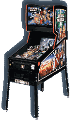

**Ep1 Prototype Differences:**

Version 1.03 Hint: Scroll down to find all infos

There were several EP1 MEL games build (around 25) with a little different playfield. The only direct remarkable difference is the outhole above the bumpers, which lateron was replaced by a single orange button. Looking more thouroughly around the playfield you will find some more differences and it is even clear, that a different print run was issued for the series playfield - although there are not really remarkable differences - they are there. As I own a very late kit playfield and a MEL game I was able to take some pictures of the differences that I found - I am shure that there are more.... come and help me to find them. It is also fun to play Ep1 with the very old SW version 0.4, which is stored in the ROMs and can be enabled with the option 'Disable update game code'. When doing so you are able to find the coil of the above mentioned outhole also in the testmenu - yes, the coil still works with version 1.4, but you can't see and test it in testmenu. Also some sounds and sequences are different in 0.4 code - e.g. the match sound!!

The following pictures show mainly the artwork differences of the PF.

**Always find the prototype on the left and the series version on the right side**

The remarkable difference - outhole above the bumpers
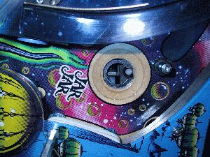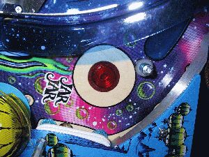

Another obvious difference, proto uses old style targets, series uses 'RFM' style targets
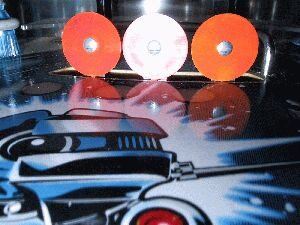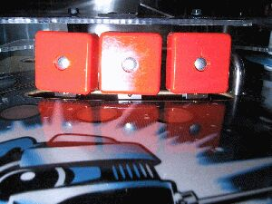

The bracket for Droid Fighter on series gives the upper fighter a higher position
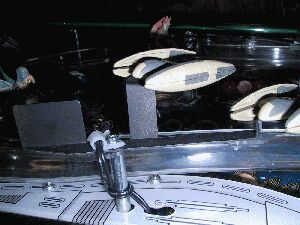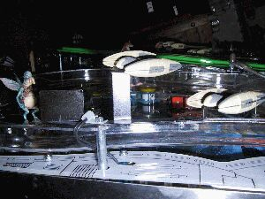

The diverter of the MEL games looks a bit handcrafted and is grey
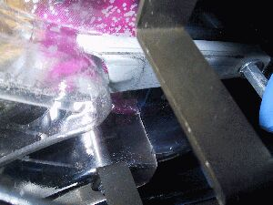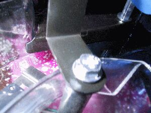

The anti ball hang posts are blue on series version
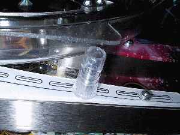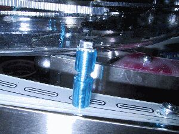

The center ballgate is black on series and silver on MEL game
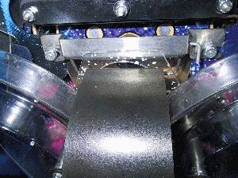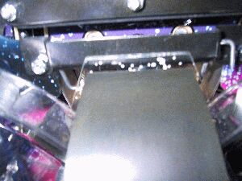

The MEL bumpercaps are violett, the kits bumpercaps are yellow - what has your game?
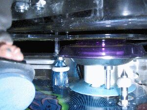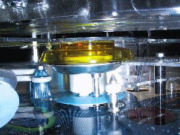

In the left outlane you find a different printing for alternative post mountings
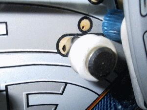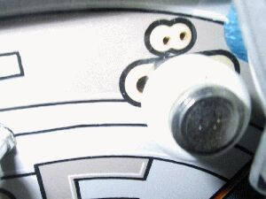

The copyright under right return lane has identical content, but 3 lines on MEL, 2 on series
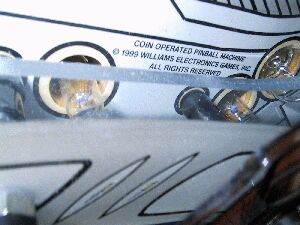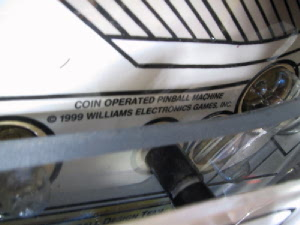
(sorry, need to retake series picture)

To be continued. M.Wiest Version for Pin2000.de
