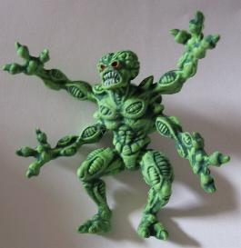

# Pinball2000.de SWE1 technical information

> [!NOTE]
> Preserved from <https://www.pinball2000.de/ep1_techinfo.htm> on `2026-11-11`. This Markdown is a readable derivative; `raw/` contains the captured evidence.

****Technical Info and problem solution Starwars Ep1 specific:****

(Version 2.02)

Ep1 uses the new WMS Pinball2000 technologie.

Use the tags or scroll down for all infos

General Pinball2000 technical infos can be found [On my techinfo pages.](https://www.pinball2000.de/Techinfo.htm)
General Pinball2000 troubleshooting infos can be found [On my troubleshoot pages.](https://www.pinball2000.de/troubleshooting.htm)

**Episode1 Specific Problems and Solutions:**

[The Episode 1 Software Bugs](https://www.pinball2000.de/ep1_swbugs.htm)
[Bad Microswitches](https://www.pinball2000.de/ep1_techinfo.htm#Microswitch)
[Bad Optos](https://www.pinball2000.de/ep1_techinfo.htm#Optos)
[Shield gets Stuck](https://www.pinball2000.de/ep1_techinfo.htm#Shield)

****Bad microswitches:****

Up to now only the C3PO microswitch was reported in RGP to have problems.
But the latest Ep1 that I have seen had a lot of microswitches misadjusted -
but none of them was defective

****Bad Optos:****

I once played an Ep1 where the central mirror target opto had a big problem.

****Central Shield gets Stuck:****
I found it now on at least 2 playfields that had some thousand games on it-
the center shield can no longer fall down all the way and gets stuck before.
The ball no longer hits the (2) rubbers but the shield metal - which makes
a big difference in gameplay as the ball bounces back much slower.
Unfortunately the metal starts looking ugly soon.
I did not find a solution so far - but have time soon.

to be continued by Wiest... 
