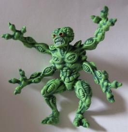

# Pinball2000.de general technical information

> [!NOTE]
> Preserved from <https://www.pinball2000.de/techinfo.htm> on `2026-11-11`. This Markdown is a readable derivative; `raw/` contains the captured evidence.

Technical Information about Pinball2000:
**Version 3.09** Add Markus description of monitor

Here you find general technical information about Pinball2000.
General Troubleshooting infos can be found on [the Pinball2000 troubleshooting pages.](https://www.pinball2000.de/troubleshooting.htm)
Specific items about RFM or EP1 can be found on the specific RFM/Ep1 Techpages [RFM](https://www.pinball2000.de/rfm_techinfo.htm) , [Ep1](https://www.pinball2000.de/ep1_techinfo.htm)

RFM and EP1 use the new WMS Pinball2000 technologie, the successor of the famous Williams WPC system . The game main control is done by a BAT format PC mainboard with Cyrix MediaGX processor (onboard graphics used!!). The Software and the DCS-2 sound hardware is located on the so called PRISM board - a Williams development which is a PCI card located in the only used PCI slot of that mainboard. For a good HW picture see [Pin2000 Programm Update in German .](https://www.pinball2000.de/nov_juni.htm) The control functions of lamps, switches and Solenoids are located on a new power driver board, that is mounted in the cabinet and connected to the parallel port of the PC mainboard. Additional tech info in german can be found under [Pinball2000 Technische Informationen.](https://www.pinball2000.de/nov_april.htm) Many information about the PIN2000 operating system, XINA, can be found at [Jack A. Robinsons Revenge from Mars Notes](http://members.home.net/ratherplaypinball/rfmnotes.htm)

****Technical Details:****

[The PRISM Card](https://www.pinball2000.de/techinfo.htm#PRISM)
[Game Software Update](https://www.pinball2000.de/techinfo.htm#SW_Update)
[The Media GX PC Mainbord and CPU](https://www.pinball2000.de/techinfo.htm#Mainboard)
[The Pinball2000 Monitor](https://www.pinball2000.de/techinfo.htm#Monitor)
[The Pinball2000 Powerdriver](https://www.pinball2000.de/techinfo.htm#Powerdriver)
[The Coin Acceptor](https://www.pinball2000.de/techinfo.htm#Coin_Acceptor)
[The Service Concept](https://www.pinball2000.de/techinfo.htm#The_Service_Concept)
[Pinball2000 Game Swap (RFM/Ep1)](https://www.pinball2000.de/techinfo.htm#Gameswap)

****The PRISM Card:****

It includes 8 **game specific** WMS ROMs that contain the images and other fixed parts like a first code boot version You might read them out when you have an EPROM Programmer capable to read 27C322 (32MBit) and even the double size of these EPROMs (64MBit). Unfortunately the biggest available EPROMs are 27C322 (42 pin EPROM) and they cost about 85$ each. On some SWE1 games one EPROM can be found as a ROM replacement, but only for the 32Mbit ROMs, not for the 64MBit ones. There exists no replacement for 64MBit ROMs. Additionally the PRISM contains flash PROMs for the update sound and game code and several ASICs for the PCI-control, the DCS-2 Soundhardware (signal processor DSP) and some glue logic. There also houses a Li-battery (BR2325) on the PRISM card for a buffered RAM, storing the big amount of statistic data, adjustment data and date/time. To prevent from a total data loss when this battery becomes empty some of the data is also stored within theflash PROMs (e.g. the total earnings).
More PRISM Card details can be found on[the PRISM info page.](https://www.pinball2000.de/prism_infos.html)

****Game Software Update:****

There are 3 ways to update the Pinball2000 game software. I prefer the last one using a PUB Card:

- Change the complete PRISM card to a one with newer Software on it
 This is nice but not many people have multiple PRISM Cards

- Update the game via Laptop, serial cable and Pinball2000 upgrade manager
 This option needs the P2K SW Update Manager (available in the web) and a PC with WINDOWS 98,
 which is barely to find these days. Markus Pautz in Munich tried to do it on a newer Windows
 PC using WINDOWS 7 - find his description text in the following PDF [P2K Update Help from Markus](assets/Pinball2000 Update.pdf)

- program a [PUB (prism update) Card](assets/tech_pub_card.jpg) in your PC and plug it into the Pinball2000 game
Details (in german) can be found [here](https://www.pinball2000.de/nov_juni.htm)
For Problems with update see also [RFM/ Ep1 Swap](https://www.pinball2000.de/pin2000_rfm_ep1_swap.html)

 German instruction how to do PUB Update. Anleitung zum Pinball2000 Software Update mit PUB Karte: The NOVA Games SW Update text [Pin2000 Programm Update in German](https://www.pinball2000.de/nov_juni.htm)
 My own instructions how to update Pinball2000 with a PUB card: - Flipper ausschalten
 - Kopfscheibe rausnehmen
 - Rechner nach vorne rausziehen soweit es geht ohne dass er rausfällt und runter hängen
 - Deckel vom Rechner öffnen - ab nun eine Hand am Rechner so oft es geht, damit man geerdet ist so gut es geht
 - Vorne im Rechner erkennt man die beiden schwarzen ISA Slots
 - PUB Karte aus der Antistatik Tüte und mit den Bauteilen nach hinten in einen der ISA Slots stecken die Karte muss ganz nach unten gehen in dem Slot
 - Nun den Flipper einschalten - beim Hochfahren sollte er die PUB Update Karte erkennen und von der Karte starten - es wird dann die Game-SW und dann die Sound SW aktualisieren
 - Wenn der Flipper sagt dass das Update beendet ist dann den Rechner ausschalten mit dem roten Knopf die PUB Karte rausziehen und wieder in die Antistatiktüte schieben
 - Den Rechner wieder einschalten und checken ob der Flipper hochläuft - wenn alles OK ist Flipper ausschalten, wenn nicht OC ausschalten und Update wiederholen.
 - Wie gesagt bitte so oft wie möglich das Metallgehäuse des Rechners anfassen um Statik zu vermeiden

****The PC mainboard and Media GX CPU:****

PB2K uses a PC mainboard in BAT formfactor with Cyrix Media GX processor on it. This cyrix processor and his cyrix bridge (CX5520) are obligatory for PB2K and not replaceable by any other PC mainboard or processor! Boards with a CX5510 bridge do start the P2K game code, but cannot display the P2K video output when the game has started. Boards with a CX5530 bridge don't work either. In 1999 these CX5520 boards (e.g. ST MGXM) did cost about 120 USD on free market and costed 300 USD as original WMS part.
 The Lithium Battery used on the mainboard is responsible for keeping date and time. On all boards I have seen a CR2032 standard cell is used (cheap, 1$). Replace it when time is stalled or lost. [Jeff Arnold](mailto:Jeff Arnold [jarnold@mainstream.net]) sold some new boards to the community in 2001, but today you need to search long to find used ones.
See a P2000 prototype board, a gift from george gomez to michael voss and me at expo 99 [front side](assets/tech_gxboard_proto_front.jpg) and [back side with 'reject' note by WMS.](assets/tech_gxboard_proto_back.jpg)
The boards used for Pinball2000 series production looks a little bit [different.](assets/tech_gxboard_series.jpg) I know that at least 3 different board types where used.
The PC mainboard, the PRISM card and the sound amplifier are located in an [industrial PC case.](assets/tech_pc_case.jpg)with a poor quality [powersupply.](assets/ps_cover.jpg)

**Hints for a longer and safe operation of P2K motherboard and CPU:**
All original P2K boards that I found so far were jumpered for 233 Mhz operation, that means a busclock of 33 Mhz and a multiplyer of 7. This was done, although many games I found used a 266 Mhz CPU. But is this speed really needed?
RFM works sufficent with 180 Mhz while SWE1 works fine with 200 Mhz. So it is a good idea to reduce the speed, which the causes board and CPU to stay cooler and longer alive. This can be done in the easiest way = reducing the busclock from 33 Mhz to 30 Mhz (that makes the CPU run with 7*30Mhz):
On the Board with version V2.0 inscript you have to change on JP4 from A0 B1 to A0 B0
On the Board named 586GXM-AV you have to change JP2 from 2-4 1-3 to 4-6 3-5
You could also reduce the multiplicator from 7 to 6, but I do not think that this is really necessary.
 Cooooooler gets the CPU, when you reduce the CPU core voltage. Most of the used Media GX CPUs 'need' 2,9V, what is printed on the CPU. In the meantime I found 200 Mhz CPUs, that only need 2,2V. You may want to reduce the voltage to the lowest value, where the CPU still runs stable. Try it!
There are 4 voltage jumpers on the mainboard. They work very simple:
 To a base voltage of 2V the jumper adds 0,1V (=V1 or 1-2) ; 0,2V (=V2 or 3-4); 0,4V (=V3 or 5-6) and 0,8V (=V4 or 7-8).
So the lowest voltage you can have is 2,0V when all jumpers are open and 3,5V when all are set. If you set e.g. V1 and V8, which is the default, you get 2,9V. Have fun with your trial. Addon: When your P2K date no longer runs for shure, replace that CR2035 battery on your motherboard (just 1$).

****The Monitor:****

Pinball2000 uses a 19" CGA color monitor from [ducksan (CGM-1901CW)](assets/duck_sca.jpg) or [Wells Gardener (19K7302) in 2 variants](assets/wells_g.jpg) (click on links to see first page of monitor manual). [Wells Gardener](http://208.170.203.97/wells/index.icl) has no longer PB2K monitors on stock!
For more monitor information and **replacement alternatives!** see the [Pinball2000 Monitor Infos.](https://www.pinball2000.de/pin2000_monitor.htm)

****The Powerdriver:****

The powerdriver looks similar to the formerly used WPC95 powerdriver, but it has multiple innovations:
- Most Coils are controlled with MOS-FET Transistors for more power
- No more GI. Instead of this the number of LAMP columns is doubled so 128 lamps are now switchable by CPU
- A lamp burnt + short circuit detection has been implemented in lamp matrix (capcom had a similar mechanism for good service)
- detection for power loss for several voltages - especially for coil voltage (door open)
 The powerdriver is still assembled without SMD parts for easy maintenance, but an SMD variant had been developed shortly before the WMS pinball department closure.

****Coin Acceptor:****

As far as I know Pinball2000 was delivered to world market only with [electronic coin acceptor (CASHFLOW 330)](assets/coin_ac.jpg) (unlike WPC game, which came to germany mostly with 3 slot mechanical coin acceptors). Pinball2000 also may carry a bill acceptor or instead of this a barcode reader (expo 1999 tournament).

****Service concept:****

There were lots of improvements in the Pinball2000 service concept.
Details in german can be found [here](https://www.pinball2000.de/nov_mai.htm)
All switches, lamps and coils were shown onn the monitor screen during tests.
More Details in english: coming soon

****Swapping RFM with SWE1:****

The official sold SWE1 kit contained:
Manual
ROMs - no PRISM card!!!
Black plastic tool to split the PRISM card
Ball Shooter
Translite
Large Decals for Cabinet and TOP sides and for below coin door.
Playfield
For installation instructions and troubleshooting See [The RFM / Ep1 Swap page](https://www.pinball2000.de/pin2000_rfm_ep1_swap.html)

An RFM kit was never sold by WMS, but used translites/playfields had been sold in Germany as result of RFM game conversions to Ep1.

 to be continued by  Wiest.
