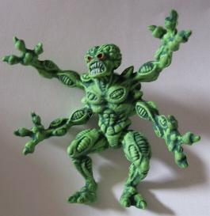

# Pinball2000.de troubleshooting

> [!NOTE]
> Preserved from <https://www.pinball2000.de/troubleshooting.htm> on `2026-11-11`. This Markdown is a readable derivative; `raw/` contains the captured evidence.

Typical Pinball2000 Problems and Solutions:
**Version 3.04** direct link the monitor page
hint: scroll down for all infos or use taglist

Here you find general technical problems of Pinball2000 and their solutions.
Specific items about RFM or EP1 can be found on the specific RFM/Ep1 Techpages [RFM](https://www.pinball2000.de/rfm_techinfo.htm) , [Ep1.](https://www.pinball2000.de/ep1_techinfo.htm)
General technical information can be found on [Pinball2000 Techinfo Page](https://www.pinball2000.de/Techinfo.htm) .

[CPU Fan Problems!!!!!](https://www.pinball2000.de/troubleshooting.htm#CPU_FAN)
[Power Supply Problems!!!!](https://www.pinball2000.de/troubleshooting.htm#Powersupply)
[Pin2000 does not boot](https://www.pinball2000.de/troubleshooting.htm#NO_BOOT)
[Monitor Problems](https://www.pinball2000.de/pin2000_monitor.htm)
[Attention: Driver Board Blown?](https://www.pinball2000.de/troubleshooting.htm#DRIVER_BLOWN)
[Bad Microswitches](https://www.pinball2000.de/troubleshooting.htm#MICROSWITCHES)
[Broken Flippers](https://www.pinball2000.de/troubleshooting.htm#FLIPPERS)
[Ballthrough Opto defective](https://www.pinball2000.de/troubleshooting.htm#BALLTHROUGH_OPTO)
[Speaker Miswired?](https://www.pinball2000.de/troubleshooting.htm#SPEAKER_MISWIRE)
[No Sound at All](https://www.pinball2000.de/troubleshooting.htm#NO_SOUND)
[Static Sound Disturbance](https://www.pinball2000.de/troubleshooting.htm#STATIC)
[PUB Card Loading Problem in a PC](https://www.pinball2000.de/troubleshooting.htm#PUB_LOAD_PROBLEM)
[Battery Problems](https://www.pinball2000.de/troubleshooting.htm#BATTERY_PROBLEMS)

[Processor Cooling Fan:](assets/rfm_fan.jpg)Although WMS used a ball bearings Fan, **the Fans become defect very very quick**. Often after some weeks of operation they need to be replaced. When replacing them remove that foil between cooler and processor and use 'Thermoleitpaste/ thermal conducting paste' instead. I even found a non working fan where the metal block had become so hot, that the metal was now light green instead of the original color that came from WMS dark green.

****Power Supply & its cooling fan:**** As WMS seemed to use a really cheap [powersupply.](assets/ps_cover.jpg) its fan also fails very often. Short time after this the complete powersupply will fail and be [internally burnt](assets/ps_burnt.jpg). So check the PS fan frequently!
**Be careful when you replace the powersupply or test it outside of the machine: The system transformer of P2K transforms any foreign voltage to 110V for the CPU Powersupply, so the powersupply must be set to 110V when used in the machine. If it is set to 230V in the machine, the system will not start (in most cases). If you remove it for test and check outside the game, it must be set to your PLUG Voltage (e.g. Germany 230V). Always check the voltage when you bring back the computer case in your game. ATTENTION: Some operators in Germany replaced the Powersupply with a 230V only version and cabled the power away from the transformer directly to the plug. Buy a new PS for 110V and recable it to the Transformer to avoid any future confusion!**

[Pinball2000 does not boot:](https://www.pinball2000.de/no_boot.htm)
Follow the [link](https://www.pinball2000.de/no_boot.htm) for more information.

[Pinball2000 monitor problems:](https://www.pinball2000.de/pin2000_monitor.htm)
Follow the [link](https://www.pinball2000.de/pin2000_monitor.htm) for more information.

****Bad microswitches:****
 Microswitch problems on both, RFM and EP1 are quite often!

****Broken Flippers or Flipper Links:**** Bad quality parts! Often need replacement of both! I know this for RFM. Valid for Ep1??

****Attention: Driverboard Blown**:**
(reported by****Hans Balk) Hans Balk reported the following weird thing from a customer.
 After poking underneath the playfield the game died he told me. "slam tilt switch stuck" What looked at first glance like a blown LM339 turned out to be a "slightly" more complicated:
 The 50volts that stroke into the LM339 also blew the LS240 after it. And....................... It blew the ENTIRE DATABUS after that one plus some sideparts.
 Total score: 11 blown LS240, 9 blown LS574, 4 blown LS138, 1 blown LS 245, 9 blown LM339, 1 blown ULN 2803.
 Maybe it had been a good idea to switch the game off
**It SURE is a good idea to warn people for it. Do not poke under the placfield! Do not gove the 50V coil voltage a chance to hit a cable of the switch matrix!**
 Hans Balk www.shootmagain.nl

****Ball Through Opto**:**
(reported by****Ron Salny) From RGP: On power up or whenever you open and close the coin door the game automatically recycles the balls. The game works perfectly but recycles upon each new powerup unlike my other two RFMs. Result: Was a bad trough eject opto number 41. Brand new machine.

****Speaker Miswiring / schematics error:****
(reported by rob willemsen)

During the connection of headphones rob willemsen detected, that the schematics concerning the speaker connector on amplifier board are wrong. The picture of the 6-pin connector shows all speaker '-' on one side (pin 1,2,3) and all '+' on the other side. The drawings of the components show a different thing, - pin 2 and 5 are swapped, that means 2 is '+' and 5 is '-'. [see schematics](assets/p2000spk.jpg) . I checked it on the amplifier board and this is correct. When you look inside the backbox WMS connected the '-' cables, all green/-- , to pin 1..3 and the '+' cables, all yellow/??, to the pins 4..6. The backbox speakers are connected both the same 'green to -' and 'yellow to +'. This seems to be wrong, but it is not. It seems to be a SW or HW problem of P2000-DCS hardware that the audio-signal of left and right channel differs 180 degree phase and that this problem was solved by putting the '-' of one speaker to ground and the '+' of the other speaker.

****NO Sound:****
(Ron Salny RGP)

Just had the sound on one of my SW die. It was static and then nothing. Changed prism cards from my other one and it works fine. I want to buy some
spares. Does anyone know which side of the card is most likely to fail? The side with the removable game roms or the other side? It would be cheaper to
buy half than whole I would assume. Also I hear they are all reconditioned now. No more new ones. The price is the same. Any danger here of getting
lesser quality than a new one?

You should also see if the game passes the POST for the sound section (it'll flag it in the error report if not) ... IF so, the DSP chip is okay and you should look onwards from there for your fault. It's likely a very simple fix - either a simple little opamp or a bad connection. If no error report, then the DSP chip is likely okay, so suspect something in the output, then ... Unfortunately, there also isn't anything *between* the DSP and the output
connector, so it may be the DSP chip after all. (Jonathan Deitch)

When swapping RFM to SWE1 the sound might no longer work and you might see the message U109 error! This is no HW defect but a SW problem. You need the latest SWE1 sound software to be loaded and the the sound works fine again. See [Game Swap pages](https://www.pinball2000.de/pin2000_rfm_ep1_swap.html) for more information.

****Static Sound Disturbance (German:Knistern):****
(M.Wiest, Tom Uban)

A lot of Pinball2000 owners have problem with static sounds disturbing the pinball 2000 great sound, especially in gameover mode. Tom Uban and Martin Wiest finally found the solution for it. Read the infos below:

From Tom Uban:

Hi, Well it is interesting that your removal of the cable tie on the cable helped out the problem. The reason for the static (I am told) is that there is cross talk in the signals driving the amplifier from the PRISM. While there was an early change to add the inline resistors on some of the signals, it appears that all of the boards I have seen (and which you describe) have the resistor change. I guess that the change was made fairly early and that very few of the old version PRISM boards made it into the field. The second change (which I significantly easier to make) which affects the static problem is to cut all of the tie-wraps on the PRISM-amplifier cable and let the wires separate. This reduces the cross talk and thus the static. I did this on my RFM, which was having the static problem, and it has mostly gone away. Give it a try... --tom

From Martin Wiest:
 Hello Tom.

BINGO ! I removed all the cable ties of that cable in my Ep1 and all statics are dissapeared!! Great success. Thanks a lot for your help. Martin

[PUB Card Loading Problem in a PC](https://www.pinball2000.de/troubleshooting.htm#PUB_LOAD_PROBLEM)

****PUB Card Loading Problem in a PC**:**
(reported by****Hans Balk) Hans Balk reported a big problem of loading a PUB card in his PC:
 I bought me a PUB card (didn't have and wanna have all). Tried to flash it in my PC but is was not recognised by the software!
 I tried everything but no go! I removed all other cards from the computer but the AGP and the PUB still did not work!
 At last I found that the BIOS setup was the solution!! The ISA MEMBLOCK is usually set to AUTO. I suppose that since the PUB does not use any IRQ, it does not tickle the ISA bus enough to get a memory block.
**So I set the BIOS memblock manually to C800... and success!!**
 Met vriendelijke groet / With kind regards Hans Balk

[https://www.pinball2000.de/troubleshooting.htm#BATTERY_PROBLEMS](https://www.pinball2000.de/troubleshooting.htm#BATTERY_PROBLEMS)

****Battery Problems**:**
 If you experience the lost of time&day or experience loss of recent highscores or some random awards are no more random ... it is time to change the Batterys of your Pinball 2000.
 2 Lithium Batterys and some FLASH EPROM take care of saving data on a P2K machine:
 1) Lithium Battery CR2032 on PC Motherboard (cheap, easy to swap) takes care of time & day which runs also when game is switched of. Replace it when you experience date problems.
 2) Lithium Battery BR2335 on the PRISM Sandwhich Board. Not easy to swap, to only if you must. So far I am not shure, what problems exactly happen, when this battery gets empty. So far I have seen that they have still > 3,3 Volts!

to be continued by  Wiest.
