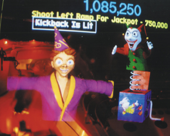
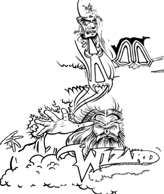

# Pinball2000.de Wizard Blocks archive

> [!NOTE]
> Preserved from <https://www.pinball2000.de/wb_ind.htm> on `2026-11-11`. This Markdown is a readable derivative; `raw/` contains the captured evidence.

WELCOME TO.... 

Wizard Blocks Page, the home of .... hope.
(scroll down for all the Infos!!)

Wizard Blocks Information that can be found on my pages:

The Wizard Blocks Owners List ......
only one owned by Gene Cunningham...

[The Wizard Blocks Story by Pat Lawlor](https://www.pinball2000.de/wb_story.html)

[Wizard Blocks Prototype Pictures](https://www.pinball2000.de/wb_proto.htm)

**Links to other pages containing Wizard Blocks Information:**

| Original Page from Jim Schelberg - Pat Lawlor Interview | [Pingame Journal Article](http://www.pingamejournal.com/articles/makehtma.php?file=article3.txt) |
| --- | --- |

Latest News and major hints:

**If you own an Episode 1 please register for the**[owners list](https://www.pinball2000.de/ep1_owners_list.html)**! Please send your game info to :**[Martin Wiest](mailto:Mr.Startrek@gmx.de)

These pages are maintained by [Martin Wiest,](mailto:Mr.Startrek@gmx.de) the [German Pinball Association (GPA)](http://www.flipperverein.de) and friendly help from Jim Schelberg.

If would like to add any information about Wizard Blocks on this page. Please [email](mailto:Mr.Startrek@gmx.de) me everything you have.

**(**Page version is 1.00) 23.9.2001
Last modification: All New
