# Pinball 2000 Repair

> [!NOTE]
> Preserved from <https://pinwiki.com/wiki/index.php/Pinball_2000_Repair> on `2026-03-28`. This Markdown is a readable derivative; `raw/` contains the captured evidence.

Click to go back to the [ Williams solid state repair guides index](https://pinwiki.com/wiki/index.php/Williams_Repair_Guides_).

# Introduction
Pinball 2000 (P2K) was the answer to a failing pinball industry. This was the last system used in a pinball machine before Williams ceased production of pinball machines. The reasons for why Williams ceased production are highly debated and more information can be found [here](https://pinwiki.com/wiki/index.php/Williams#Cease_Of_Production).

This system was a hybrid of conventional pinball with a video aspect. Using a 19" arcade monitor (CGA Resolution) and special playfield glass that is coated to reflect the image, it created the illusion of holographic images on the playfield. This is known as the [Pepper's Ghost effect.](http://en.wikipedia.org/wiki/Pepper%27s_ghost) To be able to handle both the pinball and video aspects of the game, the designers of Pinball 2000 used a commercial off the shelf PC based on a unique graphics and CPU processor, the Cyrix MediaGX. There are two proprietary components, the PRISM card, which contains the roms and booted the PC without a hard disk, and an audio amp. Unfortunately, the software requires the Cyrix MediaGX CPU for its display. The MediaGX did not sell well, and the boards and chips are now hard to find.

Only two games were released using the P2K platform, with 2 or 3 in development when Williams ceased production.

# Games
- Revenge From Mars
- Star Wars Episode 1
- Wizard Blocks *
- Playboy *
**** Denotes a game that was never produced***

## Recommended Documentation
### Manuals & Schematics
Schematics for each game are essential in tracing down connections to lamps, switches, and solenoids. The owner's game manual is a handy resource to have for general game operation, game settings & diagnostics, switch & lamp matrices, fuse lists, circuit boards and parts, playfield assemblies, some basic schematics, and wiring diagrams.

Be aware that although rare, some factory documentation contains errors in schematics, wiring, switch/lamp matrices, and solenoid assignments.

### Theory of Operation & Schematics
Details for board and cabinet schematics and theory of operation guides for pinball 2000 games can be found in game manuals and the Schematic Manual.

| Guide | Version | Cover | Source | Notes |
| --- | --- | --- | --- | --- |
| Williams Pinball 2000 Schematic Manual | 16-10882 (February, 1999) | 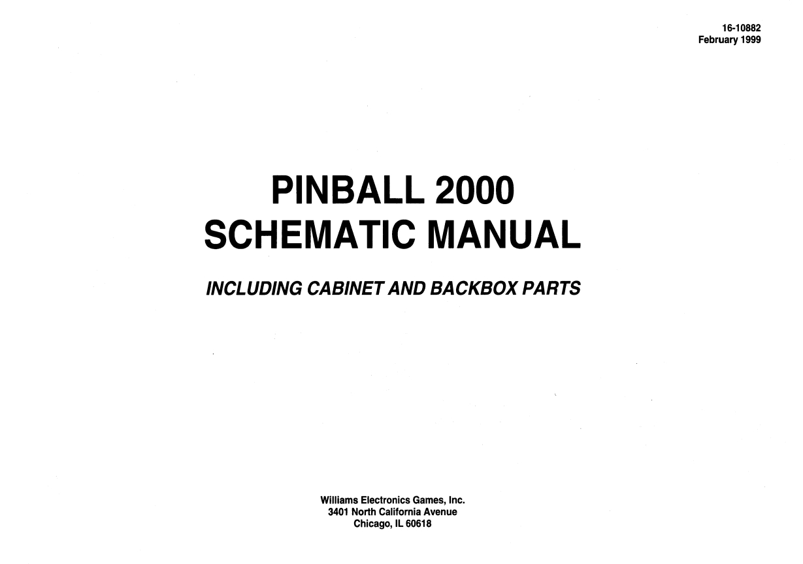 | [IPDB](https://www.ipdb.org/machine.cgi?id=4446)
[PDF](assets/Bally_Pinball_2000_Schematic_Manual_16-10882_OCR_searchable.pdf) |  |
| Pinball 2000 Safety Manual | 16-10878 (February, 1999) | 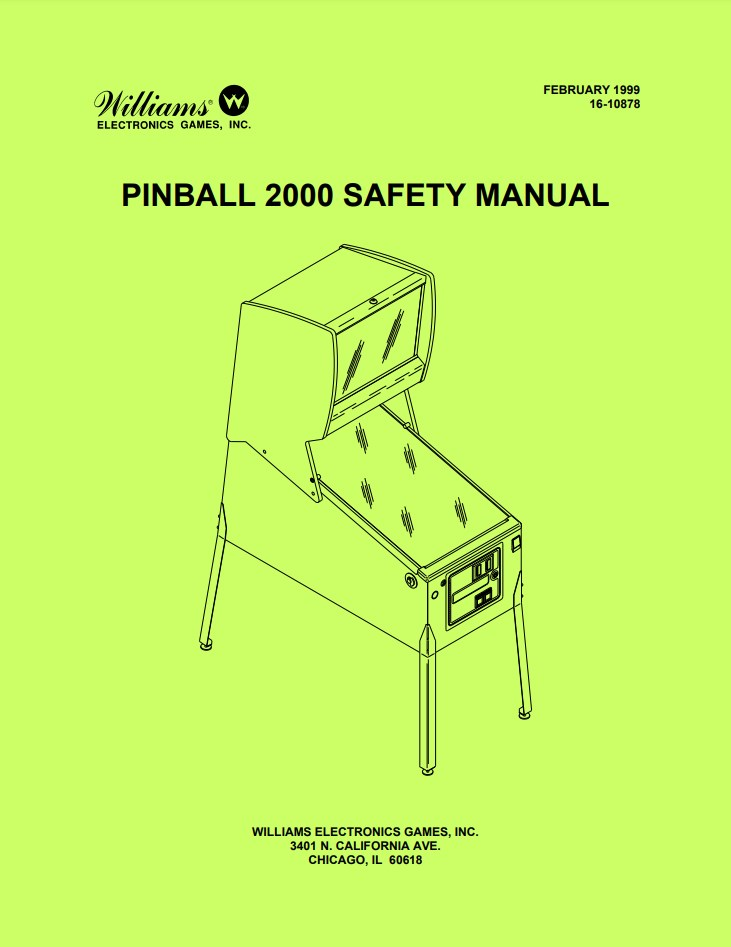 | [PDF](assets/Pinball_2000_Safety_Manual_16-10878_Feburary_1999.pdf) |  |

# Technical Info
Pinball 2000 was run using a commercial PC with a Cyrix Media GX CPU. The software depends on the integrated graphics in the Media GX CPU to operate. The PRISM card is a PCI card that carried the masked ROMs (64MB, the most dense possible in a 16-bit configuration), and ran the basic boot process of the PC to run Pinball 2000. Along with the PRISM card, the PC contained a custom audio amp to drive the stereo speakers and subwoofer.

Optional pieces of hardware available for the Pinball 2000 system include the SMC8416T ethernet card and a barcode reader. These worked to be able to access bookkeeping info over the internet and also host tournaments involving barcode based "login" to the system.

Three types of the SMC8416 network card will work: SMC8416T, SMC8416BT, and SMC8416BTA. The last letters refer to the type of Ethernet interface installed.  'T' refers to RJ-45 which is the current type of 'wired ethernet' and is available on all three cards.

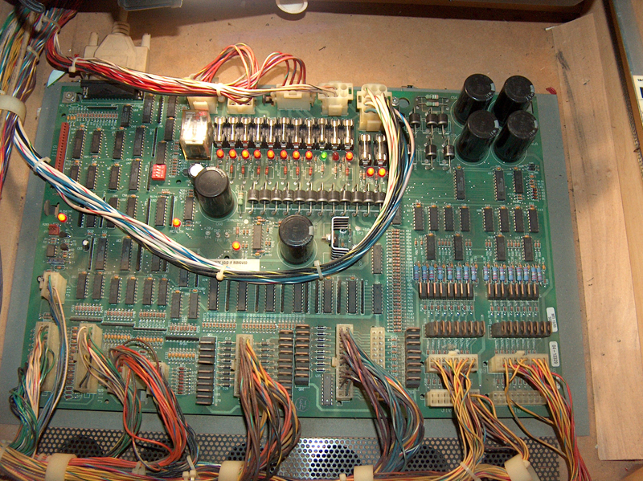
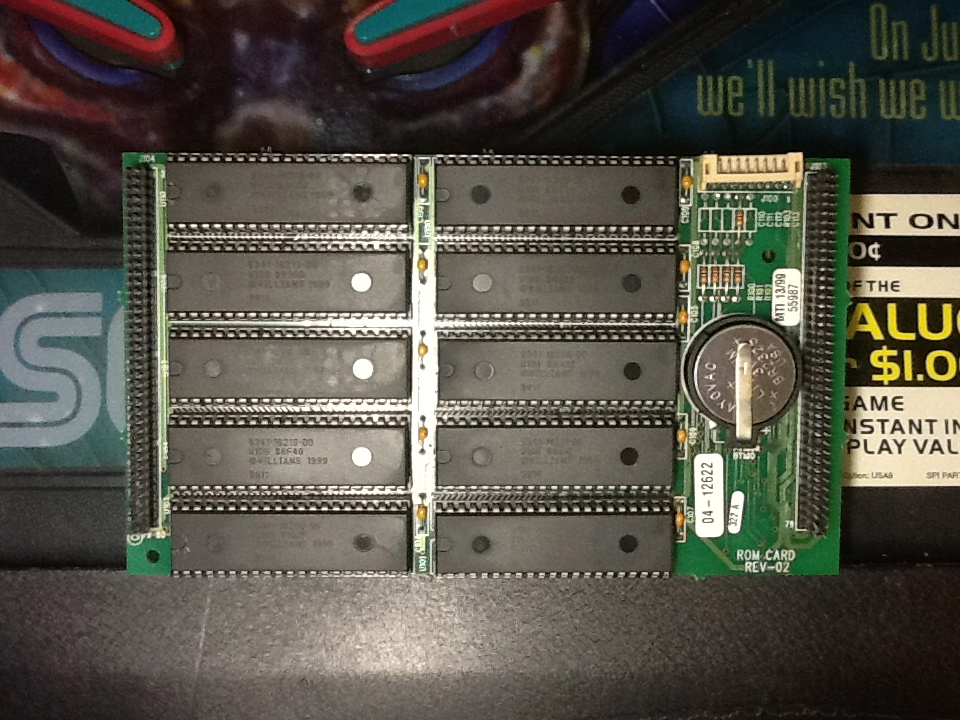
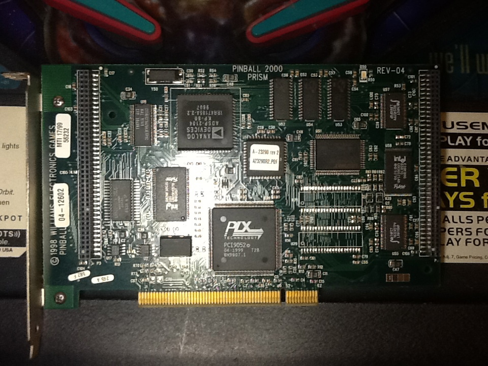

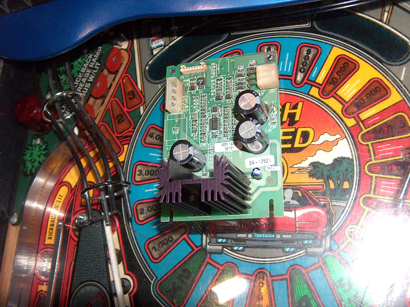
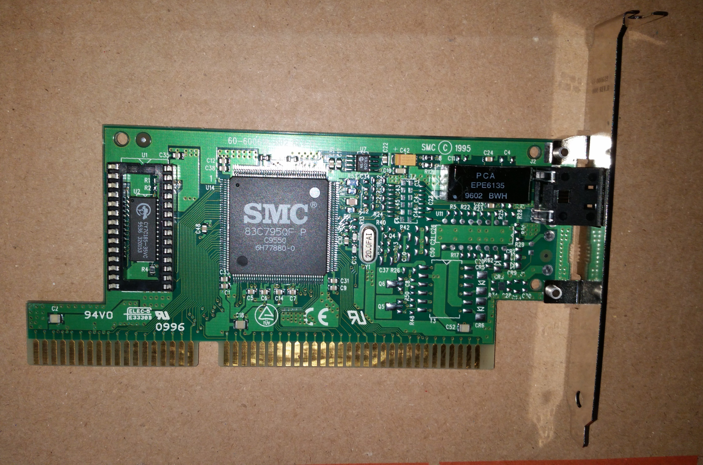

Note that there is a complete drop-in replacement solution if pinball 2000 computer components were not repairable. See [NuCore](http://www.bigguyspinball.com/nucore.shtml) for information. Nucore is an emulation system for pinball 2000 that could be used on more modern and readily available computer hardware instead of being locked into using the original computer hardware.

## Motherboards
More than one Cyrix Media GX Motherboard model was used, so there are a few different possible models that may have appeared in pinball 2000 games.

However, only motherboards with the CX5520 chipset would work with the pinball 2000 system. Similar chipsets (such as the CX5510 and CX5530) are unable to successfully operate the pinball 2000 software.

To identify the chipset, one of the large square gray chips soldered to the motherboard has the chipset model printed on it, along with other pieces of information.

At least two CPUs were used: Cyrix GXm-266GP 2.9V and GXm-233GP 2.9V

**WARNING:** Even though the the [Cyrix GX-based CPUs](https://en.wikipedia.org/wiki/MediaGX) (in a grey ceramic PGA package) that are used in the Pinball 2000 computer can physically fit into an [Intel/AMD-based "Socket 7" CPU socket](https://en.wikipedia.org/wiki/Socket_7), they have completely different pinouts and are not pin compatible with Intel/AMD Socket 7 motherboards. Additionally, Socket 7 CPUs, such as the Intel P5 Pentium or AMD K5/K6 CPUs, are not compatible with Cyrix GX-based motherboards. Likewise, the later generation [Cyrix 6x86](https://en.wikipedia.org/wiki/Cyrix_6x86) CPUs/motherboards are incompatible with Cyrix GX. Attempting to mix & match these incompatible CPUs and motherboards will likely result in unrepairable damage to the motherboard and/or CPU.

The motherboards of this era typically have their model number labeled with white text next to or between the beige-colored PCI slots. They can also be identified by matching the layout to what appears in the manual.

Motherboards & manuals:
- [Cyrix 586-GXM-AV](assets/Cyrix-Motherboard-gxm-av.pdf)
- [InformTech 586-GXM+](assets/Cyrix-Motherboard-it-596-gxm.pdf)
- [Global Circuit Technology (GCT) ST-MGXm](assets/ST-MGXM_motherboard_manual.pdf)
- [Dataexpert MGX7520](assets/Dataexpert_MGX7520_A_motherboard_manual.pdf) (Note that there there is a "SLIM" version and "BABY AT" version. The slim version does not have any PCI slots; a PCI slot is necessary to install the PRISM card, so the slim version cannot be used even though it has the compatible chipset.)

### Cyrix 586 GXM-AV Motherboard
| MOTHERBOARD SPECIFICATIONS |  |
| --- | --- |
| 586 GXM-AV |  |
| Manufacturer | AVT INDUSTRIAL, LTD |
| Device Type | Motherboard |
| Processor | Cyrix GX (Socket 7) |
| Processor Speed | 166/180/200/233MHz |
| Chip Set | Cyrix |
| Maximum Onboard Memory | 128MB SDRAM DIMM Slots (2) **PC100 168-pin DIMM** will work |
| Cache | None |
| BIOS | Award |
| Dimensions | 220mm x 170mm |
| I/O Options | 32-bit PCI slots (2), floppy drive interface, game interface, green PC connector, IDE interfaces (2), parallel port, PS/2 mouse interface, serial ports (2), VGA interface, USB connector, audio in- CD-ROMs (2). |
| NPU Options | None (no optional Numeric Processor) |

| 586 GXM-AV Motherboard Connections |  |  |  |
| --- | --- | --- | --- |
| Interface Purpose | Location | Interface Purpose | Location |
| **Floppy drive interface** | CN1 | **Serial port 1 (COM1)** | P1 |
| **IDE interface 2** | CN2 | **Serial port 2 (COM2)** | P2 |
| **IDE interface 1** | CN3 | **Parallel port (LPT)** | P3 |
| **Reset switch** | J1 | **Game interface** | P4 |
| **Power LED & keylock** | J2 | **PS/2 mouse interface** | P5 |
| **IDE interface LED** | J3 | **VGA interface** | P6 |
| **Chassis fan power** | J4 | **USB connector** | P7 |
| **CPU fan power** | J5 | **VGA interface** | P8 |
| **Green PC connector** | J6 | **Audio connector** | P10 |
| **Audio in – CD-ROM** | J7 | **Baby-AT Power connector** | P11 |
| **32-bit PCI slots** | PC1 – PC2 |  |  |
| Note: Refer to the motherboard manual for physical locations. |  |  |  |

### InformTech 586-GXM+ Motherboard
| InformTech 586-GXM+ Motherboard Jumpers |  |  |  |
| --- | --- | --- | --- |
| Jumper Purpose | Location | Jumper Purpose | Location |
| **Normal CMOS Operation** | JP3:1-2 | **Clear CMOS** | JP3:2-3 |
| **180MHz CPU Clock** | JP47:out JP48:in JP2:1-2 | **200MHz CPU Clock** | JP47:in JP48:out JP2:1-2 |
| **233MHz CPU Clock** | JP47:in JP48:out JP2:3-4 | **266MHz CPU Clock** | JP47:in JP48:out JP2:none |
| **300MHz CPU Clock** | JP47:in JP48:out JP2:3-4 & 5-6 | **JP2 Orientation** | Pin 1 Bottom Left with board as below |
| Note: The use of JP47/48 with JP2 are for CPU clocking. Refer to the motherboard manual for details. |  |  |  |

**InformTech 586-GXM+ Motherboard Layout (the actual board layout may differ)**

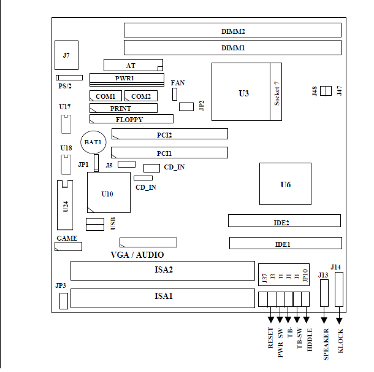

### Global Circuit Technology ST-MGXm
### Dataexpert MGX7520
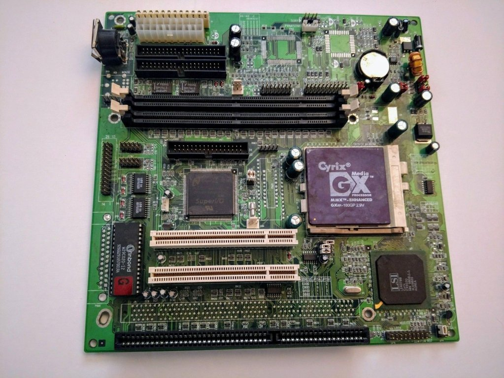
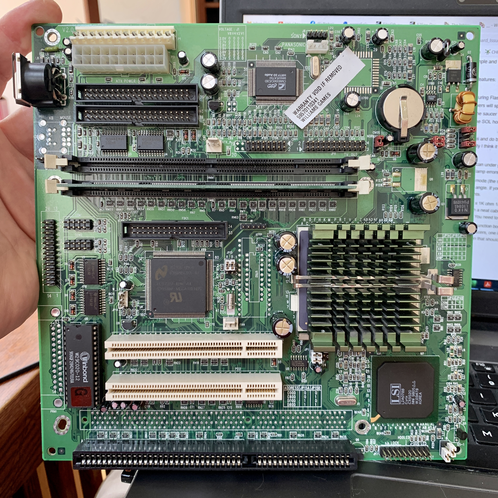

**Dataexpert MGX7520 BABY AT Motherboard Layout**

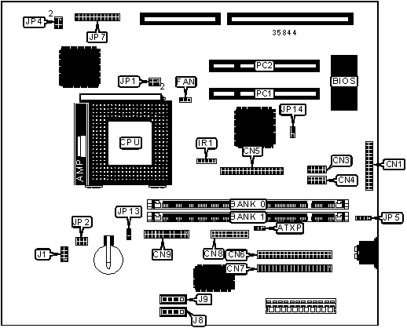

| MOTHERBOARD SPECIFICATIONS |  |
| --- | --- |
| MGX7520 BABY AT |  |
| Manufacturer | Dataexport Corporation |
| Device Type | Motherboard |
| Processor | Cyrix GX (Socket 7) |
| Processor Speed | Unknown |
| Chip Set | Cyrix CX5520 |
| Maximum Onboard Memory | 256MB SDRAM DIMM Slots (2) |
| Cache | None |
| BIOS | Award |
| Dimensions | 220mm x 220mm |
| I/O Options | 32-bit PCI slots (2), floppy drive interface, game interface, green PC connector, IDE interfaces (2), parallel port, PS/2 mouse interface, serial ports (2), ATX power connector, MIDI/TV out connector, audio in - CD-ROMs (2), soft off power supply |

| Connections |  |
| --- | --- |
| Interface Purpose | Location |
| ATX-P connector | ATXP |
| Parallel port | CN1 |
| Serial port 2 | CN3 |
| Serial port 1 | CN4 |
| Floppy drive interface | CN5 |
| IDE interface 2 | CN6 |
| IDE interface 1 | CN7 |
| Game interface | CN8 |
| MIDI/TV out connector | CN9 |
| Chassis fan power | FAN |
| IR connector | IR1 |
| Audio in - CD-ROM | J8 |
| Audio in - CD-ROM | J9 |
| PS/2 mouse interface | JP5 |
| Power LED & keylock | JP7/pins 1 - 5 |
| Green PC LED | JP7/pins 8 & 9 |
| Soft off power supply | JP7/pins 10 & 11 |
| Reset switch | JP7/pins 12 & 24 |
| Speaker | JP7/pins 13 - 16 |
| IDE interface LED | JP7/pins 20 & 21 |
| Green PC connector | JP7/pins 22 & 23 |
| 32-bit PCI slots | PC1 – PC2 |

| User Configurable Settings |  |  |  |
| --- | --- | --- | --- |
| Function | Label | Position |  |
| » | Factory configured - do not alter | J1 | Unidentified |
| » | CMOS memory normal operation | JP13 | Pins 1 & 2 closed |
|  | CMOS memory clear | JP13 | Pins 2 & 3 closed |
| » | Factory configured - do not alter | JP14 | Unidentified |

| DIMM Configuration |  |  |
| --- | --- | --- |
| Size | Bank 0 | Bank 1 |
| 8MB | (1) 1M x 64 | None |
| 16MB | (1) 2M x 64 | None |
| 16MB | (1) 1M x 64 | (1) 1M x 64 |
| 24MB | (1) 2M x 64 | (1) 1M x 64 |
| 32MB | (1) 4M x 64 | None |
| 32MB | (1) 2M x 64 | (1) 2M x 64 |
| 40MB | (1) 4M x 64 | (1) 1M x 64 |
| 48MB | (1) 4M x 64 | (1) 2M x 64 |
| 64MB | (1) 8M x 64 | None |
| 64MB | (1) 4M x 64 | (1) 4M x 64 |
| 72MB | (1) 8M x 64 | (1) 1M x 64 |
| 80MB | (1) 8M x 64 | (1) 2M x 64 |
| 96MB | (1) 8M x 64 | (1) 4M x 64 |
| 128MB | (1) 16M x 64 | None |
| 128MB | (1) 8M x 64 | (1) 8M x 64 |
| 136MB | (1) 16M x 64 | (1) 1M x 64 |
| 144MB | (1) 16M x 64 | (1) 2M x 64 |
| 160MB | (1) 16M x 64 | (1) 4M x 64 |
| 192MB | (1) 16M x 64 | (1) 8M x 64 |
| 256MB | (1) 16M x 64 | (1) 16M x 64 |

| Video Memory Configuration |
| --- |
| Note: the size & location of the video memory is unidentified. |

| CPU Internal Clock Speed Selection |  |
| --- | --- |
| Speed | JP1 |
| 6x | Pins 1 & 3, 4 & 6 closed |
| 7x | Pins 2 & 4, 3 & 5 closed |

| CPU Speed Selection |  |
| --- | --- |
| Speed | JP4 |
| 30MHz | Pins 3 & 5, 4 & 6 closed |
| 33MHz | Pins 1 & 3, 4 & 6 closed |

| CPU Voltage Selection |  |  |
| --- | --- | --- |
| Voltage | V core | JP2 |
| 3.3v | 2.9v/3.6v | Pins 1 & 2, 4 & 5 closed |
| 2.9v/3.6v | 2.9v/3.6v | Pins 2 & 3, 5 & 6 closed |

## LED Indicators
**Note: All LEDs labelled in bold are normally off when the coin door is open. This is a safety feature to prevent the potential of getting shocked with the high power in the game**

| LED Number | Purpose | Notes |
| --- | --- | --- |
| LED1 | Blanking/Watchdog |  |
| LED2 | Health | This LED simply blinks when the game is booted. Williams had intentions to do more with this, however they closed up before doing so |
| LED3 | 18VAC Lamp Matrix (Matrix A) | Supplies the 18VDC for the the "A" matrix |
| **LED4** | 50VDC Lower Right Flipper |  |
| **LED5** | 50VDC Lower Left Flipper |  |
| **LED6** | 50VDC Upper Right Flipper | No production games used this, however the LED will still be lit as long as the fuse is good. |
| **LED7** | 50VDC Upper Left Flipper | No production games used this, however the LED will still be lit as long as the fuse is good. |
| LED8 | 18VAC Lamp Matrix (Matrix B) | Supplies the 18VDC for the the "B" matrix |
| LED9 | Incoming 50VAC for Solenoids | This feeds the 4 solenoid busses |
| LED10 | 20VAC for Flash Lamps |  |
| **LED11** | 50VDC Solenoid Power Bus 1 |  |
| **LED12** | 50VDC Solenoid Power Bus 2 |  |
| **LED13** | 50VDC Solenoid Power Bus 3 |  |
| **LED14** | 50VDC Solenoid Power Bus 4 |  |
| LED15 | 20VDC |  |
| LED16 | 12VAC | This LED is Green unlike the others. The 5V used for on-board logic is generated with this |
| LED17 | 5VDC |  |

## Fuse Chart
All Pinball 2000 fuses are listed as "time delay" fuses, more commonly referred to as slow-blow fuses. Using fast blow fuses in its place will cause you much grief. Make sure you are using the correct type. Fuses are also the "mini" type, or more commonly referred to as 20mm online.

The line fuse for the game is a 4A fuse on foreign games, and 5A on domestic games. This is due to the differences in incoming power.

| Location | Value | Description |
| --- | --- | --- |
| F100 | 4A/250V | Solenoid Power 4 |
| F101 | 4A/250V | Solenoid Power 1 |
| F102 | 4A/250V | Solenoid Power 2 |
| F103 | 4A/250V | Solenoid Power 3 |
| F104 | 4A/250V | Lower Right Flipper Power |
| F105 | 4A/250V | Lower Left Flipper Power |
| F106 | 4A/250V | Upper Right Flipper Power |
| F107 | 4A/250V | Upper Left Flipper Power |
| F108 | 4A/250V | 12VAC Unregulated |
| F109 | 4A/250V | 20VAC Flash Lamps |
| F110 | 6.3A/250V | 50VAC Solenoids |
| F111 | 5A/250V | 18VAC Lamp Matrix "A" |
| F112 | 5A/250V | 18VAC Lamp Matrix "B" |

# Problems and Solutions
## Entering and Viewing Bookkeeping and Diagnostics
Bookkeeping and diagnostics can be handled in 2 different ways. The more traditional method is to use the 4 coin door buttons, the other method is through the use of a keyboard.

### Traditional Coin Door Method
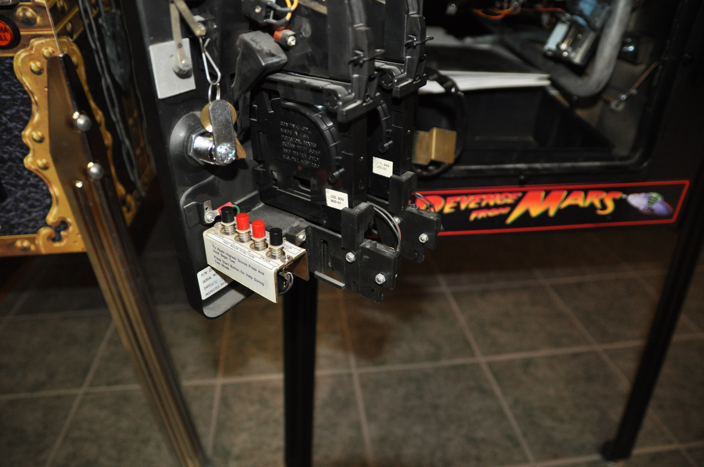
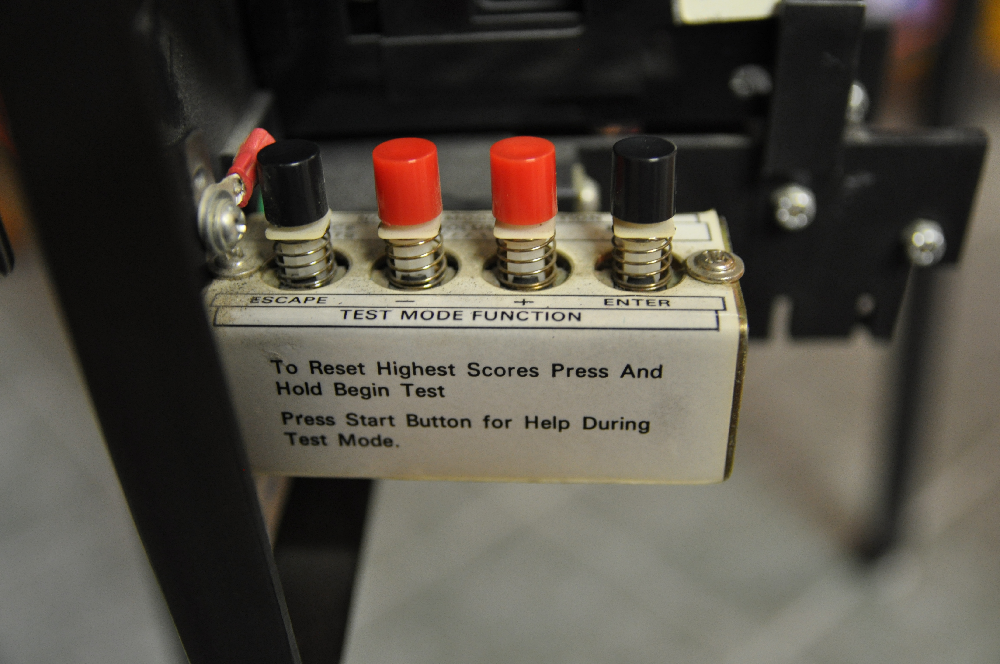

The first step to this is obviously opening the coin door. Once opened, you will see 4 buttons. From left to right they are: "escape", "minus", "plus", and "enter". The basic function of the buttons are relatively simple. Enter will let you enter a menu or option that you want to change, escape allows you to go back, and the plus and minus are used for navigation, as well as changing any adjustments you select.

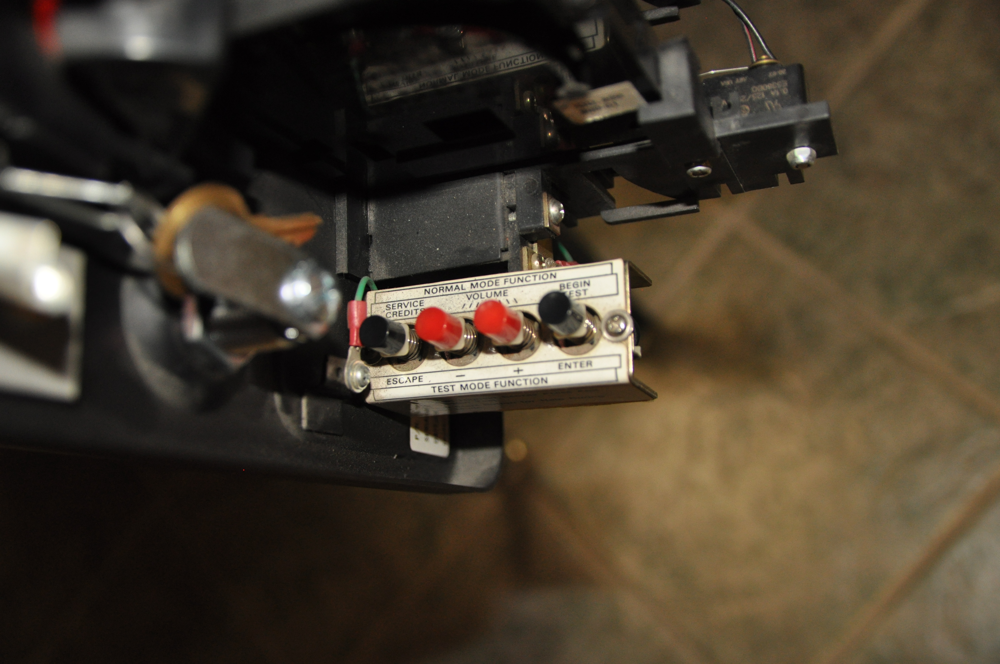
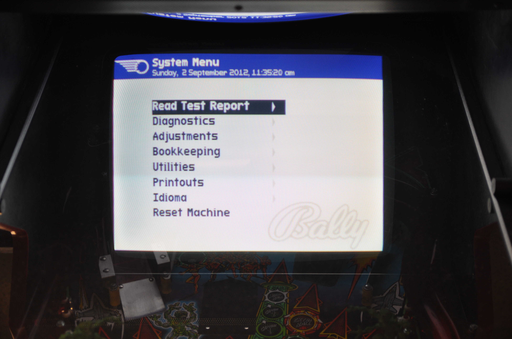

To enter the menu, start by pressing the enter button. This will bring you to the screen shown to the side. From here you have many different things you can do. Tasks include viewing the test report, diagnostics, bookkeeping, utilities, printouts, and language.

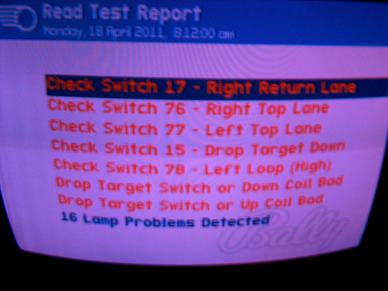

The test report offers a good general summary of items that commonly decrease earnings on location, or other major system errors. Things like burnt out lamps, switch errors, disabled features, and hardware failures. This area can be seen in the picture on the side.

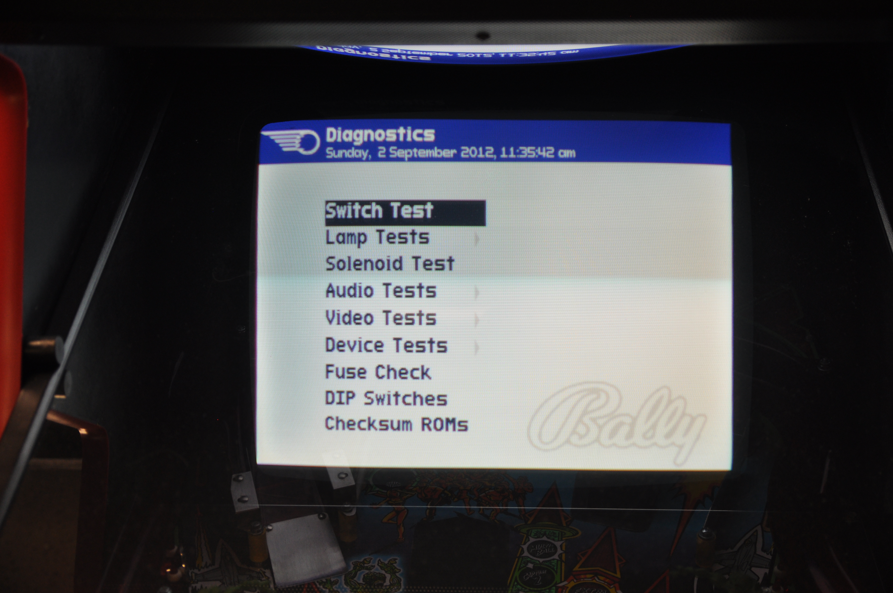

The diagnostics menu will allow you to run switch tests, lamp tests, solenoid tests, audio tests, video tests, device tests, fuse checks, dip switch viewing, and checksum the roms. The switch test will allow you to view switches that are currently active, as well as map the location of each switch on the playfield. Lamp test will allow you to trigger lamps, one at a time, each row or column, all at once, or the flashers. This is a great tool to see which lamps are working as the onscreen menu will tell you which ones are having issues (shorted or burnt out) as well as telling you where the bulb is with the onscreen map. The solenoid test menu will cycle through all the solenoids and flashers in the cabinet. If you press the enter button you can select repeat, and press it again to stop. Using the plus and minus buttons will let you select which coil to fire. Audio tests will allow you to drive a test tone to each of the 3 channels in the pinball machine as well as testing the "knocker" sound. Video tests provide screens for displaying different patterns that are useful for adjusting the monitor.

### Keyboard Method

## Power Problems
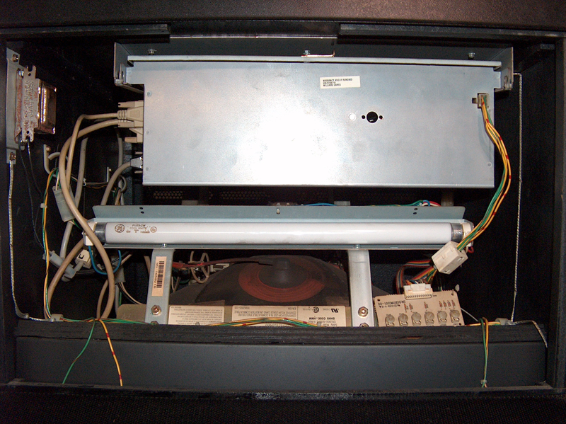

The AT power supply in the PC case is a common point of failure. Symptoms may include the computer not powering up at all or the computer/graphics exhibiting erratic behavior. If the power supply fails, there are two options:
1. Find another AT power supply. Because of old/obsolete the AT-style power supplies are, it has become difficult to find a good-quality new one.
1. Replace it with a newer ATX power supply. With an ATX power supply, it does not have its own separate case power switch like on an AT power supply, so it will require a small modification or adapter cable in order for it to power up with the main power switch on the game.

### Installing an ATX Power Supply
Look for a power supply that is 230W or greater (preferably at least 300W or 350W) and has an intake on the front and an exhaust on the back. Note that ATX power supplies with fans or vents on the top or bottom might not fit properly inside the computer case.

ATX power supplies can have a 20-pin or 24-pin connector for the motherboard. On the 24-pin connector, one end can usually be snapped off to separate it into a 20-pin and 4-pin connector. This is usually notated as 20+4-pin connector.

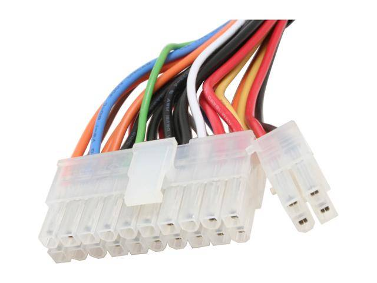

Note that there are two possible methods to adapt an ATX power supply for use in a pinball 2000 game; either with a couple of small modifications of the power supply wiring, or with an adapter cable.

#### Power Supply Modification Method
In order to use an ATX power supply in place of the original AT power supply, a couple minor modifications may be necessary.

The green wire on the 20-pin connector is the "power on" wire, and it will need to be cut and grounded in order to boot the motherboard.

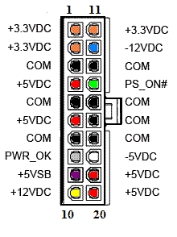

The quick and easy way to do this is to just cut off this wire, and ground it to the case. The best place is the threaded lug next to the original AT power switch at the front of the case. Cut the green wire as close to the connector pin as possible, slip it out of any zip ties in the bundle of wires, crimp a #8 terminal ring on the wire, and screw down the nut. When the game is turned on, the computer will also turn on.

In order to keep using the power switch at the front of the case (making it possible to reboot the computer without powering down the entire game), put an insulated .205" quick disconnect connector on the green wire. Connect that to one of the lugs on the power switch on the left or right side. Then, cut a small wire and put a #8 ring terminal on one end, and an insulated .205" quick disconnect connector on the other. Connect the spade connector to the lug on the switch on the same side as the green wire. Then put the terminal ring on the threaded lug next to the power switch, and screw down the nut. If everything is connected correctly, the power switch on the front of the case can then be used to turn on and off the computer.

#### Power Supply ATX to AT Adapter Method
A plug 'n play alternative to making modifications to the power supply is to use an adapter cable.

There are [ATX 20-Pin to AT P8+P9 6-Pin (with connectors for a push power button) adapters](https://www.amazon.com/gp/product/B075ZPWJBX/) available, which doesn't require any modifications to the power supply.

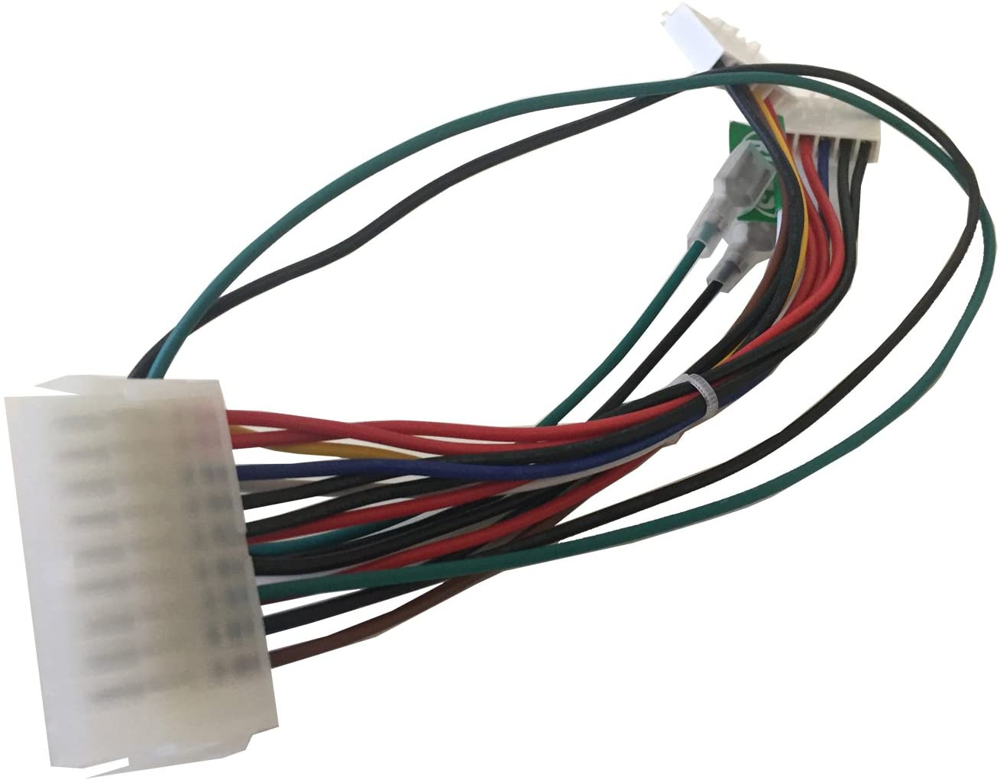

#### Turning On The Power Supply
Once everything has been connected and installed, on the back of the power supply, make sure the small red switch is set to 115v and that the large black rocker power switch has the "1" pressed in.

### Power Supply Warning For Non-US Owners
[*** Warning! ***](https://pinwiki.com/wiki/index.php/***_Warning!_***)
The PC inside a Pinball 2000 game ***always runs at 120v AC*** as it gets it's power from the transformer in the pinball cabinet.  So if you are in a country that uses 240v DO NOT plug in the PSU directly to the mains socket with a PC mains lead.  If you need to run the computer out of the game to do diagnostics on the motherboard, check that the switch on the back of the PSU is at 240v before plugging in into the mains!  Also remember to set ***any PSU back to [120v](https://pinwiki.com/wiki/index.php/120v)*** before installing it in the game and powering up the pinball machine. I learned this lesson the hard way... and had to replace my AT PSU.  This situation will not be an issue for individuals within the USA.

## General PC issues
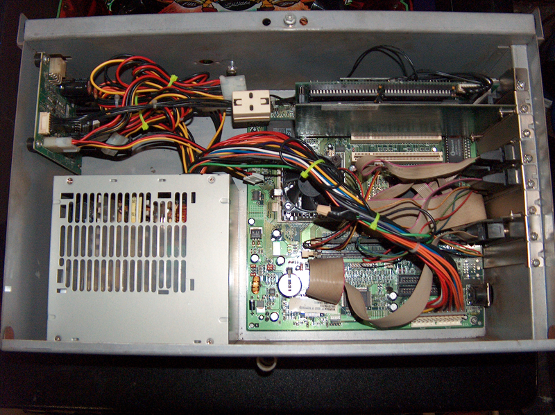
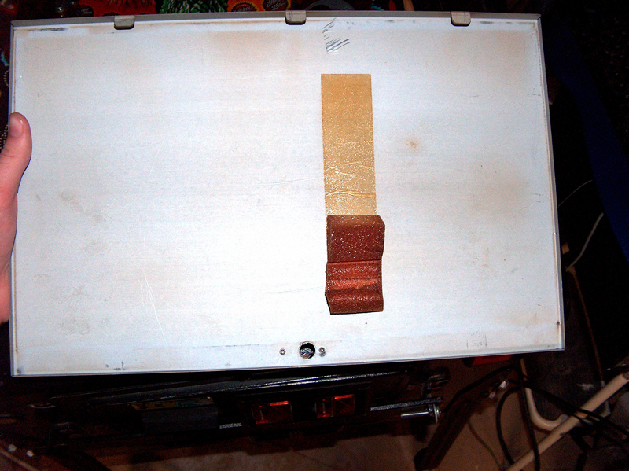

One of the issues with the PC is that the fan on the CPU heatsink is prone to failure. Once the fan stops working, the CPU overheats and over time will eventually fail. A big factor that causes the fan to fail is the foam piece that goes across the lid. Due to heat, the glue gives up and it sags right down on top of the fan. The best thing to do is to trim it back to just over the PRISM card, which is the foam's original purpose.

Another tip for prolonging the PC's life is to underclock the CPU. This can be done within the computer's BIOS settings.

## CMOS and Prism card batteries

There are a couple coin style batteries used on the P2K computer. One on the motherboard and another between the prism cards. The motherboard battery is a standard CR2032, and the one in between the prism cards is a BR2325 coin style batteries. It would be a good idea to replace these if they have not been already. The prism card battery is sort of an odd size, and probably won't be typically available at a local retail or electronics store, though they can usually be ordered online.

## Motherboard Issues
<b>Symptom: Won't Boot

Leading Cause: Bad Motherboard Capacitors</b>

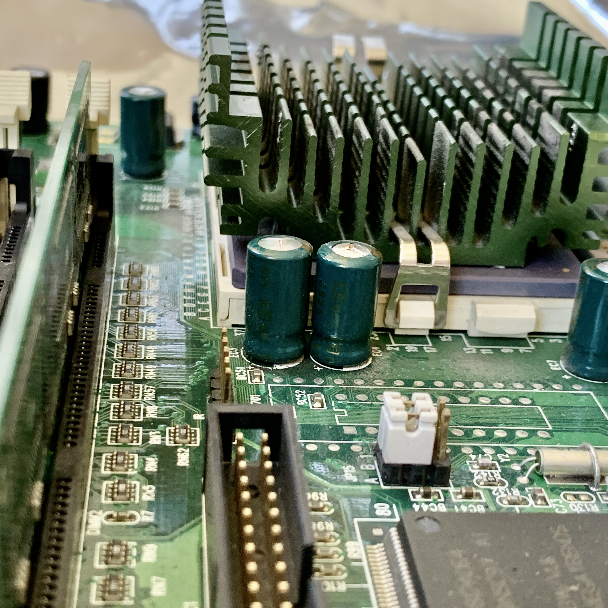
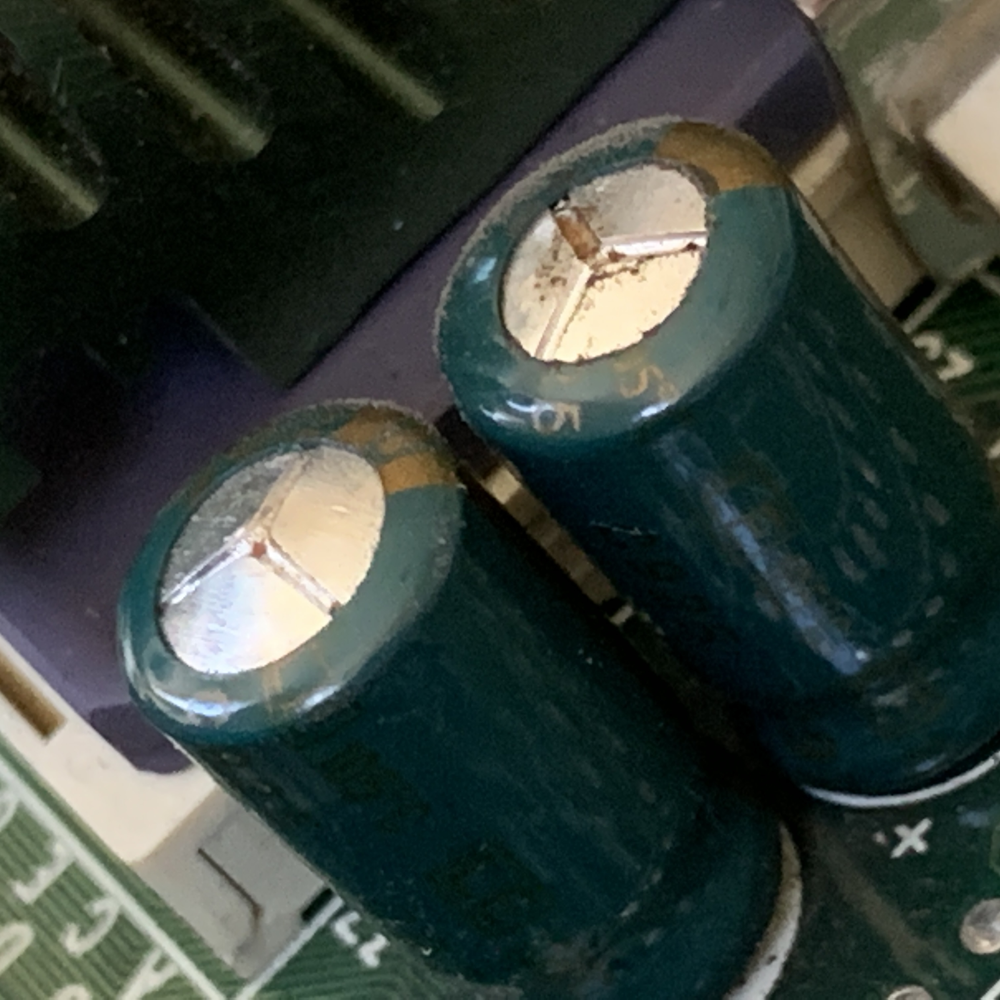
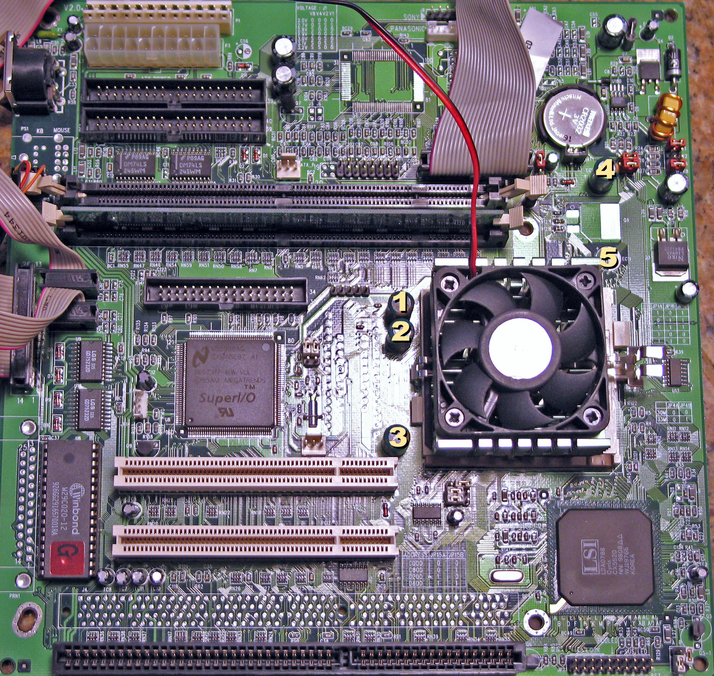
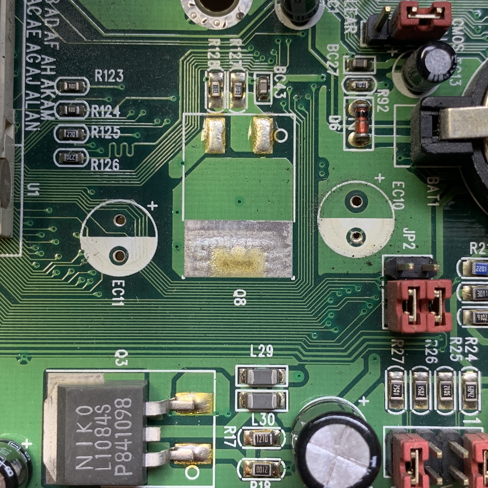

Pinball 2000 machines use computer motherboards that have capacitors very prone to leakage that tend to puff up and then leak out.  Once they puff up, it can cause erratic operation.  Once the tops break, even a little, and they begin to leak, it will cause the machine not to boot.  Fortunately, they can be replaced.

There are at least two kinds of caps in the Pinball 2000 motherboards in the 5 spots numbered in the picture. One has green caps (bad), and the other light blue (good). The green caps are 6.3v, 1000uf, 105c and made by TAYEH.  These are the ones that are usually bulged, popped, or leaking. If the caps are light blue 10v 1000uf 105c caps from Xicon, these are likely fine. These rarely bulge or leak, so the problem probably lies elsewhere.

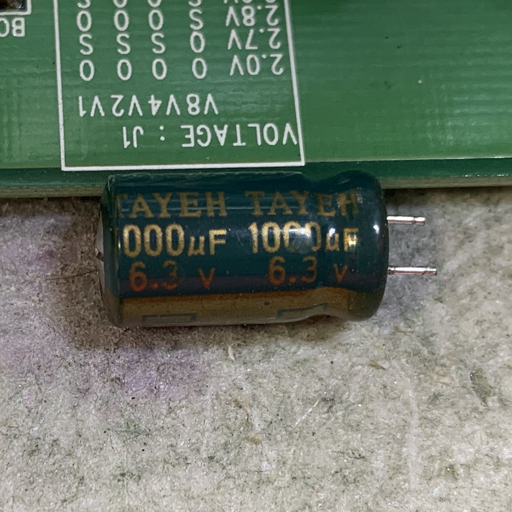

An original 1000uf/6.3V capacitor that has been removed from a Pin2K motherboard is pictured at left.

Original capacitors are 9mm in diameter and 15mm tall. The lead spacing is 4mm. When ordering replacement capacitors, be sure to note the capacitor diameter as adjacent capacitors on the PCB do not leave much space.

If the Pin2k computer box will not boot when hooked to an external monitor with the prism card removed, look at the 5 numbered locations in the picture.  They are all the same capacitor. If ANY are bulged or leaking replace ALL FIVE.  Mouser carries suitable replacement caps made by Nichicon. Check for part number UHE0J102MPD. These are part of a switching power supply so they should be Low-ESR type capacitors such as Nichicon UHE0J102MPD or Panasonic EEU-FM1A102L.

When removing the existing caps and replacing them with the newer ones, be VERY CAREFUL. There are a ton of fine traces near the pads for these caps, and this is a multi-layer board.  Take it slow and use a bit of new solder to loosen up the  existing solder if necessary.  Just stay patient, and do NOT overheat the solder pads. Remember, just one “oops” will make this basic repair much more painful or even impossible.

Once the caps are removed, note that the caps are marked with a “-“ and a stripe on the negative side. Just make sure to put the positive back on the positive side and the negative on the negative (the board is marked with a "+" where the positive lead goes).

Once all 5 are replaced, put the machine back together and power it up. If it had the Tayeh caps, chances the motherboard was able to be revived for only about an hour labor and $1.00 in parts.

## Solenoid problems
Be sure connectors are on coil lugs tight. Vibration can loosen them and burn the lugs.  The female spade connectors were used to allow for quick and easy replacement of solenoids.  If a lug connection is loose or sloppy, it is best to just solder the wires directly to the coil lug. The 1/4" terminal is the positive (cathode) side of the diode and the 3/16" terminal is the ground (anode) side of the diode.

If a connector slips off the flipper coils, it could potentially short to an adjacent flipper coil lug, and take out the drive transistor for the flipper coil.  The short can occur, because the connections are unfortunately not insulated.

Connections between the playfield and cabinet's interconnect can also be problematic.  This can be caused by the playfield wiring harness stressing the connections.  If solenoids are not engaging, check these connections.

Solenoids are driven by MOS-FETs rather than the typical TIP102/122 found in earlier games. The part number is 20N10L. Grounding the tab is still able to be done to test that a coil is good and that the issues is either the drive transistor or further upstream.  IRL540N can be used as a substitute for 20N10L.

## Lamp problems
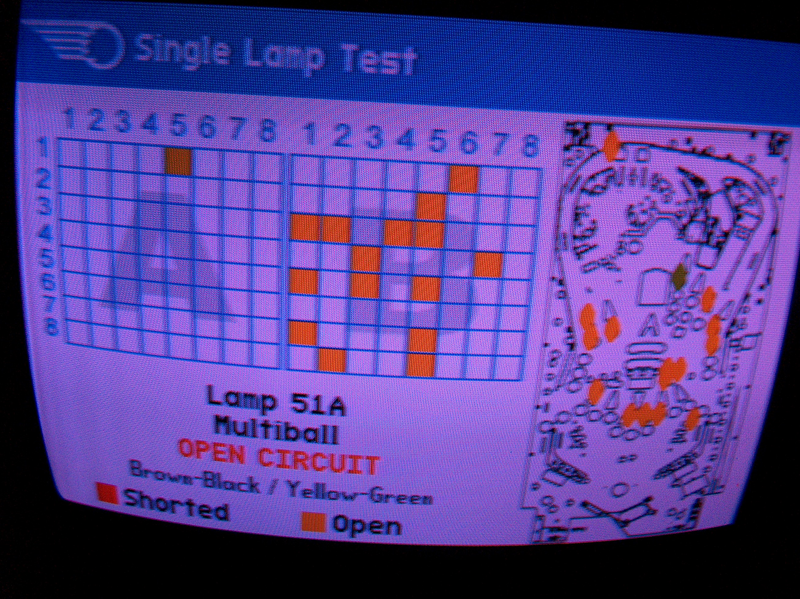

With Pinball 2000 came some methods to help make operator maintenance easier. One of those features is a burnt out lamp detection feature in the game diagnostics. The only problem with this is that if LED bulbs are installed, they draw too little current to be detected as good, and will report as bad to to the system. LED bulbs sometimes strobe incorrectly for the feature lights after the machine is on for some time. Also, using LEDs may eliminate most of the fade effects that would otherwise normally be seen when using incandescent bulbs.

The theory of operations for the Pinball 2000 lamp matrix is generally a carry over from WPC, including using TIP107 transistors for the columns and TIP102 for the rows. However, due to the lack of a "general illumination" circuit, instead of a single 8x8 matrix, Pinball 2000 uses two (2) 8x8 matrixes for a total of 128 possible controlled lamps.

## Switch problems

The switches are a common failure on these machines. The sub-microswitches used throughout the playfield are susceptible to sporadic or total failure, like some WPC-95 games. Most switch related problems are the switch itself not the switch matrix.  Replacement of the switches is the only resolution to make them reliable again. These are common switches in a Pinball 2000 machine:
- [5647-12693-19](http://www.pinballlife.com/index.php?p=product&id=829&parent=0) (rollover lane micro switch)
- [Williams/Bally DA3 Switch Body](http://www.pinballlife.com/index.php?p=product&id=1863&parent=101)
(DB3 is the modern equivalent - but not as good.  Buy the DA3 switch body (if still available) and snap on the original actuating wire.

<b>Problem: Machine reports coin door open all the time

Solution: Check motherboard mount in Pin 2000 computer case</b>

If the machine is reporting this, check the raised mounts under the motherboard in the Pin2k computer case.

Inside the Williams Pinball 2000 computer case, there are 6 raised, threaded metal lugs acting as mounts beneath the motherboard to secure it to the case. However, some of the replacement boards don't allow all the holes to line up. The top middle peg (closest to the power supply) can grounding out on the bottom of the motherboard where there was no hole to secure it and causing the machine to think the coin door was open.

To fix this, cut three rubber mini post grommets in half horizontally to make two small rubber doughnuts and use the six rubber pieces to create insulators for all six posts. Once it's insulated and re-secured to the mounts through the insulator/spacers, problem should be solved!

## Monitor problems
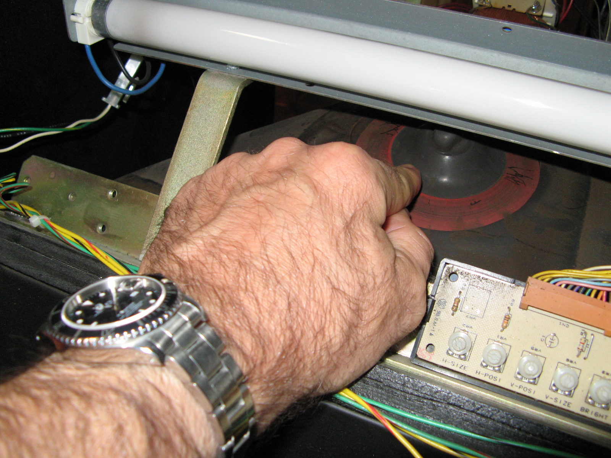
The monitor inside a Pinball 2000 machine is a normal low-resolution arcade monitor. Two different brand CGA monitors were put in Pinball 2000 machines, a Wells-Gardener 19K7302 or a Ducksan CGM-1901CW. At this age, most of these monitors could use adjusting, if not a capacitor kit. Working on the monitor or chassis is not much different than working on a video arcade game monitor & chassis. Re-capping the chassis, neck board and re-flowing major solder joints is a good start to bullet proof the machine. If the high voltage connection to the CRT tube needs to be removed, **DISCHARGE IT** a couple times before grabbing it. This can be done with a long screw driver with the shank grounded. Slide it under the rubber insulating cup, and when contact is made, a pop or snap will be heard. Do this a couple times before touching it. The tube can sometimes have a residue charge, even if it hasn't been turned on in awhile. Always discharge it before touching it. One note on the Ducksan chassis. There is a fuse on the chassis that if blown, it will not discharge a couple big capacitors on the board. If for some reason this fuse is open or blown, the capacitors will have a charge until they are grounded or touched. Look for a blown fuse on the chassis before prodding a lot of things.

If there is a blown fuse, discharge the big caps on the chassis. **On the upside if you do discharge it with your body you will remember it longer than reading about it!**

Another option for Pinball 2000 monitors include purchasing an LCD and mounting it place of the CRT. This option will require a signal converter to convert the low resolution signal to something a VGA computer monitor can handle. A Kortek KTN-2001 (a.k.a. KT-2001N) can be installed on the Wells-Gardner 19K7302 frame if the Wells Gardner chassis cannot be repaired.

### Monitor Adjustment
### Video Amplifier
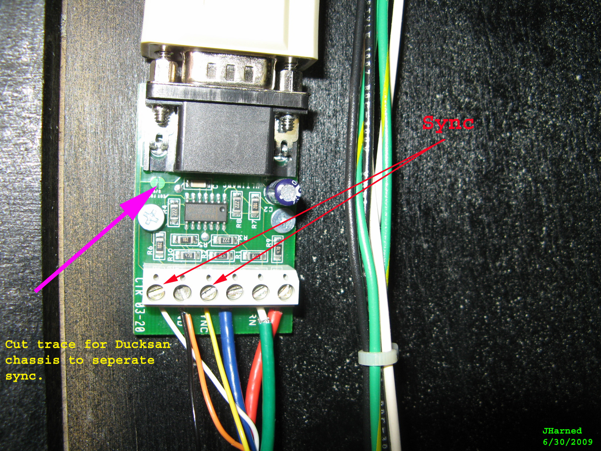
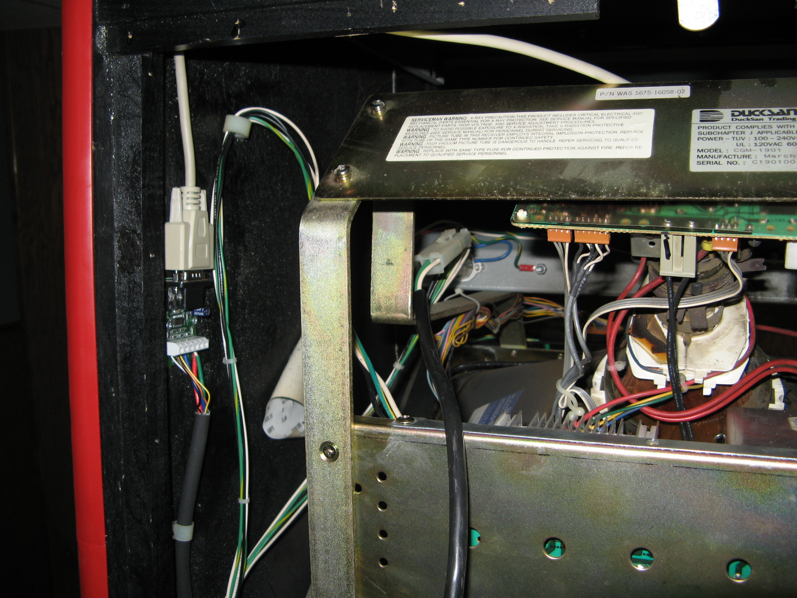
Adding a video amplifier to the standard CRT monitor drastically increases contrast and color. This is a fairly simple and relatively cheap add-on. The recommended video amp can be purchased from [Ultimarc](https://www.ultimarc.com/arcade-vga-and-video/arcadevga-accessories/arcade-monitor-video-amplifier/). Installation is basically feeding the video cable output from the P2000 computer into the video amp. Wires will have to be attached to the amp's screw down terminals. These are the RGB (Red,Green,Blue) and Sync. wires. These run from the amp output (screw down terminals) to the CRT chassis.

With Wells Gardner, the sync wires can be joined together. Here is a link to the [pin outs](http://www.Scirocco2.de/rfm_monitor_plug.jpg) on a Wells Gardner. Use the first four pins: R,G,B and Gnd. And the last three: Gnd, V/Sync, H/Sync. The two ground wires tie together.  Locations are clearly indicated on the video amp.

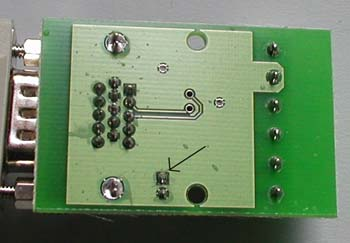On Ducksan chassis, the Sync wires will be separated. If using the Ducksan chassis, there is a small board trace on the amp that must be cut. This is so the video sync is correct. If the sync is wrong, the symptom will be a rolling picture that can not be adjusted. If hooked up incorrectly, there shouldn't be any ill results, except that there will not be a picture.

An important point is that the game's PC video card may not output +5v on pin 9, which is needed to run the Ultimarc video amp board. Test this with a meter set to DC volts between pin 9 and the metal shell of the cable supplied with the video amp connected to the PC and with the game up and running attract mode. From experience, Star Wars Episode I won't output the +5v, but the later RFM boards probably will. If there is no +5v, the upgrade will appear to fail and there will be no video signal. Fear not. Run a long connection from a spare 4-pin molex drive connector (connect to one of the Red wires) in the PC out to the Video amp. The isolated pad it needs to be soldered to is indicated at the bottom of the ultimarc product page and [shown here](https://www.ultimarc.com/images/1/vidampconn.jpg). Then cable tie the wire to the whole length of the supplied video cable leaving some slack at the ends. It isn't necessary to run a separate ground wire; the shield of the cables and other earthing takes care of it.

If there is a very slight wobble side-to-side in the picture, try isolating the video cable run away from the black/green/white wires that carry the AC power. Beyond that consider re-capping the chassis, neck board and re-flowing (solder) connections.  This is highly recommended. Once the amp is installed and running, it's a good idea to turn the contrast down on the chassis or neck board adjustment pot. The amp will really kick it up a lot from its previous setting. It's not a bad idea to adjust the focus on the flyback too. With the amp installed, it's a night & day difference for image quality, color and contrast.

If the existing CRT tube is good, video amp is a nice add on. The black level of CRT tubes is difficult to replicate with LCD / LED panels. However, that is not to say modern LCD panels don't look good.

### Duckscan Cap Kit

## Sound problems
The audio amp circuit board inside the PC box is pretty reliable, but if it does ever have problems, there are 2 strikes against it:

1. It is a proprietary board from Williams.
1. The majority of its components, less the amp and some electrolytic capacitors, are surface mount components.

This makes service and replacement a little bit of a challenge.

The other side of the audio is based on the PRISM card which is also all surface mount and out of date chips that are challenging to find.

### Aftermarket Audio Amplifier
The Nucore folks at Bigguys Pinball created a modern replacement amplifier board for Pinball 2000.  It was available from [Pinball Life](https://www.pinballlife.com/index.php?p=product&id=4685) for $119 ([archived link](https://web.archive.org/web/20170912000256/https://www.pinballlife.com/index.php?p=product&id=4685) for reference) and was intended for use in Nucore games, but could function as a plug-in replacement for the original board, presuming the original was not repairable. [Support information for the aftermarket amplifier board is available on the Bigguys website](http://www.bigguyspinball.com/nucoresupport.shtml) and the [schematics here](assets/Bigguys-pin2000-audio-amp-schematic.pdf).

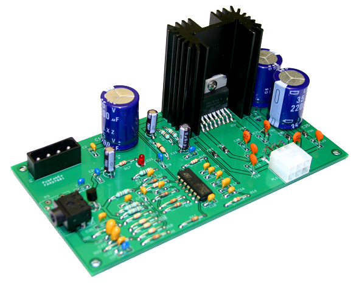

### Modifying The Original Audio Amplifier
The original Audio Amplifier found in Pinball 2000 machines are driven from the PRISM card with a unique connector, however the original design has an (unpopulated) headphone (3.5mm) jack included in it. While I have not found a proper jack to install on the board, you can use an old pair of headphones, cut the cable off, add 2 components and solder the cable straight to the board. This will allow you to use an original audio amplifier for a nucore system.

Components needed:
- 3.5mm headphone cable
- 10K Ohm Resistor
- 10uF 50v Capacitor

The unpopulated headphone jack is labeled J4 and is next to the connector that would normally plug into the PRISM card (J1). The Top hole is "right" audio, the bottom left (component side) is ground, and the bottom right (component side) is "left" audio. Then you will need to tie the resistor and the positive lead of the capacitor to pin 1 of J1 (closest to the corner of the board). The negative lead of the capacitor then is attached to the ground for the headphone pin (bottom left). The other side of the resistor gets tied to the 5V input of the audio amp board, which happens to be the closest pin on the 4-pin connector to the side of J1.

## Flipper problems
The flipper assemblies are Williams "WPC" style units. It should be noted that the E.O.S. switches are normally open with gold flashed contacts.

## Reed Switches
The Williams 20-10293 Reed Switch assembly is nearly unobtainium and used in several Williams/Bally pins:

- Cirqus Voltaire
- Cactus Canyon
- NBA Fastbreak
- No Good Gofers
- Revenge From Mars
- Safe Cracker
- Star Wars Episode 1

With a bit of effort, the reed switch can be removed from the Williams Reed Switch assembly and replaced with a standard '1 Form A' 7mm reed switch. Switches recommended include the Hamlin (Littelfuse) MITI-3V1-8-12.5 or the Meder KSK-1A80-1015 available form Great Plains Electronics or Mouser.

A step by step procedure along with photographs is provided by Pinside poster lyonsden.

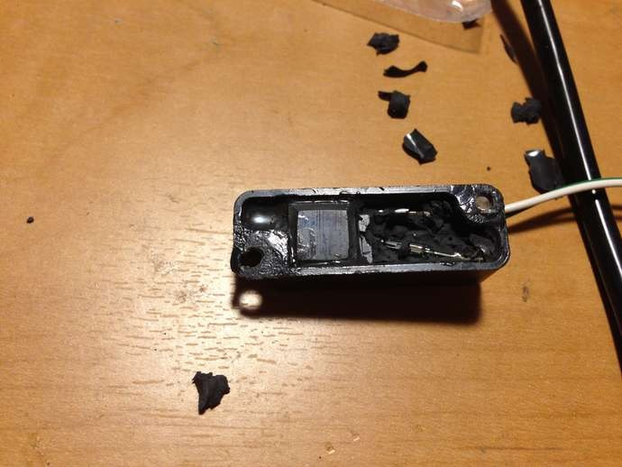
Step 1: Take out reed switch

Step 2: Pick out silicone (whatever it is). I used a small flathead screwdriver.

Step 3: Expose diode and reed switch

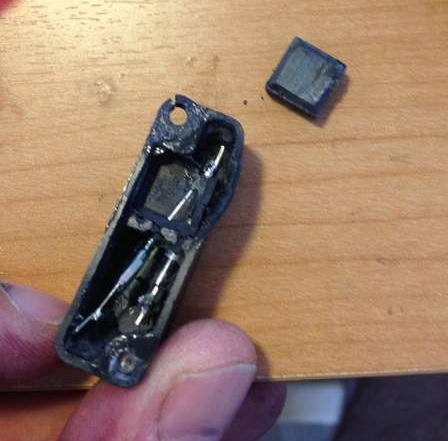
Step 4: Pry out magnet

Note: Don't pry out magnet on the other side of the reed switch.

Step 5: push out reed switch and diode with switch wires.

Note that there are small channels the wires run through in an internal bracket and then between the magnets.

Step 6: Remove old reed switch and diode (might as well replace everything)

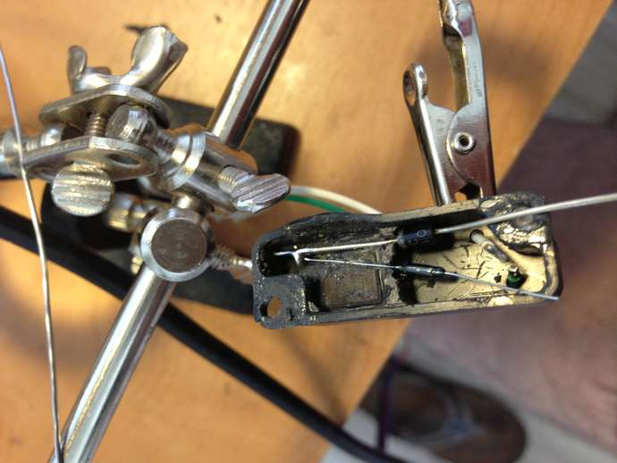
Step 7: Tin new reed switch and place in channel

Note: orientation of reed switch *may* be important (need to test). In this example, both the original and the replacement were oriented with the flat sides of the switch facing up/down (not looking at the edge from above).

Step 8: Tin new diode and place in channel. Note the direction of the diode!

Note: You'll have to cut the lead to fit

Step 9: Solder leads of diode and reed switch together

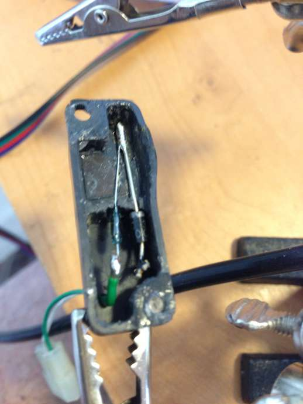
Step 10: Solder plug wire to reed lead. Clip excess lead

Step 11: Solder plug wire to diode lead. Clip excess lead

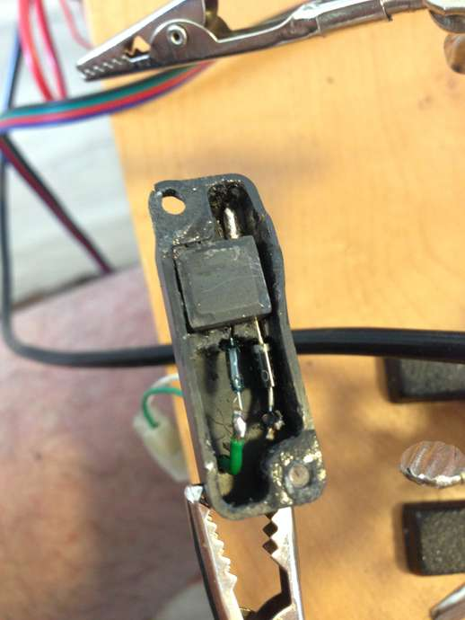
Step 12: replace magnet

Step 13: Fill with silicone or caulk. Let cure till surface is solid.

Step 14: Put back in game and test with switch test.

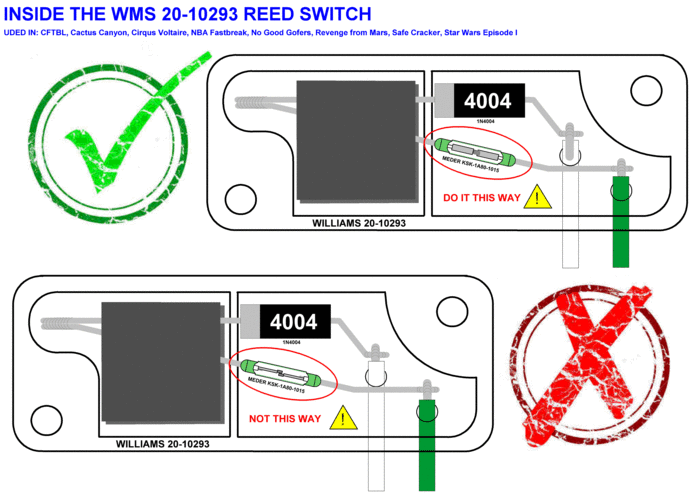
To clarify the orientation of the reed switch within the case - Ingo Kramer has provided an excellent graphic showing the correct way to install the reed switch and the wrong way to install the reed switch. (Click on image to see larger view)

## Fluorescent Bulb
If the fluorescent bulb in the backbox won't turn on, the issue could be a bad bulb (most likely), bad starter (also highly likely), or bad ballast (least likely). If if flickers or if there is a long delay before it turns on, it will need a new starter. If a new bulb is installed and it blows immediately or after a short period of time, the ballast might need to be replaced.

A replacement fluorescent bulb is an 18" T8 15W. Warm white and cool white are typically available. Cool white can help to counteract the coloring resulting from minor translite yellowing. It's a common bulb and can be found at most hardware stores that carry a selection of fluorescent bulbs.

The starter is a small silver-colored cylinder, and is mounted directly behind the fluorescent bulb's fixture near the right side. Twist the component to release and gently pull straight out. It is an FS-2 fluorescent starter, and can be found from various sources for less than $1.

The ballast is the small, metal box mounted to the left side inside the backbox. A T8 120V 15W ballast can be used to replace it.

### LED replacement
There are T8 style LED bulbs that can fit into the fluorescent bulb fixture. In most cases, the starter and ballast will need to be bypassed and the fixture will need to be connected directly to the voltage supplied by the transformer.

Another option is to get an LED light strip and connect it to a 4-pin AMP connector housing (1-480426-0) and Mate-N-Lok pins (60620-1-C), and then connect it to the computer's power supply, which can supply either 12VDC (yellow wire) or 5VDC (red wire).

One benefit to using LEDs is that it will help prevent the translite from yellowing, which can be caused by a fluorescent bulb's heat and from it emitting UV light.

# Modifications
## Adding Saucer Lights to RFM
**The first option is to buy and fit a kit**:
- The one from [UFO Pinball](http://www.ufopinball.com/RFM-LED/features.htm). It's a nicely designed mod at a decent price. The saucer animation on the RFM kit appears to be done in a similar way to the kit for Attack From Mars, although the RFM mod is provided as a PCI card that fits neatly inside the Pinball 2000 PC.
- The kit from [mypinballs.com](https://www.mypinballs.com/electronics/store.jsp) and [shown in a development thread on pinside](https://pinside.com/pinball/forum/topic/rfm-rgb-saucer-mod-in-development) uses interactive RGB lighting for the two saucers, and a PCB that mounts on top of the playfields large lamp board. There are optional clear-dome saucers available.

**The second option is to make your own saucer mod:**
Here is a simple "knight rider" style [LED scanner](http://www.pinballnews.com/learn/rfm.html) shown on Pinball News (along with the Martian LED "eye mod"), which was an inspiration for this mod. It was limited to a single pattern that just "spins" the LEDs around or scans them back and forth. A switch would need to be added somewhere to select when the scanning was "on".

Another option is using a PIC based board with lots of amazing scan patterns and with LED intensity variations. The plan would be to connect it to the lamp matrix flashers using an optocoupler, but the PIC board is overly complicated even though it can be programmed for lots of different patterns. There's an easier way to get there.

If you can fix simple faults on pinball games then there is a mod you can do with these features:
- Saucer LEDs are (automatically) interactive with the game.
- Saucer LEDs are off during lots of the modes where it would distract the player. Off during Flasher shows.
- Patterns are quite cool. Some modes scan, some spin around CW and CCW, and others will sparkle/flash (such as at end of modes).
- Shows a count of the saucer lights scored. As more lights are scored, more LEDs on the saucer spin giving varied patterns.
- Optional: a saucer body with the sequenced lights can be added to the flasher above the SOL hole. Mine has a red flasher dome with red LEDs.
- Cost is low, although as with most pinball mods some work is required.

It takes a few parts and some patience. The required skills include the ability to terminate crimp connections and do basic soldering - that's it. Those skills are necessary for pinball repair anyway, so this mod is worth a shot. This mod was designed to be completely reversible and removable if in the future someone decides that they don't want it, but overall, it can add a nice touch to the game.

It's based on an idea from Levi, a great guy from the Pinball group in Brazil.

It involves wiring the LEDs into the mothership saucer lights on the playfield which already scan under game control. I've had mine connected up for around two years with no problems running 3 mini-saucers. The small LEDs don't add much of a load to the Lamp Matrix. The diagnostics won't report lamp errors, because the bulbs are still there on the playfield.

Here's an idea of what this mod [will look like](http://www.youtube.com/watch?v=1u_iDSlNSfM) but with red LEDs, and only showing a single mode (likely the start of Paris in Peril). This isn't my RFM, but has been done using the same method. Here is a video of [my RFM](http://www.youtube.com/watch?v=iZYqJpxuYug) with the green LEDs but it's hard to see the SOL kickout saucer from this angle. If you search for the Bill Ung **'UFO Pinball RFM kit** on youtube, then compare the two. The UFO Pinball RFM mod has lots of scan patterns, whereas the mod given here is reliant on the playfield lights.

That said, here are the instructions:
For each saucer, 8 x 3mm LEDs and 4 x 1K ohm 1/4w resistors are needed. For wiring to connect the saucers to the playfield lights, A long (about 2M or 6.5ft) Ethernet cable can be used. When cut in half, this can be the a 6 wire+ core that can run to each saucer in a neat cable. The Ethernet plugs will (just) fit down into the playfield. Use 6" of black heat-shrink tube at the saucer end to keep the wiring small and well hidden when running up from under the playfield. **Note**: remember to add the heat-shrink tubes to the cables **before** soldering them to the LED leads.

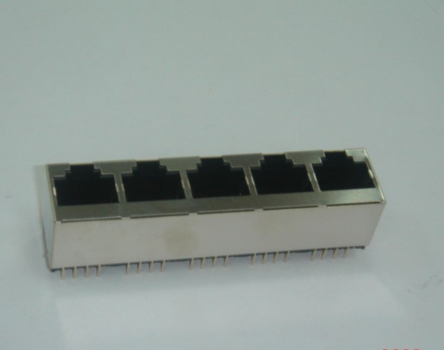
On the underside of the playfield, make a junction board out of veroboard with some RJ-45 8-way sockets which take the Ethernet cables. Use 4 x RJ45 Sockets; two at the top are for the Front Saucers, one is for the SOL hole saucer with one as a spare. If a 4 port RJ45 Ethernet module can be scavenged from an old router or small Ethernet Hub) then that should work. If not, just use separate PCB mount sockets to jumper them together.

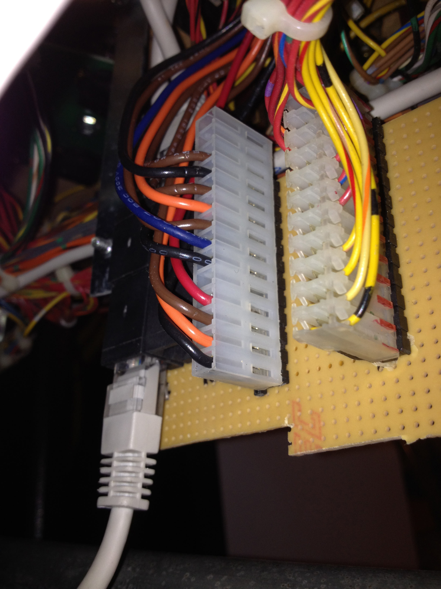
There are two 12-way Male headers on the board. On the RH side, the original connector for game's COL 3-4B and ROW 3-7B Lamp Matrix. It used to be connected under the Light board for the Motnership in the middle of the playfield.

The middle connector is the **Female to Female 12-way** going to the underside of the playfield.
The connections between the headers are simple and wired in in parallel 1:1 (meaning pin 1 to pin 1, pin 2 to pin 2, etc...). Pin 5 is the "Key" and doesn't need to be connected, so only 11 wires are used.
On the LH side the 4 black squares are the RJ45 sockets and connections. On my board, two face up and two down - but the layout could be different if it makes the wiring easier.

The RJ45 sockets are all wired to each other in parallel 1:1. Then wired to the header pins and and so connected through to the LEDs to as per [ the instructions here](https://pinwiki.com/wiki/index.php/‎media:RFM-RH-Direct-Saucer-Mod.pdf) (**NOTE:** IMHO the linked document is not fully correct. The orientation of the LEDs in the Levi schematics is wrong. They all have to be inverted in orientation to work. The table on the bottom right of the document is correct).

Lamp 9 (Row 3B) at pin 10 on the underside of the lamp board is not used for the mini-saucer LEDs, as there are only 8 LEDs on each saucer. Pins 3,4,10,11,12 must all "pass through" the headers/connectors so the playfield lights all continue to work but they don't connect to the RJ-45 sockets.

**Click a picture to enlarge, click again for even larger resolution. On most browsers use the back button to return to this page.**

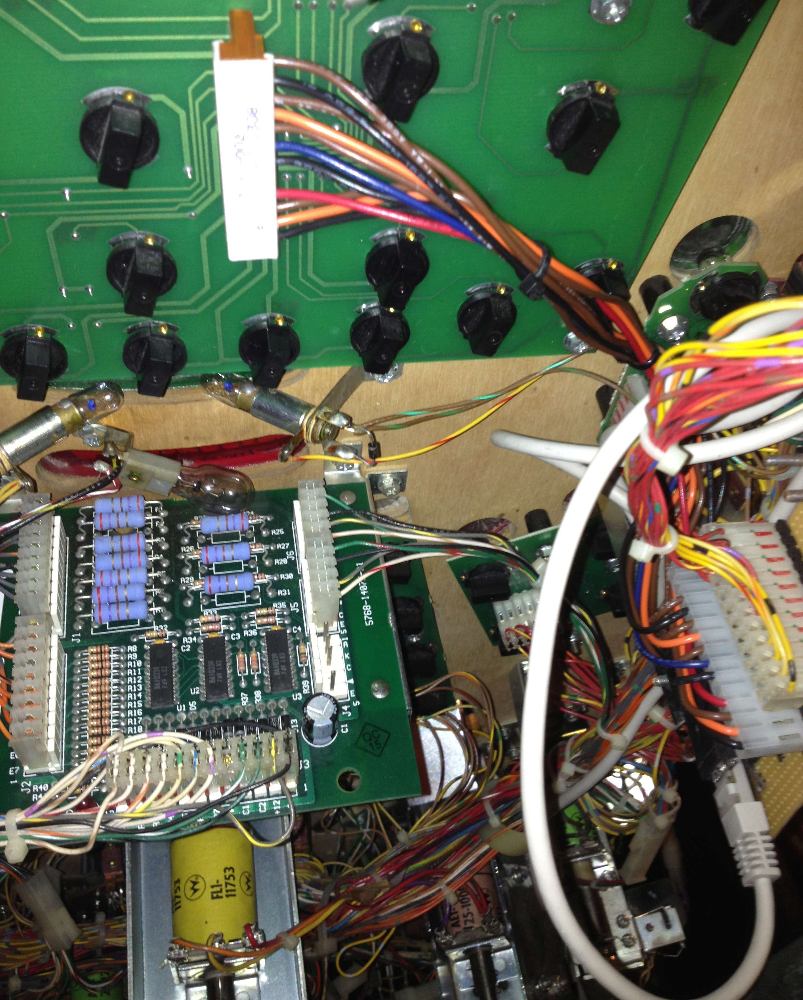
This picture shows the custom 10" connector cable: A 12-way socket to 12-way socket .156". This connects the pins under the center of the Mothership lightboard to the pins on the mod board. Think of it like an electrical extension cord, which provides a way to "breakout" the desired pin connections to the LEDs without permanently modifying the game. When adding mods to any game, it's usually a good idea to do it in a way where it can be completely reversible, and that the game can be easily put back to its original factory state. It might be easier to splice into the cabling, but that's not **ever* the right solution. To remove this mod, a later game owner should be able to remove the mod board and plug the original connector back into the playfield.

Some critical notes about making up the saucers:
- Make sure to put the LEDs in the right way around to the diagram. The cathode (-) on an LED is the shorter lead, or the LED has a flattened side towards the cathode lead.
- Hold the LEDs in place with a ***tiny*** drop of superglue gel on the underside. Liquid/watery superglue is not recommended for this.
- **Don't forget to add the 4 x 1K current limiting resistors to the lamp rows on the underside of all saucers**!

The two wires on the LH saucer can be swapped to make it "spin" in the opposite direction. Make up the LH saucer just as with the RH one. Swap over the wires from pin1 (Brown) and pin2 (Brown/White), if the suggested colors on the ethernet cable were used.
- Remember to put about 8" of black heat-shrink tubing loosely on the cables before soldering the LED leads. Then strip back the covering for about 6" arrange the wires together with a few twists and then slide down the tubing. It should go under the saucer edge and still cover the end of the Ethernet sleeve. Then and heat with a hairdryer. This makes it easier to hide the wiring on top of the playfield. The cable runs are easy, there are holes for wiring at the bottom of the slingshots and behind the SOL scoop which the RJ45 connectors will fit through, but test the ones that are intended to be used since the head sizes can be different.

Lastly, connect up the saucers to the junction board, position them as desired on the ramps, and enjoy the show.

***The results from this mod are amazing, and worth the effort involved.***

**PARTS LIST*'
As a guess, the total parts should cost < $20, without adding the cost of an extra saucer body for the SOL hole, as that would need to be bought anyway. Prices can vary.

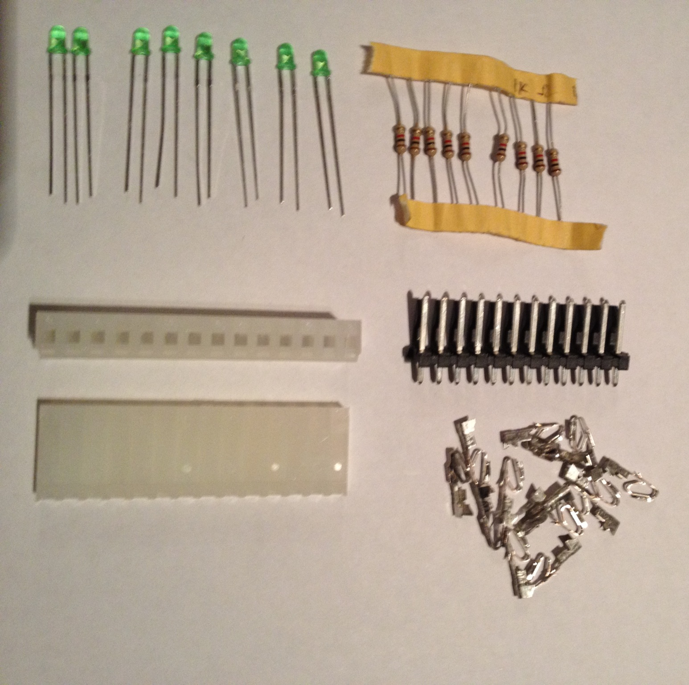

| Item | Quantity |
| --- | --- |
| LEDs 3mm (Cathode is the shorter lead) | 8 Per Saucer |
| 1K ohm 1/4w resistor | 4 Per Saucer |
| 12-way .156" Female Socket / Crimp Style | 2 (Buy 20-way and cut to size) |
| Trifuricon Crimps (preferred) | 24 |
| 12-way .156" Male Header | 2 (Buy long strips with lock and cut to size) |
| Cable: Standard Ethernet 8-core | 1 x 3M per Saucer pair (so two) |
| RJ45 8-way Ethernet Socket (like for CAT5) | 3 (VBuy 4 and have one spare) |
| Pinball Header Wire | 22-24 AWG |
| Hookup Wire | use the leftover 1/2 Ethernet cable twisted pairs |

# Repair Logs
## Light Saber on SW:E1 Will not Light
Below are common causes for the light saber not lighting.

- The 12v fuse (F108) which powers the light saber has failed.

- The neon light transformer (04-10947) had failed on the light saber.  These transformers are getting harder and harder to source, but substitutes can be found.

- The light saber is drive solenoid 41.  Solenoids in the 40s are not driven by power transistors, but driven directly by the ULN2803.  Drive 41 passes through pin 2 to pin 19 of U34 (74HCT574), and then through pins 1 to pin 18 of U35 (ULN2803).  It then is connected to J111, but also connected to J110.  Place the game in solenoid test mode, and have it repeat solenoid 41.  Test this circuit with a logic probe to see if the signal is present or where it drops off.  Start from J111, and work backwards.
