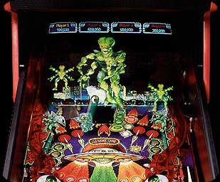

# Williams Pinball 2000 platform overview

> [!NOTE]
> Preserved from <https://www.planetarypinball.com/mm5/Williams/pinball2000/home.html> on `2026-11-11`. This Markdown is a readable derivative; `raw/` contains the captured evidence.

**For the first time in history,** a fully interactive video monitor has been seamlessly integrated with traditional playfield action. Virtual images are projected onto the playfield, allowing the ball to interact with video targets as well as traditional 3-D targets. Images on the video screen can be moved and transformed in respect to the playfield architecture, creating a "universe under glass."

Pinball 2000 is also COMPLETELY MODULAR. What does that mean? It means that while Pinball 2000 is extremely advanced technologically, it is also kit-able and amazingly simple to maintain. Game play is controlled by a ROM-based CPU housed in the backbox. By simply upgrading the software and replacing the lightweight, easily removable playfield, you can have an entirely new Pinball 2000 game in a matter of minutes. Prepare yourself, because this is it....The New Image in Pinball.

---

**Pinball 2000 is the product of extensive research and cutting-edge techonology. As a feat of engineering, Pinball 2000 is so advanced, it's simple:**

- Video images appear under the glass providing virtual targets and helpful gameplay information in the player's direct view.
- Virtual mechanisms provide greater variation in player interaction while at the same time increasing overall reliability of the game.
- The cabinet, backbox, monitor and electronics provide the base for a convertible system. With its unique skid-rail and connector panel configuration it takes only 60 seconds to replace a Pinball 2000 Playfield. [Back to Top](https://www.planetarypinball.com/mm5/Williams/pinball2000/home.html#top) **This provides 3 outstanding benefits:**

  1. Game may be converted to a new model through the purchase of a kit containing a playfield, software and graphics.
  1. Generic Pinball 2000 side graphics may be applied to the game allowing operators to rotate playfields instead of entire machines on a route. This process may include rotating the playfield into the shop for general maintenance.
  1. A route collector is able to swap a playfield requiring service with a working playfield, allowing the defective playfield to be serviced by the trained technician in the shop, at his leisure.

- Logic Box in backbox slides out for easy access, replacement or conversion.
- Power-Driver board is located in the cabinet for easy access and provides the following enhancements:

  1. Unique mounting system requires only 2 screws and has 22 fewer connectors than the previous system.
  1. All fuses are in easy reach of the front of the machine. Each fuse is mounted next to a status LED for easy troubleshooting.
  1. Standard PC parallel port interface allows for easy isolation of problems using any Personal Computer as a portable test fixture.

- Software updates are available via several methods:

  1. Computer serial port transfer of update received either from your distributor or downloaded from our website. (No Eprom programming required!)
  1. Direct update from our web site when connected via phone line to an optional modem.
  1. ROM updates from your distributor.

[Back to Top](https://www.planetarypinball.com/mm5/Williams/pinball2000/home.html#top)

- Special "Location Key" provides the location with access to the playfield while keeping the cashbox and electronics secure.
- New Stereo Sound System places speakers closer to the player for maximum enjoyment at any volume level.
- Powerful built-in troubleshooting with full screen menus and displays include the detection and reporting of blown fuses and burnt out lamps.
