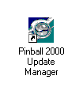
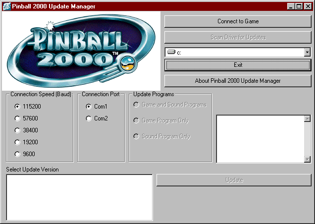
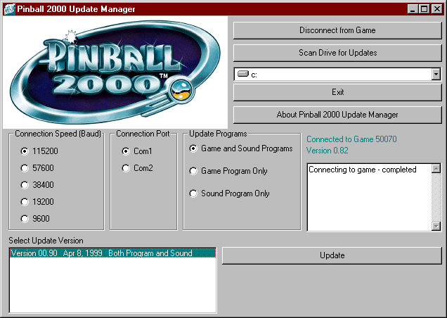
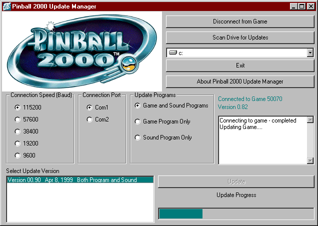

# Williams Pinball 2000 update instructions

> [!NOTE]
> Preserved from <https://www.planetarypinball.com/mm5/Williams/tech/pin2000/notes/update.html> on `2026-11-11`. This Markdown is a readable derivative; `raw/` contains the captured evidence.

# Pinball 2000 Technical Support

## Updating Pinball 2000

A new system has been designed to update the game and sound software in your Pinball 2000 System. Software updates are now stored on the PRISM card in your CPU box, no erasing and progamming of EPROM chips is necessary.

 The following is required to update your Pinball 2000 machine:

- A PC running Windows 95 or Windows 98 with approximately 10 megabytes of disk space.
- A serial "null-modem" cable to connect the PC to the pinball machine: If your PC has a 9-Pin Serial port (DB-9 connector) you must use a Null Modem (sometimes called "direct-connect") cable with 2 Female DB-9 connectors. If your PC has a 25-Pin Serial port (DB-25 connector) you must use a Null Modem (sometimes called "direct-connect") cable with 1 Female DB-9 and 1 Female DB-25 connector. A "Null Modem" connector defines a connector that crosses the wires between pins 2 and 3 (i.e. Pin 2 of the first connector is connected to Pin 3 of the other connector).

**Step 1: Download the Update Manager from the website.**
The Update Manager handles the transfer of the game program from your PC to the Pinball 2000 system. You only need one copy of the Update Manager for all Pinball 2000 machines. If you do not have the Pinball 2000 Update Manager, click on the link below to download this to your PC.

**If you are attempting to install the update manager on PC different than the one you will be using to download**, please read [Transferring Update Manager to Another Computer using a Floppy Drive](https://www.planetarypinball.com/mm5/Williams/tech/pin2000/notes/transfer.html) for help.

*If you have downloaded the Revenge From Mars 0.70 update, this is not the same program. You need to download the Update Manager as well.*

### ****[Pinball 2000 Update Manager](https://www.planetarypinball.com/mm5/Williams/tech/rom2k40ee.html?rom=Pin2000_UpMgr_130.exe&gm=Pinball_2000_Update_Manager)****

Download the Pinball 2000 Update Manager (V1.30)

 (Pin2000_UpMgr_130.exe)

**Step 2: Download the software update file from the website.**

Click on the link below and completely fill out the License Agreement form. When the form has been completed you will be presented with another link to click on. This link will start the download to your local PC. Save the file into a temporary area on your PC. **Do not change the filename when saving this to your PC!**

### **[**Revenge From Mars 1.20**](https://www.planetarypinball.com/mm5/Williams/tech/rom2ke3fb.html?rom=pin2000_50070_0120_06091999_B_10000000.exe&gm=Revenge_From_Mars_Update_120)**

Download the Revenge From Mars 1.20 software update file.

 (pin2000_50070_0120_06091999_B_10000000.exe)

**Step 3: Install the Update Manager, if you haven't already**

From the Windows Explorer, locate the Pin2000_UpMgr_130.exe file on your PC and double-click to start the Setup program. Follow the instructions and prompts to install the program on your PC.

**Step 4: Connect the PC to your Pinball 2000 System**

With your Pinball 2000 system turned off, connect the serial port "null-modem" cable from your PC to the serial port inside the coin door. If your cable has thumbscrews, tighten them to make sure the cable does not become disconnected during the update process. Once the two machines are connected, power up the Pinball 2000 system.

**Step 5: Run the Pinball 2000 Update Manager**

Once you have installed the Pinball 2000 Update Manager, double-click the Pinball 2000 Update Manager icon on your desktop

Under the 'Connection Port' box on the Update Manager window, select the serial port on the PC that you will be using (COM1 or COM2. On most PCs, the external serial port is COM1).

 Once you have selected the proper serial port, confirm that your Pinball 2000 system is powered up. Click on the 'Connect to Game' button on the upper right of the Update Manager window. The program will connect to the pinball machine and report back the model number and software revision found. (Example: 50070 = Revenge From Mars, 0.82 = Software Revision 0.82).

In the middle box on the upper right, select the drive letter that is holding the software update file that you downloaded from the website. Click on 'Scan Drive for Updates' to locate all the software updates related to this model number.

 Click and highlight the update version to upload to your Pinball 2000 system, then click the Update button to begin the upload process.

**Step 6: Do not disturb!**

The update process may take up to 10 minutes to complete. A bar graph will be shown on the pinball screen and in the Update Manager window to show approximate progress, but do NOT disconnect once the bar has reached the end. The system needs to reset itself before the update is considered complete. Once the machine is rebooted and running in attract mode, the Update Manager will reconnect to verify that the update is successful.

**Step 7: Disconnect Cables**

Congratulations, you're done!
